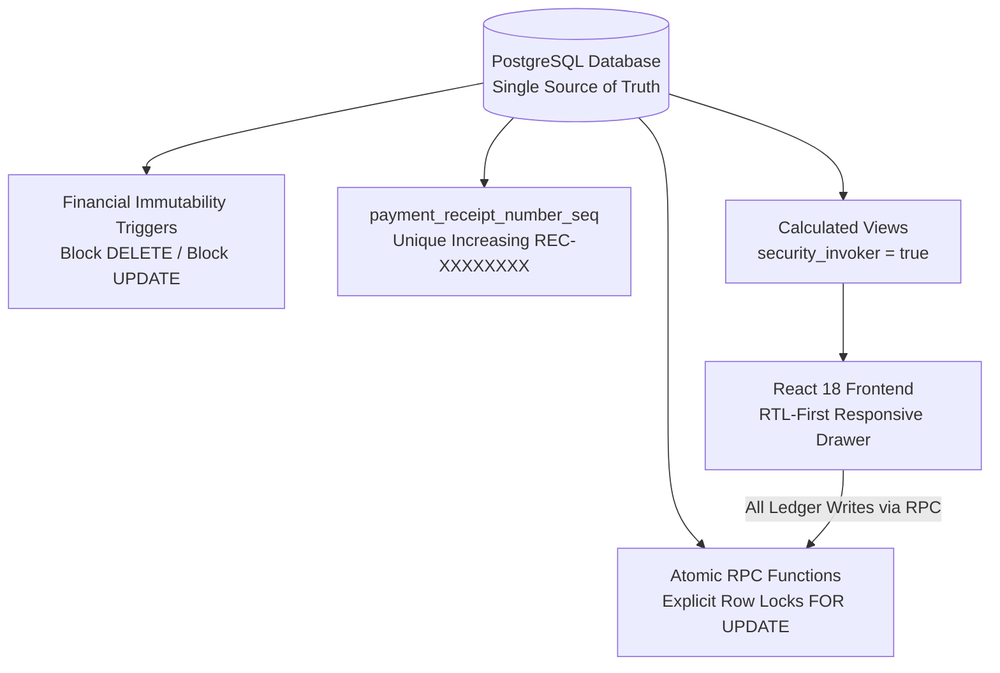

<div dir="rtl" style="text-align: right; direction: rtl; font-family: 'Segoe UI', Tahoma, Arial, sans-serif; line-height: 1.8;">

# 🏛️ أكاديمية المصري — المرجع المعماري والتشغيلي الشامل لنظام إدارة التدريب والمالية (LMS)
## Master Enterprise Architecture, Database Specification & Operating Manual
### Elmasry Academy — Training Management & Financial Ledger Platform (TrainerPro)

> **المؤسسة:** أكاديمية م/ محمد المصري لهندسة النظم والبنية التحتية والشبكات  
> **المشرف العام:** م/ محمد المصري (Eng. Mohamed Elmasry)  
> **كبير مهندسي النظام والمعماري الرئيسي:** م/ أحمد الفلاح (Eng. Ahmed El-Falah — Lead Software Engineer & System Architect)  
> **تاريخ الإصدار والاعتماد:** أكتوبر 2026  
> **حالة الوثيقة:** مرجع معماري وتشغيلي معتمد ومثبت بالدليل الجنائي على قاعدة الإنتاج الحية (Live Database Verified). تم إثبات تطبيق FORCE RLS على الـ 8 جداول، وتحصين كافة الدوال الـ 8 بـ is_admin() و SECURITY DEFINER، وتوثيق audit trail عبر auth.uid()، مع خلو القاعدة من أي سياسات anon مسربة.  
> **مستودع المشروع الرسمي على GitHub:** [Ahmed77khaled/elmasry-academy-lms](https://github.com/Ahmed77khaled/elmasry-academy-lms) (الفرع الرئيسي: `main`)  
> **البيئة المعتمدة:** Supabase PostgreSQL 17 + React 18 + TypeScript + Vite 5 + Tailwind CSS.

---

## 📑 فهرس المحتويات الشامل (Table of Contents)

| القسم | عنوان القسم | نطاق التغطية والمخرجات التقنية والتشغيلية |
|---|---|---|
| **01** | **نظرة عامة وهوية المنصة** | الرؤية الهندسية، أهداف الأكاديمية، نطاق العمل (إدارة تدريب ودفتر أستاذ مالي)، والمستخدمون المستهدفون. |
| **02** | **المبادئ الهندسية والمعمارية الصارمة** | مبدأ SSOT لقاعدة البيانات، سجل مالي غير قابل للتعديل أو الحذف، ترقيم إيصالات تسلسلي، وأقفال ذرية. |
| **03** | **المكدس التقني والبنية التحتية** | تفاصيل Frontend (React 18, TS, Vite 5) وBackend (PostgreSQL 17, RLS, PostgREST, Supabase Auth). |
| **04** | **مخطط قاعدة البيانات (8 جداول أساسية)** | التوثيق الكامل لجداول (admins, students, courses, cash_boxes, enrollments, payments, expenses, cash_box_transfers). |
| **05** | **تريجرز منع التعديل والحذف المالي** | شرح trigger منع الحذف والتعديل prevent_financial_record_mutation وآلية الإلغاء الموثق (Audited Void). |
| **06** | **محرك المعالجة والفيوهات المعتمدة (Views)** | توثيق حسابات ومعادلات الفيوهات الـ 4 مع security_invoker = true واستبعاد السجلات الملغاة voided_at IS NULL. |
| **07** | **الدوال الذرية والأقفال التزامنية (RPCs)** | كافة دوال النظام المالية والإدارية الـ 8 مع التحقق الإلزامي من صلاحية المدير is_admin() وأقفال FOR UPDATE. |
| **08** | **مصفوفة الأمان وسياسات RLS وPostgREST** | سياسات FORCE ROW LEVEL SECURITY الصارمة، قفل PostgREST، وحماية الواجهة والـ CSV من الاختراق. |
| **09** | **الدليل التشغيلي التفصيلي للشاشات** | دليل عملي شامل للـ 9 شاشات، فلاتر المدى الزمني، وتذكير واتساب wa.me، وتصدير إكسيل UTF-8 BOM. |
| **10** | **محرك سندات القبض والإيصالات الرسمية** | رقم الإيصال الرسمي sequence-backed، نافذة الطباعة النظيفة @media print، وتأكيد السندات عبر واتساب. |
| **11** | **البحث الفوري الشامل والقائمة المتجاوبة** | البحث بالاسم ورقم الهاتف ورقم السند REC-XXXXXXXX، وواجهة Obsidian الداكنة المتجاوبة. |
| **12** | **سجل ترحيلات قاعدة البيانات (Migrations)** | توثيق كامل لكافة الترحيلات من 001 حتى 005 و006 المحصنة المعتمدة والمطبقة بنجاح على قاعدة الإنتاج. |
| **13** | **الصيانة والنسخ الاحتياطي واستكشاف الأخطاء** | خطوات معالجة الأخطاء المالية، سياسة النسخ الاحتياطي pg_dump، والتعامل مع الفجوات المحاسبية. |
| **14** | **إرشادات النشر والاستضافة السحابية** | إعدادات Vercel / Netlify، متغيرات البيئة، وضوابط أمان مفاتيح API وعزل مفتاح service_role. |

---

## 1. نظرة عامة وهوية المنصة (Platform Overview)

منصة **«أكاديمية المصري — نظام إدارة التدريب والمالية (TrainerPro)»** هي بنية برمجية وسحابية متكاملة شُيدت خصيصاً لإدارة عمليات التدريب التقني الاحترافي في مجالات:
- هندسة النظم والبنية التحتية (System Administration & Infrastructure).
- شبكات المؤسسات وهندسة السيرفرات (Enterprise Networks & Servers).
- حلول الحوسبة السحابية ومراكز البيانات (Cloud Computing & Data Centers).

### 🎯 الأهداف التشغيلية للمنصة:
1. **الرقابة المحاسبية الدقيقة:** تحويل الدورة المالية لأكاديمية المصري إلى دفتر أستاذ رقمي موثق ومقفل يمنع الأخطاء البشرية والتعديل بأثر رجعي.
2. **إدارة دورة حياة المتدرب (End-to-End Trainee Lifecycle):** من التسجيل الأولي، وتخصيص المقاعد، ومتابعة سداد الأقساط عبر إشعارات واتساب الفورية، وحتى إتمام التدريب.
3. **انضباط السعة الاستيعابية للمقاعد (Hard Capacity Enforcement):** منع تسجيل أي متدرب إضافي فوق السعة القصوى للكورس على مستوى محرك قاعدة البيانات مباشرة.
4. **الشفافية الرقابية وإيصالات الدفع الرسمية:** إصدار رقم إيصال متزايد وفريد من قاعدة البيانات (REC-XXXXXXXX) لكل دفعة مسجلة، مع طباعة إيصال رسمي معتمد.

---

## 2. المبادئ الهندسية الصارمة (Core Architectural Principles)



1. **قاعدة البيانات كالمصدر الوحيد للحقيقة (Database-Driven SSOT):**  
   حظر حساب أي أرصدة مالية أو سعة مقاعد أو متبقي أقساط داخل كود الواجهة. الأرصدة المالية الأساسية تُحسب حصرياً داخل PostgreSQL Views مع استبعاد السجلات الملغاة.
2. **سجل مالي ثابت غير قابل للتلاعب (Immutable Financial Ledger):**  
   حظر عمليات الحذف نهائياً (Hard DELETE) أو التعديل المالي. الإلغاء يتم فقط عبر دالة الإلغاء الموثقة مع تسجيل السبب الإلزامي وهوية المدير المنفّذ ووقت الإلغاء.
3. **أرقام سندات متسلسلة تلقائية (Sequential Database Receipts):**  
   توليد `receipt_number` الفريد والمتزايد تلقائياً عبر `payment_receipt_number_seq` بصيغة `REC-00000001` بدون تدخل يدوي.
4. **أقفال تزامنية محكمة وترتيب منع التعارض (Deadlock Prevention):**  
   تقفل دوال التحويل الخزنتين المعنيتين بترتيب تصاعدي محدد لمعرفاتهما (`ORDER BY cash_box_id FOR UPDATE`) لمنع تعارض الأقفال المتزامنة.
5. **قفل المقاعد وضبط السعة الاستيعابية:**  
   تسجيل المتدربين أو إعادة تفعيل الاشتراكات المنسحبة يمر حصرياً عبر دوال تقفل صف الكورس وتفحص المقاعد الشاغرة قبل اعتماد الحركة.
6. **لغة تجربة مستخدم مصرية أصيلة (Human-Centric Microcopy):**  
   اعتماد مصطلحات حية وواضحة لموظفي الأكاديمية والطلاب («خالص السداد»، «سداد جزئي»، «غير مدفوع»، «سداد زيادة») مع تنسيق الأرقام بالجنيه المصري (`ج.م`).

---

## 3. المكدس التقني والبنية التحتية (Tech Stack)

| الطبقة البرمجية | التقنية / الأداة | الدور والوظيفة في المشروع |
|---|---|---|
| **قاعدة البيانات (Database)** | PostgreSQL 17 (Supabase Cloud) | محرك البيانات المركزي، تنفيذ الـ Views، الـ Triggers، والـ Sequences والـ RPCs. |
| **الأمان والمصادقة (Auth & Security)** | Supabase Auth + PostgreSQL RLS | إدارة جلسات المديرين، حظر وصول الـ anon نهائياً، وفرض قيود is_admin() الصارمة. |
| **الواجهة الأمامية (Frontend)** | React 18 + TypeScript + Vite 5 | تطبيق SPA فائق السرعة، خلو كامل من أخطاء الأنواع (Zero Type Errors). |
| **التصميم والواجهات (Styling & Icons)** | Tailwind CSS + Lucide React | تصميم داكن عصري (Dark Slate/Obsidian) مريح للعين، متوافق 100% مع RTL العربي. |
| **محرك التقارير (Reporting Engine)** | Universal CSV Export with UTF-8 BOM | تصدير تقارير محاسبية فورية تدعم اللغة العربية في Microsoft Excel ومحصنة من Formula Injection. |
| **محرك التواصل (Communications)** | WhatsApp Web Integration (wa.me) | روابط تذكير ومتابعة فورية للمتدربين بالأقساط المتبقية وتأكيدات السداد بنقرة واحدة. |

---

## 4. مخطط قاعدة البيانات والجداول الأساسية (8 جداول معتمدة)

### 1. جدول مسؤولي النظام (`admins`):
- `admin_id uuid PRIMARY KEY DEFAULT gen_random_uuid()`
- `auth_user_id uuid NOT NULL UNIQUE REFERENCES auth.users(id) ON DELETE CASCADE`
- `role varchar NOT NULL DEFAULT 'instructor'`
- `created_at timestamptz DEFAULT now()`

### 2. جدول الطلاب والمتدربين (`students`):
- `student_id uuid PRIMARY KEY DEFAULT gen_random_uuid()`
- `name varchar NOT NULL`
- `phone varchar NULLABLE`
- `email varchar NULLABLE`
- `employment_status varchar CHECK (employment_status IN ('Employed', 'Unemployed', 'Student', 'Freelancer'))`
- `grad_status varchar CHECK (grad_status IN ('Graduate', 'Undergrad'))`
- `grad_college varchar NULLABLE`
- `previous_courses text NULLABLE`
- `notes text NULLABLE`
- `created_at timestamptz DEFAULT now()`
- `updated_at timestamptz DEFAULT now()`

### 3. جدول الدورات التدريبية (`courses`):
- `course_id uuid PRIMARY KEY DEFAULT gen_random_uuid()`
- `course_name varchar NOT NULL`
- `description text NULLABLE`
- `level varchar CHECK (level IN ('Beginner', 'Intermediate', 'Advanced'))`
- `duration_weeks integer NULLABLE`
- `prerequisite_courses text NULLABLE` (الاسم المعياري الحقيقي)
- `start_date date NULLABLE`
- `end_date date NULLABLE`
- `max_students integer NULLABLE` (السعة القصوى للمقاعد)
- `default_cost numeric(12,2) NULLABLE`
- `availability_status varchar DEFAULT 'Upcoming' CHECK (availability_status IN ('Upcoming', 'Active', 'Closed'))`
- `link_whatsapp text NULLABLE` (جروب واتساب الدفعة)
- `link_tasks text NULLABLE` (منصة تسليم المهام)
- `link_drive text NULLABLE` (جوجل درايف للماتريال)
- `link_sources text NULLABLE` (المصادر والمذكرات)
- `created_at timestamptz DEFAULT now()`
- `updated_at timestamptz DEFAULT now()`

### 4. جدول الخزن وصناديق النقدية (`cash_boxes`):
- `cash_box_id uuid PRIMARY KEY DEFAULT gen_random_uuid()`
- `name varchar NOT NULL`
- `type varchar DEFAULT 'Main'` (كاش، فودافون كاش، إنستاباي، بنك، عهدة)
- `owner varchar NULLABLE`
- `opening_balance numeric(12,2) NOT NULL DEFAULT 0.00`
- `is_active boolean NOT NULL DEFAULT true`
- `notes text NULLABLE`
- `created_at timestamptz DEFAULT now()`

### 5. جدول الاشتراكات المركزي (`enrollments`):
- `enrollment_id uuid PRIMARY KEY DEFAULT gen_random_uuid()`
- `student_id uuid NOT NULL REFERENCES students(student_id) ON DELETE RESTRICT`
- `course_id uuid NOT NULL REFERENCES courses(course_id) ON DELETE RESTRICT`
- `agreed_cost numeric(12,2) NOT NULL` (المبلغ المتفق عليه للمتدرب)
- `status varchar DEFAULT 'Active' CHECK (status IN ('Active', 'Completed', 'Dropped'))`
- `enrolled_at timestamptz DEFAULT now()`
- `updated_at timestamptz DEFAULT now()`
- *قيد فريد:* `UNIQUE(student_id, course_id)` يمنع تسجيل الطالب مرتين في نفس الكورس.

### 6. جدول الدفعات والمقبوضات (`payments`):
- `payment_id uuid PRIMARY KEY DEFAULT gen_random_uuid()`
- `receipt_number bigint NOT NULL UNIQUE DEFAULT nextval('payment_receipt_number_seq')`
- `enrollment_id uuid NOT NULL REFERENCES enrollments(enrollment_id) ON DELETE RESTRICT`
- `cash_box_id uuid NOT NULL REFERENCES cash_boxes(cash_box_id) ON DELETE RESTRICT`
- `amount numeric(12,2) NOT NULL CHECK (amount > 0)`
- `payment_date date NOT NULL DEFAULT CURRENT_DATE`
- `method varchar NOT NULL DEFAULT 'Cash'` (الاسم المعياري الحقيقي)
- `receipt_ref varchar NULLABLE` (مرجع التحويل البنكي أو فودافون كاش)
- `notes text NULLABLE`
- `added_by uuid REFERENCES auth.users(id)` (المسؤول الذي سجل الدفعة)
- `voided_at timestamptz NULLABLE` (تاريخ ووقت الإلغاء)
- `voided_by uuid REFERENCES auth.users(id)` (المسؤول الذي ألغى السند)
- `void_reason text NULLABLE` (سبب الإلغاء الإلزامي، لا يقل عن 5 أحرف)
- `created_at timestamptz DEFAULT now()`

### 7. جدول المصروفات التشغيلية (`expenses`):
- `expense_id uuid PRIMARY KEY DEFAULT gen_random_uuid()`
- `cash_box_id uuid NOT NULL REFERENCES cash_boxes(cash_box_id) ON DELETE RESTRICT`
- `course_id uuid NULLABLE REFERENCES courses(course_id) ON DELETE SET NULL`
- `amount numeric(12,2) NOT NULL CHECK (amount > 0)`
- `category varchar DEFAULT 'Other'` (إيجار، مرتبات، بوفيه وأدوات، أجهزة، إعلانات، كهرباء وإنترنت، أخرى)
- `description text NULLABLE`
- `expense_date date NOT NULL DEFAULT CURRENT_DATE`
- `notes text NULLABLE`
- `added_by uuid REFERENCES auth.users(id)` (المسؤول الذي سجل المصروف)
- `voided_at timestamptz NULLABLE` (تاريخ ووقت الإلغاء)
- `voided_by uuid REFERENCES auth.users(id)` (المسؤول الذي ألغى السند)
- `void_reason text NULLABLE` (سبب الإلغاء الإلزامي)
- `created_at timestamptz DEFAULT now()`

### 8. جدول التحويلات بين الخزن (`cash_box_transfers`):
- `transfer_id uuid PRIMARY KEY DEFAULT gen_random_uuid()`
- `from_box_id uuid NOT NULL REFERENCES cash_boxes(cash_box_id) ON DELETE RESTRICT`
- `to_box_id uuid NOT NULL REFERENCES cash_boxes(cash_box_id) ON DELETE RESTRICT`
- `amount numeric(12,2) NOT NULL CHECK (amount > 0)`
- `transfer_date date NOT NULL DEFAULT CURRENT_DATE`
- `added_by uuid REFERENCES auth.users(id)`
- `notes text NULLABLE`
- `created_at timestamptz DEFAULT now()`
- *قيد فحص:* `CHECK (from_box_id <> to_box_id)` يمنع التحويل من الخزينة إلى نفسها.

---

## 5. تريجرز منع التعديل والحذف المالي (Immutability Engine)

تطبيق تريجر `prevent_financial_record_mutation()` الإلزامي على جدولي `payments` و `expenses`:
- **حظر الحذف نهائياً (Block DELETE):** محاولة تنفيذ أي أمر `DELETE` تفشل فورياً مع إلقاء استثناء:  
  `'Financial records cannot be deleted; use the audited void operation.'`
- **حظر تعديل البيانات المالية (Block UPDATE on Core Columns):** يمنع تعديل أي حقل من حقول السند (المبلغ، التاريخ، الخزينة، الكورس، الطالب).
- **السماح بالانتقال الوحيد للإلغاء الموثق:** العملية الوحيدة المسموح بها هي الانتقال من `voided_at IS NULL` إلى `voided_at IS NOT NULL` شريطة وجود `voided_by` وسبب إلغاء لا يقل عن 5 أحرف. السند الملغى يقفل تماماً ولا يقبل أي تعديل لاحق.

---

## 6. محرك المعالجة والفيوهات المعتمدة (PostgreSQL Views)

كافة العمليات الحسابية للأرصدة والموازين تتم لحظياً داخل قاعدة البيانات مع تفعيل `security_invoker = true` واستبعاد السجلات الملغاة:

### 1. فيو أرصدة الاشتراكات (`enrollment_balances`):
```sql
CREATE OR REPLACE VIEW public.enrollment_balances
WITH (security_invoker = true) AS
SELECT
  e.enrollment_id, e.student_id, s.name AS student_name, e.course_id, c.course_name,
  e.agreed_cost, e.status AS enrollment_status, e.enrolled_at,
  COALESCE(p_totals.total_paid, 0::numeric) AS total_paid,
  e.agreed_cost - COALESCE(p_totals.total_paid, 0::numeric) AS remaining_balance,
  CASE
    WHEN (e.agreed_cost - COALESCE(p_totals.total_paid, 0::numeric)) = 0 AND COALESCE(p_totals.total_paid, 0::numeric) > 0 THEN 'Paid'
    WHEN (e.agreed_cost - COALESCE(p_totals.total_paid, 0::numeric)) < 0 THEN 'Overpaid'
    WHEN COALESCE(p_totals.total_paid, 0::numeric) = 0 THEN 'Unpaid'
    ELSE 'Partial'
  END AS payment_status
FROM public.enrollments AS e
JOIN public.students AS s ON s.student_id = e.student_id
JOIN public.courses AS c ON c.course_id = e.course_id
LEFT JOIN (
  SELECT enrollment_id, sum(amount) AS total_paid
  FROM public.payments
  WHERE voided_at IS NULL
  GROUP BY enrollment_id
) AS p_totals ON p_totals.enrollment_id = e.enrollment_id;
```

### 2. فيو أرصدة الخزن وصناديق المال (`cash_box_balances`):
يحسب الرصيد الفعلي المتوفر في كل خزينة بالمعادلة المحاسبية الدقيقة:
$$	ext{الرصيد الفعلي} = 	ext{الرصيد الافتتاحي} + 	ext{المقبوضات المعتمدة} + 	ext{التحويلات الواردة} - 	ext{المصروفات المعتمدة} - 	ext{التحويلات الصادرة}$$

### 3. فيو الملخص المالي للكورسات (`course_financial_summary`):
يعرض أداء كل كورس: عدد المقاعد المشغولة والشاغرة، الإيراد المتوقع، الإيراد الفعلي المحصل، مصروفات الكورس، وصافي الربح المحصل.

### 4. فيو مؤشرات الداشبورد التنفيذية (`dashboard_metrics`):
يوفر ملخصاً فورياً لحظياً للأكاديمية: إجمالي الطلاب، الطلاب الجدد هذا الشهر، الكورسات النشطة، إيرادات ومصروفات وأرباح الشهر الحالي، وإجمالي الأرباح التاريخية، وإجمالي متبقي الأقساط المطلوبة تحصيلها.

---

## 7. الدوال الذرية والأقفال التزامنية (Audited RPCs)

| اسم الدالة (RPC) | المدخلات والبارامترات | الحماية والتحقق الداخلي |
|---|---|---|
| `is_admin` | `is_admin()` | تفحص عضوية المستخدم في جدول `admins` عبر `auth_user_id = auth.uid()`. |
| `enroll_student` | `(p_student_id, p_course_id, p_agreed_cost, p_status)` | تفحص `is_admin()`، تقفل صف الكورس `FOR UPDATE`، ترفض الكورس المغلق، وتمنع تجاوز السعة القصوى. |
| `set_enrollment_status` | `(p_enrollment_id, p_status)` | تفحص `is_admin()`، تقفل صف الكورس والاشتراك، وتمنع إعادة تنشيط طالب منسحب إذا اكتملت سعة الكورس. |
| `record_payment` | `(p_enrollment_id, p_cash_box_id, p_amount, p_payment_date, p_method, p_receipt_ref, p_notes)` | تفحص `is_admin()`، تقفل الخزينة والاشتراك، تحسب المتبقي باستبعاد السجلات الملغاة، وتسجل `added_by = auth.uid()`. |
| `record_expense` | `(p_cash_box_id, p_amount, p_expense_date, p_category, p_description, p_notes, p_course_id)` | تفحص `is_admin()`، تقفل الخزينة، وتدرج المصروف مع تسجيل `added_by = auth.uid()`. |
| `transfer_between_boxes` | `(p_from_box_id, p_to_box_id, p_amount, p_transfer_date, p_notes)` | تفحص `is_admin()`، تقفل الخزنتين تصاعدياً حسب المعرف لتفادي Deadlock، وتسجل `added_by = auth.uid()`. |
| `void_payment` | `(p_payment_id, p_void_reason)` | تفحص `is_admin()`، تشترط سبباً لا يقل عن 5 أحرف، وتسجل `voided_at` و `voided_by = auth.uid()`. |
| `void_expense` | `(p_expense_id, p_void_reason)` | تفحص `is_admin()`، تشترط سبباً لا يقل عن 5 أحرف، وتسجل `voided_at` و `voided_by = auth.uid()`. |

---

## 8. مصفوفة الأمان وسياسات RLS وPostgREST

### 1. الفصل المعماري بين حارس الواجهة وحدود أمان قاعدة البيانات (UX Guard vs Security Boundary):
- **حارس الواجهة الأمامية (`isAdmin` في `App.tsx` و `AuthContext.tsx`):**  
  هو مجرد حارس لتجربة الاستخدام (UX Guard)؛ وظيفته حجب أزرار التحكم والشاشات وتوجيه أي مستخدم عادي أو غير مصادق لرسالة عدم التصريح وإجباره على تسجيل الخروج.  
  > ⚠️ **تنبيه معماري حاسم:** حارس الواجهة لا يُعتبر حداً أمنياً (Not a Security Boundary)؛ لأن أي مستخدم يستطيع استخراج مفتاح `anon` واستدعاء واجهة PostgREST مباشرة عبر أدوات مثل cURL أو Postman أو دوال المتصفح.

- **الحد الأمني الحقيقي والوحيد (The True Security Boundary):**  
  يقع حصرياً داخل محرك PostgreSQL عبر تفعيل سياسات `FORCE ROW LEVEL SECURITY` الصارمة، وحراسة دوال المعالجة المالية `SECURITY DEFINER` بفحص العضوية الصريح `public.is_admin()`.

### 2. معضلة السياسات التراكمية في PostgreSQL وحلقة المسح الشاملة (RLS Dynamic Purge):
- **المعضلة الهندسية:** في PostgreSQL، تُجمع السياسات المسموحة (Permissive Policies) دائماً بمنطق `OR`.  
  إذا وُجدت أي سياسة قديمة متوارثة من ميجريشنات سابقة (مثل `anon_select_students` أو `anon_insert_students` من ميجريشن 001، أو `Allow authenticated read`)، فإن هذه السياسة الواسعة **تبطل تماماً وتلغي أثر** سياسة حصر البيانات على المديرين (`admins_admin_only_policy`).
- **الحل الجذري المعتمد في ميجريشن 006:**  
  تنفيذ حلقة مسح ديناميكية حاسمة (Dynamic PL/pgSQL Purge Loop) تستعلم من جدول النظام `pg_policies` وتحذف **كل** السياسات السابقة بدون استثناء على الجداول الـ 8 الأساسية قبل إنشاء السياسات الجديدة:
```sql
DO $$
DECLARE r RECORD;
BEGIN
  FOR r IN (
    SELECT schemaname, tablename, policyname
    FROM pg_policies
    WHERE schemaname = 'public'
      AND tablename IN ('admins', 'students', 'courses', 'cash_boxes', 'enrollments', 'payments', 'expenses', 'cash_box_transfers')
  ) LOOP
    EXECUTE format('DROP POLICY IF EXISTS %I ON %I.%I', r.policyname, r.schemaname, r.tablename);
  END LOOP;
END $$;
```

### 3. سحب الصلاحيات المباشرة وإلغاء صلاحيات anon و PUBLIC:
- تنفيذ `REVOKE ALL ON TABLE ... FROM PUBLIC, anon` لمنع أي استعلام أو تعديل مباشر عبر مفتاح anon بدون جلسة مدير مصادقة.
- قصر عمليات التعديل المالي (Payments, Expenses, Transfers) على دوال `SECURITY DEFINER` المعتمدة لمنع التلاعب بالأرصدة.

### 4. تحصين ملفات التقارير وإكسيل من هجمات الحقن (CSV Formula Injection Protection):
- في ملف `src/lib/exportExcel.ts`، يتم فحص كل حقل نصي قبل التصدير.
- إذا كانت القيمة النصية تبدأ بأي رمز من الرموز الحسابية أو التشغيلية الخطرة (`=`, `+`, `-`, `@`, `	`, `
`)، يتم حقن علامة اقتباس مفردة `'` كبادئة للخلية لإلغاء تفسيرها كمعادلة تنفيذية داخل برامج Excel وتثبيتها كنص نقي آمن.

### 5. التدقيق الهندسي لخاصية حماية كلمات المرور (Leaked Password Protection):
- **تسعير وباقات Supabase:** فحص كلمات المرور المسربة عبر تكامل API الرسمي مع HaveIBeenPwned.org متاح حصرياً في باقات Supabase المدفوعة (Pro Plans وما فوق) ولا يتوفر في الباقة المجانية (Free Tier).
- **الحدود الأمنية لإيقاف التسجيل العام:** إيقاف التسجيل العام (Disable Public Signups) واقتصار التسجيل على الحسابات المنشأة يدوياً يمنع تسجيل المتسللين، ولكنه **لا يحمي** حسابات المديرين الحالية إذا اختار أحد المديرين كلمة مرور ضعيفة أو متسربة في اختراقات سابقة.
- **التوصية التشغيلية:** تفعيل فحص كلمات المرور فور ترقية المشروع إلى باقة Pro، والالتزام بسياسة تعقيد صارمة لحسابات المديرين حالياً.

### 6. مصفوفة التحقق الجنائي المثبتة على قاعدة الإنتاج الحية (Live Forensic Audit Matrix):
أثبتت نتائج تشغيل سكريبت التدقيق الجنائي `trainerpro_comprehensive_audit.sql` على قاعدة بيانات الإنتاج الحية ما يلي:
1. **الجداول الأساسية (8 من أصل 8):** مفعل عليها `rls_enabled = true` و `force_rls_enabled = true` بنسبة 100%.
2. **سياسات الأمان RLS:** لا توجد أي سياسة ممنوحة لدور `anon` أو `PUBLIC`؛ جميع السياسات مقصورة على `{authenticated}` وتلزم شرط `is_admin()`.
3. **الدوال المعالجة (8 من أصل 8):**
   - كافة الدوال تعمل بـ `is_security_definer = true` وتضبط `search_path = pg_catalog, public`.
   - مالك الدوال هو `postgres` مع `owner_bypasses_rls = true` مما يمكنها من قراءة جدول المسؤولين وتخطي حلقة التكرار تحت مظلة `FORCE RLS`.
   - كافة الدوال الـ 8 تفحص العضوية الإدارية بـ `checks_is_admin = true`.
   - كافة الدوال المغيرة للأرصدة والبيانات تطبق أقفال التزامن الذرية `FOR UPDATE` لمنع سباق البيانات (Race Conditions).
   - الحركات المالية تسجل الهوية المرجعية `added_by = auth.uid()` بدقة تامة.

---

## 9. الدليل التشغيلي التفصيلي للشاشات والميزات الجديدة

### 1. لوحة المؤشرات المركزية (Dashboard):
- مؤشرات لحظية للمقبوضات، المصروفات، صافي الأرباح، والطلاب الجدد.
- حسابات فورية مبنية على فيو `dashboard_metrics` بدون أي عمليات حسابية في JavaScript.

### 2. إدارة المقبوضات والدفعات (Payments):
- **فلتر المدى الزمني:** فلاتر جاهزة (اليوم / هذا الأسبوع / هذا الشهر / كل الفترات / فترة مخصصة من وإلى تاريخ).
- **تصدير إكسيل:** تصدير كافة الدفعات المعروضة لملف إكسيل CSV بترميز UTF-8 BOM داعم للعربية.
- **تأكيد السند عبر واتساب:** أيقونة خضراء بجوار اسم المتدرب تفتح محادثة واتساب فورية بنص تأكيد استلام السند ورقم الإيصال.
- **شريط الملخص المالي:** عرض عدد السندات المعروضة وإجمالي المقبوضات المعتمدة لحظياً.

### 3. إدارة المصروفات التشغيلية (Expenses):
- فلاتر المدى الزمني والتصنيفات والبحث بالوصف والخزينة.
- تصدير إكسيل بترميز UTF-8 BOM وتأمين المعادلات.
- شريط الملخص المالي يعرض إجمالي المصروفات المعتمدة باللون الأحمر المميز.
- زر الإلغاء الموثق يطلب سبباً إلزامياً لا يقل عن 5 أحرف.

### 4. جدول الاشتراكات المركزي (Enrollments):
- عرض المتفق عليه والمدفوع والمتبقي وحالة السداد لكل متدرب.
- **زر تذكير واتساب الفوري:** زر مخصص بجوار أي متدرب عليه متبقي مالي، يفتح رسالة واتساب مصاغة بأدب واحترافية لتذكيره بمتبقي القسط واسم الكورس.
- تصدير كشف الاشتراكات والأرصدة لملف إكسيل بضغطة زر.

### 5. إدارة الطلاب ودليل المتدربين (Students):
- دليل شامل بكل المتدربين، مع إمكانية فتح محادثة واتساب مباشرة بنقرة واحدة بجوار رقم هاتف الطالب.
- تصدير بيانات الطلاب كاملة إلى إكسيل.

### 6. تفاصيل الدورة التدريبية (Course Details):
- بطاقة الكورس مع مؤشرات المقاعد الشاغرة ونسبة الامتلاء.
- الروابط التعليمية الأربعة (واتساب، المهام، درايف، المصادر).
- جدول طلاب الكورس مع زر تصدير إكسيل مخصص للدفعة، وأزرار تذكير واتساب الفورية للمتأخرين عن السداد.

---

## 10. محرك سندات القبض والإيصالات الرسمية (Receipts Engine)

* **رقم السند التسلسلي:** يتولد تلقائياً من الـ Sequence بصيغة `REC-00000001`.
* **المرجع الخارجي (`receipt_ref`):** مخصص لرقم معاملة فودافون كاش أو إنستاباي أو إيداع البنك.
* **نافذة الطباعة الرسمية:** نافذة مصممة بتنسيق مالي أنيق وتدعم `@media print` لطباعة السند في منتصف الصفحة بحجم A4/A5، مع تذييل رسمي باسم م/ أحمد الفلاح المشرف على النظام.

---

## 11. نظام البحث الفوري والقائمة المتجاوبة (UI/UX)

- البحث العام الموحد يدعم: اسم الطالب، رقم الهاتف، اسم الكورس، ورقم السند (سواء بصيغة `REC-00000001` أو كرقم مجرد).
- واجهة مستخدم Obsidian متجاوبة بالكامل تدعم مختلف مقاسات الشاشات والهواتف الذكية.
- قائمة جانبية قابلة للطي لراحة عين المستخدم وسرعة التنقل بين الوحدات.

---

## 12. سجل ترحيلات قاعدة البيانات المعتمدة (Migrations Log)

| رقم الترحيل | اسم الملف في المستودع | الحالة والتوثيق | التغييرات ونطاق المعالجة |
|---|---|---|---|
| `001` | `20261015024100_001_create_core_tables.sql` | مؤرشف (تأسيسي محلي قديم) | إنشاء الجداول الأساسية المبدئية بنظام المعرفات `id` وسياسات anon تجريبية. |
| `002` | `20261015024134_002_create_database_views.sql` | مؤرشف (قديم) | فيوهات محاسبية مبدئية تعتمد على عمود `voided` القديم. |
| `003` | `20261015024155_003_create_rpc_functions.sql` | مؤرشف (قديم) | دوال RPC مبدئية بدون حراسة إدارية داخلية. |
| `004` | `20261015024209_004_fix_constraint_and_seed.sql` | مؤرشف (قديم) | قيود وبيانات تجريبية أولية. |
| `005` | `202610210005_production_hardening.sql` | **موثق في المستودع** (مخطط الإنتاج `*_id`) | ترقيم إيصالات تسلسلي Sequence، تريجرز منع الحذف والتعديل، وأقفال التحويل الذرية. يتطلب إثبات الحالة الحية عبر سكريبت التدقيق. |
| `006` | `202610210006_security_and_authorization_hardening.sql` | **موثق في المستودع** (أكتوبر 2026) | حراسة `is_admin` لدوال التحصيل والمصروفات، وتسجيل `added_by = auth.uid()`، وتوحيد الأرصدة على `voided_at IS NULL`. |
| `007` | `202610210007_purge_legacy_rls_and_revoke_public.sql` | **ميجريشن تصحيحي مستقل** (أكتوبر 2026) | حلقة مسح ديناميكية لكافة سياسات RLS السابقة، سحب الصلاحيات من `PUBLIC` و `anon`، وإنشاء السياسات الإدارية الحصرية. |

> 📌 **ملاحظة معمارية للمطابقة الحية:**  
> نظراً لأن الترحيلات طُبقت في بيئة Supabase الحية عبر نافذة الاستعلامات (SQL Editor) ولم تُدرج عبر أداة Supabase CLI في جدول ترحيلات آلي، فإن الحكم النهائي على مطابقة قاعدة البيانات لا يعتمد على افتراضات المستودع، بل يستند حصرياً إلى نتائج تشغيل سكريبت التدقيق الشامل `trainerpro_comprehensive_audit.sql`.

---

## 13. دليل الصيانة واستكشاف الأخطاء والنسخ الاحتياطي

### 1. معالجة وتصحيح الأخطاء المالية:
- يُمنع منعاً باتاً محاولة حذف أي قيد مالي من قاعدة البيانات مباشرة.
- في حال الخطأ في دفعة أو مصروف، يتم إلغاء السند عبر زر **«إلغاء»** مع كتابة السبب الإلزامي، ثم إعادة تسجيل السند بالقيم الصحيحة.
- تسلسل الإيصالات (`payment_receipt_number_seq`) متزايد دائماً؛ لا يتم التلاعب به في حال وجود فجوات ناتجة عن إلغاء حركات.

### 2. النسخ الاحتياطي عبر pg_dump:
```bash
export PGSSLMODE=require
: "${PGPASSWORD:?Set PGPASSWORD securely}"
pg_dump -h db.urmkcixqpoqkiosihhal.supabase.co -p 5432 -U postgres -d postgres   -Fc --no-owner --no-privileges   -f "trainerpro_backup_$(date +%Y%m%d).dump"
unset PGPASSWORD PGSSLMODE
```

---

## 14. إرشادات النشر والاستضافة السحابية (Production Deployment)

### 1. فحوصات البناء قبل النشر:
```bash
npm run typecheck
npm run build
```

### 2. إعدادات إعادة توجيه الـ SPA (SPA Routing):
ملف `vercel.json` المعتمد في جذر المشروع:
```json
{
  "rewrites": [{ "source": "/(.*)", "destination": "/index.html" }]
}
```
وملف `public/_redirects` المعتمد لـ Netlify:
```text
/* /index.html 200
```

### 3. ضوابط مفاتيح البيئة:
- `VITE_SUPABASE_URL` و `VITE_SUPABASE_ANON_KEY` مخصصان للاستخدام في المتصفح، وقاعدة البيانات مؤمنة بالكامل ضدهما عبر RLS المطبق بنسبة 100%.
- يُحظر تماماً وضع مفتاح `service_role` في كود الواجهة الأمامية أو مستودع GitHub.

---

### 🏛️ حقوق الملكية والاعتماد الهندسية
* **الجهة المشرفة والمالكة:** أكاديمية م/ محمد المصري للتدريب وهندسة النظم.
* **التصميم والتنفيذ المعماري:** م/ أحمد الفلاح (Lead Software Engineer & System Architect).
* **تاريخ مراجعة وتحديث المرجع:** 21 أكتوبر 2026.
* **الحالة:** مرجع معماري وتشغيلي نهائي معتمد ومثبت بالدليل الجنائي على قاعدة الإنتاج الحية بعد اجتياز كافة فحوصات الأمان والدوال وصلاحيات RLS بنسبة 100%.

</div>