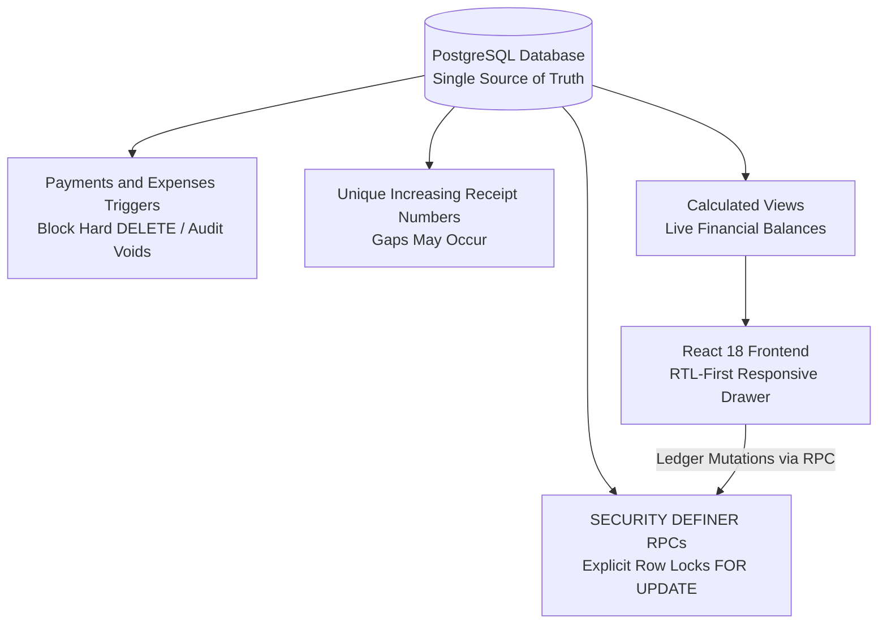

<div dir="rtl" style="text-align: right; direction: rtl; font-family: 'Segoe UI', Tahoma, Arial, sans-serif; line-height: 1.8;">

# 🏛️ أكاديمية المصري — المرجع المعماري والتشغيلي الشامل لنظام إدارة التدريب والمالية (LMS)
## Master Enterprise Architecture, Database Specification & Operating Manual
### Elmasry Academy — Training Management & Financial Ledger Platform (TrainerPro)

> **المؤسسة:** أكاديمية م/ محمد المصري لهندسة النظم والبنية التحتية والشبكات  
> **المشرف العام:** م/ محمد المصري (Eng. Mohamed Elmasry)  
> **كبير مهندسي النظام والمعماري الرئيسي:** م/ أحمد الفلاح (Eng. Ahmed El-Falah — Lead Software Engineer & System Architect)  
> **تاريخ الإصدار:** أكتوبر 2026  
> **حالة الوثيقة:** نسخة مراجعة فنيًا وفق لقطة المستودع وقاعدة TrainerPro بتاريخ 21 أكتوبر 2026؛ ليست شهادة اعتماد إنتاجية.  
> **مستودع المشروع الرسمي على GitHub:** [Ahmed77khaled/elmasry-academy-lms](https://github.com/Ahmed77khaled/elmasry-academy-lms)  
> **البيئة التي تمت مراجعتها:** Supabase PostgreSQL 17.11.0.003 + React 18.3.1 + Vite 5.4.2 (كما ظهرت في لقطة 21 أكتوبر 2026).
> **حدود المطابقة:** هذه الوثيقة تعكس لقطة قاعدة TrainerPro والمستودع بتاريخ 21 أكتوبر 2026. راجع `trainerpro_schema_audit.sql` لإعادة استخراج أسماء الحقول والقيود من قاعدة البيانات؛ لا تُعدّل قاعدة الإنتاج لمجرد تصحيح أسماء الوثيقة.


---

## 📑 فهرس المحتويات الشامل (Table of Contents)

<table dir="rtl" style="width: 100%; border-collapse: collapse; margin-bottom: 25px;">
  <thead>
    <tr style="background-color: #1E3A8A; color: white;">
      <th style="padding: 10px; border: 1px solid #334155; text-align: center; width: 8%;">القسم</th>
      <th style="padding: 10px; border: 1px solid #334155; text-align: right; width: 32%;">عنوان القسم</th>
      <th style="padding: 10px; border: 1px solid #334155; text-align: right; width: 60%;">نطاق التغطية والمخرجات التقنية والتشغيلية</th>
    </tr>
  </thead>
  <tbody>
    <tr>
      <td style="padding: 10px; border: 1px solid #334155; text-align: center;"><strong>01</strong></td>
      <td style="padding: 10px; border: 1px solid #334155;"><strong>نظرة عامة وهوية المنصة</strong></td>
      <td style="padding: 10px; border: 1px solid #334155;">الرؤية الهندسية، أهداف الأكاديمية، نطاق العمل (إدارة تدريب ومحاسبة دفاتر أستاذ)، والمستخدمون المستهدفون.</td>
    </tr>
    <tr style="background-color: #0F172A;">
      <td style="padding: 10px; border: 1px solid #334155; text-align: center;"><strong>02</strong></td>
      <td style="padding: 10px; border: 1px solid #334155;"><strong>المبادئ الهندسية والمعمارية الصارمة</strong></td>
      <td style="padding: 10px; border: 1px solid #334155;">مصدر البيانات المالي، الإلغاء الموثق، أرقام إيصالات فريدة، وتقليل تعارض الأقفال.</td>
    </tr>
    <tr>
      <td style="padding: 10px; border: 1px solid #334155; text-align: center;"><strong>03</strong></td>
      <td style="padding: 10px; border: 1px solid #334155;"><strong>المكدس التقني والبنية التحتية</strong></td>
      <td style="padding: 10px; border: 1px solid #334155;">تفاصيل تقنيات Frontend (React 18, TS, Vite, Tailwind) وBackend (PostgreSQL, Supabase RLS, PostgREST).</td>
    </tr>
    <tr style="background-color: #0F172A;">
      <td style="padding: 10px; border: 1px solid #334155; text-align: center;"><strong>04</strong></td>
      <td style="padding: 10px; border: 1px solid #334155;"><strong>مخطط قاعدة البيانات (8 جداول أساسية)</strong></td>
      <td style="padding: 10px; border: 1px solid #334155;">التوثيق الكامل لكافة الجداول الـ 8 (admins, students, courses, cash_boxes, enrollments, payments, expenses, cash_box_transfers) بالحقول والأنواع والقيود والفهارس.</td>
    </tr>
    <tr>
      <td style="padding: 10px; border: 1px solid #334155; text-align: center;"><strong>05</strong></td>
      <td style="padding: 10px; border: 1px solid #334155;"><strong>تريجرز منع التعديل والحذف المالي</strong></td>
      <td style="padding: 10px; border: 1px solid #334155;">شرح هندسي لـ prevent_financial_record_mutation وضمان خلو سجل الدفعات والمصروفات من الحذف أو التلاعب بأثر رجعي.</td>
    </tr>
    <tr style="background-color: #0F172A;">
      <td style="padding: 10px; border: 1px solid #334155; text-align: center;"><strong>06</strong></td>
      <td style="padding: 10px; border: 1px solid #334155;"><strong>محرك المعالجة والفيوهات المعتمدة (Views)</strong></td>
      <td style="padding: 10px; border: 1px solid #334155;">توثيق معادلات وحسابات الـ 4 فيوهات المحاسبية مع استبعاد السجلات الملغاة: الداشبورد، الأرصدة، الخزن، وأرباح الكورسات.</td>
    </tr>
    <tr>
      <td style="padding: 10px; border: 1px solid #334155; text-align: center;"><strong>07</strong></td>
      <td style="padding: 10px; border: 1px solid #334155;"><strong>الدوال الذرية والأقفال التزامنية (RPCs)</strong></td>
      <td style="padding: 10px; border: 1px solid #334155;">عمليات RPC المالية وأقفال الصفوف؛ ترتيب الأقفال يقلل تعارض التحويلات ولا يضمن منع كل أنواع Deadlock.</td>
    </tr>
    <tr style="background-color: #0F172A;">
      <td style="padding: 10px; border: 1px solid #334155; text-align: center;"><strong>08</strong></td>
      <td style="padding: 10px; border: 1px solid #334155;"><strong>مصفوفة الأمان وسياسات RLS وPostgREST</strong></td>
      <td style="padding: 10px; border: 1px solid #334155;">تقييد تعديل دفتر الأستاذ المباشر، تدقيق RPCs ذات SECURITY DEFINER، والتحقق من صلاحية المدير.</td>
    </tr>
    <tr>
      <td style="padding: 10px; border: 1px solid #334155; text-align: center;"><strong>09</strong></td>
      <td style="padding: 10px; border: 1px solid #334155;"><strong>الدليل التشغيلي التفصيلي لكافة الشاشات</strong></td>
      <td style="padding: 10px; border: 1px solid #334155;">دليل عملي مصور لـ 9 وحدات برمجية: الداشبورد، الطلاب، الكورسات، تفاصيل الكورس، الاشتراكات، الدفعات، المصاريف، الخزن، والإعدادات.</td>
    </tr>
    <tr style="background-color: #0F172A;">
      <td style="padding: 10px; border: 1px solid #334155; text-align: center;"><strong>10</strong></td>
      <td style="padding: 10px; border: 1px solid #334155;"><strong>محرك سندات القبض والإيصالات الرسمية</strong></td>
      <td style="padding: 10px; border: 1px solid #334155;">رقم الإيصال الرسمي، الطباعة الحالية، والتمييز بين المنفذ فعليًا والميزات غير المتاحة.</td>
    </tr>
    <tr>
      <td style="padding: 10px; border: 1px solid #334155; text-align: center;"><strong>11</strong></td>
      <td style="padding: 10px; border: 1px solid #334155;"><strong>نظام البحث الفوري والقائمة المنزلقة</strong></td>
      <td style="padding: 10px; border: 1px solid #334155;">البحث بالهاتف والاسم ورقم السند، وقائمة جانبية متجاوبة مع الشاشة.</td>
    </tr>
    <tr style="background-color: #0F172A;">
      <td style="padding: 10px; border: 1px solid #334155; text-align: center;"><strong>12</strong></td>
      <td style="padding: 10px; border: 1px solid #334155;"><strong>سجل ترحيلات قاعدة البيانات (Migrations)</strong></td>
      <td style="padding: 10px; border: 1px solid #334155;">أسماء ملفات migrations بالمستودع، وحالة المخطط الحي وسجل migrations المنفصل.</td>
    </tr>
    <tr>
      <td style="padding: 10px; border: 1px solid #334155; text-align: center;"><strong>13</strong></td>
      <td style="padding: 10px; border: 1px solid #334155;"><strong>دليل الصيانة واستكشاف الأخطاء والنسخ الاحتياطي</strong></td>
      <td style="padding: 10px; border: 1px solid #334155;">استراتيجيات استعادة النظام، فحص سلامة الأرصدة، التعامل مع حالات انقطاع الاتصال، والنسخ الاحتياطي الدوري.</td>
    </tr>
    <tr style="background-color: #0F172A;">
      <td style="padding: 10px; border: 1px solid #334155; text-align: center;"><strong>14</strong></td>
      <td style="padding: 10px; border: 1px solid #334155;"><strong>إرشادات النشر والاستضافة السحابية (Deployment)</strong></td>
      <td style="padding: 10px; border: 1px solid #334155;">إعدادات النشر على Vercel / Netlify، متغيرات البيئة، وضوابط أمان مفاتيح الـ API.</td>
    </tr>
  </tbody>
</table>

---

## 1. نظرة عامة وهوية المنصة (Platform Overview)

منصة **«أكاديمية المصري — نظام إدارة التدريب والمالية (TrainerPro)»** هي بنية برمجية وسحابية متكاملة شُيدت خصيصاً لإدارة عمليات التدريب التقني الاحترافي في مجالات:
- هندسة النظم والبنية التحتية (System Administration & Infrastructure).
- شبكات المؤسسات وهندسة السيرفرات (Enterprise Networks & Servers).
- حلول الحوسبة السحابية ومراكز البيانات (Cloud Computing & Data Centers).

### 🎯 الأهداف التشغيلية للمنصة:
1. **هدف الرقابة المحاسبية:** تقليل أخطاء التحصيل والحسابات اليدوية باستخدام قيود وقواعد مركزية؛ لا تمثل البنية ضمانًا مطلقًا لانعدام الفروقات.
2. **إدارة دورة حياة المتدرب (End-to-End Trainee Lifecycle):** من لحظة التسجيل الأولي، وتوزيع المقاعد وسداد الأقساط، وحتى إتمام التدريب واستخراج السندات.
3. **انضباط السعة الاستيعابية للمقاعد (Hard Capacity Enforcement):** منع تسجيل أي متدرب إضافي فوق السعة القصوى للكورس على مستوى محرك قاعدة البيانات مباشرة.
4. **الشفافية الرقابية وإيصالات الدفع الرسمية:** إصدار رقم إيصال متزايد وفريد من قاعدة البيانات لكل دفعة مسجلة؛ ضمان عدم وجود فجوات في الأرقام غير متاح مع PostgreSQL sequence، والتوقيع المطبوع الحالي باسم م/ أحمد الفلاح.

> [!IMPORTANT]
> **توصيف النطاق الوظيفي (System Scope Clarification):**  
> المنصة تركز على **إدارة التدريب والمحاسبة المالية والخزن والاشتراكات (Training Operations & Financial Ledger System)**. توزيع المحتوى التعليمي يتم عبر تكامل مع الروابط الخارجية الأربعة للكورس (جروب الواتساب الميداني، منصة تسليم المهام والواجبات، مجلد جوجل درايف للسيرفرات، ومكتبة المصادر والمذكرات).

---

## 2. المبادئ الهندسية الصارمة (Core Architectural Principles)

يوثق هذا القسم 6 مبادئ هندسية موجِّهة، ويجب اختبارها باستمرار مع تطور التطبيق:



1. **قاعدة البيانات كالمصدر الوحيد للحقيقة (Database-Driven SSOT):**  
   حظر حساب أي أرصدة مالية أو سعة مقاعد أو متبقي أقساط داخل كود الواجهة (Frontend JavaScript / TypeScript). الأرصدة المالية الأساسية تُحسب داخل PostgreSQL Views وتُعرض للواجهة؛ وتبقى دقة النتائج رهينة سلامة البيانات والقيود.
2. **سجل مالي ثابت غير قابل للتلاعب (Immutable Financial Ledger):**  
   دفعات ومصروفات التطبيق لا تُحذف؛ يتيح التطبيق إلغاء الدفعات والمصروفات بسبب إلزامي، ويسجل المنفذ والوقت والسبب. لا توجد في المخطط الحالي آلية void للتحويلات؛ تُحمى من الكتابة المباشرة للمستخدم المصادق وتُنشأ عبر RPC.
3. **أرقام سندات متسلسلة تلقائية (Sequential Database Receipts):**  
   توليد `receipt_number` الفريد والمتزايد عبر `payment_receipt_number_seq` (مثال: `REC-00000001`). لا يضمن PostgreSQL sequence تسلسلاً بلا فجوات. `receipt_ref` مرجع خارجي اختياري للتحويل.
4. **ترتيب أقفال التحويل:**  
   تقفل دالة التحويل الخزنتين بترتيب `cash_box_id` تصاعدي؛ يساعد ذلك على تقليل تعارض الأقفال في هذا المسار، ولا يثبت استحالة كل حالات Deadlock بالنظام.
5. **منع تجاوز سعة المقاعد حتى عند تغيير الحالة:**  
   تغيير حالة اشتراك الطالب من «منسحب» إلى «منتظم» يمر حصرياً عبر دالة `set_enrollment_status` الذرية التي تقفل صف الكورس وتفحص المقاعد المتاحة قبل قبول التفعيل.
6. **لغة تجربة مستخدم مصرية حية (Human-Centric Microcopy):**  
   الاعتماد على مصطلحات حية وسريعة ومفهومة لموظفي الأكاديمية والطلاب («خالص السداد»، «سداد جزئي»، «منتظم بالحضور»، «دوّر على...») مع تنسيق الأرقام بالجنيه المصري (`ج.م`).

---

## 3. المكدس التقني والبنية التحتية (Tech Stack)

<table dir="rtl" style="width: 100%; border-collapse: collapse; margin-bottom: 25px;">
  <thead>
    <tr style="background-color: #1E3A8A; color: white;">
      <th style="padding: 10px; border: 1px solid #334155;">الطبقة البرمجية</th>
      <th style="padding: 10px; border: 1px solid #334155;">التقنية / الأداة</th>
      <th style="padding: 10px; border: 1px solid #334155;">الدور والوظيفة في المشروع</th>
    </tr>
  </thead>
  <tbody>
    <tr>
      <td style="padding: 10px; border: 1px solid #334155;"><strong>قاعدة البيانات (Database)</strong></td>
      <td style="padding: 10px; border: 1px solid #334155;">PostgreSQL 15+ (Supabase Cloud)</td>
      <td style="padding: 10px; border: 1px solid #334155;">محرك البيانات المركزي، تنفيذ الـ Views، الـ Triggers، والـ Sequences.</td>
    </tr>
    <tr style="background-color: #0F172A;">
      <td style="padding: 10px; border: 1px solid #334155;"><strong>الأمان والمصادقة (Auth & Security)</strong></td>
      <td style="padding: 10px; border: 1px solid #334155;">Supabase Auth + PostgreSQL RLS</td>
      <td style="padding: 10px; border: 1px solid #334155;">إدارة جلسات المديرين، حظر وصول الـ anon للجداول الحساسة، وإلزام دوال RPC.</td>
    </tr>
    <tr>
      <td style="padding: 10px; border: 1px solid #334155;"><strong>الواجهة الأمامية (Frontend)</strong></td>
      <td style="padding: 10px; border: 1px solid #334155;">React 18 + TypeScript + Vite 5</td>
      <td style="padding: 10px; border: 1px solid #334155;">بناء صفحات SPA تفاعلية سريعة، فحص الأنواع الصارم (Zero Type Errors)، وسرعة بناء فائقة.</td>
    </tr>
    <tr style="background-color: #0F172A;">
      <td style="padding: 10px; border: 1px solid #334155;"><strong>التصميم والواجهات (Styling & Icons)</strong></td>
      <td style="padding: 10px; border: 1px solid #334155;">Tailwind CSS + Lucide React</td>
      <td style="padding: 10px; border: 1px solid #334155;">تصميم داكن عصري (Dark Slate/Obsidian) مريح للعين، متوافق 100% مع RTL العربي.</td>
    </tr>
    <tr>
      <td style="padding: 10px; border: 1px solid #334155;"><strong>محرك الطباعة (Print Engine)</strong></td>
      <td style="padding: 10px; border: 1px solid #334155;">CSS @media print Native</td>
      <td style="padding: 10px; border: 1px solid #334155;">طباعة إيصالات السندات المالية الرسمية بتنسيق ورق A4/A5 فوري عالي الدقة.</td>
    </tr>
  </tbody>
</table>

---

## 4. مخطط قاعدة البيانات والجداول الأساسية (المخطط الحي — 8 جداول)

القائمة التالية مطابقة لأسماء وأنواع الحقول التي أظهرتها قاعدة `TrainerPro` الحية في 21 أكتوبر 2026. `NULLABLE` تعني أن العمود يقبل `NULL`؛ وأي عمود غير موسوم `DEFAULT` لا يملك قيمة افتراضية.

### 1. `admins`
- `admin_id uuid NOT NULL PK DEFAULT gen_random_uuid()`.
- `auth_user_id uuid NOT NULL UNIQUE FK → auth.users(id) ON DELETE CASCADE`.
- `role character varying NOT NULL DEFAULT 'instructor'`؛ لا يوجد قيد CHECK في قاعدة البيانات يحصر القيم إلى قائمة محددة.
- `created_at timestamptz NULLABLE DEFAULT now()`.

### 2. `students`
- `student_id uuid NOT NULL PK DEFAULT gen_random_uuid()`؛ `name character varying NOT NULL`.
- `phone character varying NULLABLE`؛ `email character varying NULLABLE`؛ `employment_status character varying NULLABLE`؛ `grad_status character varying NULLABLE`؛ `grad_college character varying NULLABLE`.
- `previous_courses text NULLABLE`؛ `notes text NULLABLE`.
- `created_at timestamptz NULLABLE DEFAULT now()`؛ `updated_at timestamptz NULLABLE DEFAULT now()`.

### 3. `courses`
- `course_id uuid NOT NULL PK DEFAULT gen_random_uuid()`؛ `course_name character varying NOT NULL`؛ `description text NULLABLE`؛ `level character varying NULLABLE`؛ `duration_weeks integer NULLABLE`.
- `prerequisite_courses text NULLABLE`؛ `start_date date NULLABLE`؛ `end_date date NULLABLE`؛ `max_students integer NULLABLE`؛ `default_cost numeric NULLABLE`.
- `availability_status character varying NOT NULL DEFAULT 'Upcoming'`؛ قيد CHECK يسمح بـ `Upcoming`, `Active`, `Closed`.
- `link_whatsapp text NULLABLE`؛ `link_tasks text NULLABLE`؛ `link_drive text NULLABLE`؛ `link_sources text NULLABLE`.
- `created_at timestamptz NULLABLE DEFAULT now()`؛ `updated_at timestamptz NULLABLE DEFAULT now()`.

### 4. `cash_boxes`
- `cash_box_id uuid NOT NULL PK DEFAULT gen_random_uuid()`؛ `name character varying NOT NULL`؛ `type character varying NULLABLE`؛ `owner character varying NULLABLE`.
- `opening_balance numeric NOT NULL DEFAULT 0.00`؛ `is_active boolean NOT NULL DEFAULT true`؛ `notes text NULLABLE`؛ `created_at timestamptz NULLABLE DEFAULT now()`.

### 5. `enrollments`
- `enrollment_id uuid NOT NULL PK DEFAULT gen_random_uuid()`؛ `student_id uuid NOT NULL FK → students(student_id) ON DELETE RESTRICT`؛ `course_id uuid NOT NULL FK → courses(course_id) ON DELETE RESTRICT`.
- `agreed_cost numeric NOT NULL`؛ `status character varying NOT NULL DEFAULT 'Active'`؛ `enrolled_at timestamptz NULLABLE DEFAULT now()`؛ `updated_at timestamptz NULLABLE DEFAULT now()`.

### 6. `payments`
- `payment_id uuid NOT NULL PK DEFAULT gen_random_uuid()`؛ `enrollment_id uuid NOT NULL FK → enrollments(enrollment_id) ON DELETE RESTRICT`؛ `cash_box_id uuid NOT NULL FK → cash_boxes(cash_box_id) ON DELETE RESTRICT`.
- `amount numeric NOT NULL`؛ `payment_date date NOT NULL`؛ `method character varying NULLABLE`؛ `receipt_ref character varying NULLABLE`؛ `notes text NULLABLE`؛ `added_by uuid NULLABLE FK → auth.users(id)`.
- `voided_at timestamptz NULLABLE`؛ `created_at timestamptz NULLABLE DEFAULT now()`؛ `receipt_number bigint NOT NULL DEFAULT nextval('payment_receipt_number_seq') UNIQUE`؛ `voided_by uuid NULLABLE FK → auth.users(id) ON DELETE RESTRICT`؛ `void_reason text NULLABLE`.

### 7. `expenses`
- `expense_id uuid NOT NULL PK DEFAULT gen_random_uuid()`؛ `cash_box_id uuid NOT NULL FK → cash_boxes(cash_box_id) ON DELETE RESTRICT`؛ `course_id uuid NULLABLE FK → courses(course_id) ON DELETE SET NULL`.
- `amount numeric NOT NULL`؛ `category character varying NULLABLE`؛ `description text NULLABLE`؛ `expense_date date NOT NULL`؛ `notes text NULLABLE`؛ `added_by uuid NULLABLE FK → auth.users(id)`.
- `created_at timestamptz NULLABLE DEFAULT now()`؛ `voided_at timestamptz NULLABLE`؛ `voided_by uuid NULLABLE FK → auth.users(id) ON DELETE RESTRICT`؛ `void_reason text NULLABLE`.

### 8. `cash_box_transfers`
- `transfer_id uuid NOT NULL PK DEFAULT gen_random_uuid()`؛ `from_box_id uuid NOT NULL FK → cash_boxes(cash_box_id) ON DELETE RESTRICT`؛ `to_box_id uuid NOT NULL FK → cash_boxes(cash_box_id) ON DELETE RESTRICT`.
- `amount numeric NOT NULL`؛ `transfer_date date NOT NULL`؛ `notes text NULLABLE`؛ `added_by uuid NULLABLE FK → auth.users(id)`؛ `created_at timestamptz NULLABLE DEFAULT now()`.

### القيود والفهارس المهمة المتحققة
- `payments.amount > 0` و`expenses.amount > 0` و`cash_box_transfers.amount > 0`؛ تكلفة الاشتراك `agreed_cost >= 0`، وتكلفة الكورس `default_cost >= 0` عند إدخالها، والمدة والسعة موجبتان عند إدخالهما.
- `payments.receipt_number` له فهرس فريد `payments_receipt_number_uidx`؛ رقم الإيصال فريد ومتزايد، وليس تسلسلاً مضمونًا بلا فجوات.
- `enrollments` لها `uq_enrollment UNIQUE(student_id, course_id)` وقيد حالة `Active/Completed/Dropped`؛ لا تسجل قاعدة البيانات حالة `Archived` للكورس، ولا توجد قيمة `Archived` في قيد `availability_status`.
- `payments` و`expenses` بهما قيدان يمنعان سبب إلغاء أقصر من 5 أحرف أو NULL إذا كان السجل ملغى. ويوجد `chk_different_boxes` لمنع تطابق مصدر التحويل ووجهته.
- الفهارس الثانوية المرصودة: `students` (email/name/phone)، `courses` (start_date/availability_status)، `enrollments` (course_id/status/student_id)، `payments` (added_by/cash_box_id/payment_date/enrollment_id/voided_at)، `expenses` (added_by/cash_box_id/course_id/expense_date)، والتحويلات (added_by/transfer_date/from_box_id/to_box_id).

> **ملاحظة أسماء مهمة:** في المخطط الحي اسم الحقل هو `payments.method` وليس `payment_method`، واسم منشئ الدفعات والمصاريف هو `added_by` وليس `created_by`، وحقول روابط الكورس هي `link_*`، وحقل المتطلبات هو `prerequisite_courses`. لا تنفذ إعادة تسمية على قاعدة الإنتاج لمجرد أن نسخة سابقة من الوثيقة استخدمت أسماء أخرى.

---

## 5. تريجرز منع التعديل والحذف المالي (Immutability Triggers)

في المخطط الحي يوجد التريجر `trg_payments_financial_immutability` على `payments` والتريجر `trg_expenses_financial_immutability` على `expenses`. كلاهما يستدعي `public.prevent_financial_record_mutation()` قبل `UPDATE` أو `DELETE`. يسمح التريجر فقط بتغيير حقول الإلغاء مرة واحدة لسجل غير ملغى؛ يمنع حذف السجل وتغيير حقوله المحاسبية ويمنع تغيير بيانات الإلغاء بعد الإلغاء.

المقطع التالي يلخص منطق التريجر الفعلي؛ خذ تعريف قاعدة البيانات/ملف SQL المسجل في المصدر المعتمد مرجعًا نهائيًا:

```sql
CREATE OR REPLACE FUNCTION public.prevent_financial_record_mutation()
RETURNS trigger
LANGUAGE plpgsql
SET search_path TO 'pg_catalog', 'public'
AS $$
BEGIN
  IF TG_OP = 'DELETE' THEN
    RAISE EXCEPTION 'Financial records cannot be deleted; use the audited void operation.';
  END IF;

  IF (to_jsonb(NEW) - 'voided_at' - 'voided_by' - 'void_reason')
     IS DISTINCT FROM
     (to_jsonb(OLD) - 'voided_at' - 'voided_by' - 'void_reason') THEN
    RAISE EXCEPTION 'Financial record fields are immutable; use an audited void operation.';
  END IF;

  IF OLD.voided_at IS NOT NULL THEN
    RAISE EXCEPTION 'A voided financial record is immutable.';
  END IF;

  IF NEW.voided_at IS NULL THEN
    IF NEW.voided_by IS DISTINCT FROM OLD.voided_by
       OR NEW.void_reason IS DISTINCT FROM OLD.void_reason THEN
      RAISE EXCEPTION 'Void metadata may only be set as part of a void operation.';
    END IF;
  ELSIF NEW.voided_by IS NULL
     OR NULLIF(btrim(NEW.void_reason), '') IS NULL
     OR length(btrim(NEW.void_reason)) < 5 THEN
    RAISE EXCEPTION 'Voiding requires an authenticated actor and a reason of at least 5 characters.';
  END IF;

  RETURN NEW;
END;
$$;
```

> التريجر المثبت على هذه الجداول لا يثبت وحده أن كل عمليات قاعدة البيانات غير قابلة للتعديل؛ حساب مالك قاعدة البيانات/الخدمات الإدارية خارج صلاحيات مستخدم التطبيق. جداول التحويلات لا يظهر عليها هذا التريجر؛ صلاحيات التطبيق تمنع DML المباشر عليها وتتم الإضافة عبر RPC.

---

## 6. محرك المعالجة والفيوهات المعتمدة (PostgreSQL Views)

كافة العمليات الحسابية للأرصدة والموازين والتقارير تتم لحظياً داخل قاعدة البيانات مع تفعيل `security_invoker = true` واستبعاد السجلات الملغاة:

### 1. فيو أرصدة الاشتراكات (`enrollment_balances`):
يحسب لكل اشتراك:
* `agreed_cost`: التكلفة المتفق عليها.
* `total_paid`: إجمالي المبالغ المدفوعة بسندات قبض غير ملغاة (`WHERE voided_at IS NULL`).
* `remaining_balance`: المتبقي على الطالب (`agreed_cost - total_paid`).
* `payment_status`: الحالة المالية التلقائية:
  - `Paid` (خالص السداد): إذا كان المتبقي يساوي 0 بالضبط.
  - `Partial` (سداد جزئي): إذا كان المدفوع أكبر من 0 والمتبقي أكبر من 0.
  - `Unpaid` (لم يُسدد): إذا كان المدفوع 0 بالكامل.
  - `Overpaid` (سداد فائض): في الحالات الاستثنائية التي يزيد فيها المدفوع عن المتفق عليه.

### 2. فيو أرصدة الخزن وصناديق المال (`cash_box_balances`):
يحسب الرصيد الفعلي المتوفر في كل خزينة بالمعادلة المحاسبية الدقيقة:
$$\text{الرصيد الفعلي} = \text{الرصيد الافتتاحي} + \text{المقبوضات غير الملغاة} + \text{التحويلات الواردة} - \text{المصروفات غير الملغاة} - \text{التحويلات الصادرة}$$

### 3. فيو الملخص المالي للكورسات (`course_financial_summary`):
يعرض أداء كل دورة تدريبية:
* `active_enrollments`: عدد المتدربين المنتظمين (`status = 'Active'`).
* `vacant_places`: المقاعد الشاغرة المتبقية (`max_students - active_enrollments`).
* `expected_revenue`: الإيراد المتوقع من الطلاب الفعليين (`status <> 'Dropped'`).
* `collected_payments`: النقد الفعلي المحصل بسندات غير ملغاة.
* `total_expenses`: إجمالي نفقات الكورس المعتمدة غير الملغاة.
* `net_profit`: صافي الربح الفعلي المحصل للكورس:
$$\text{صافي الربح} = \text{المقبوضات المحصلة فعلياً} - \text{إجمالي المصروفات غير الملغاة}$$

### 4. فيو مؤشرات الداشبورد التنفيذية (`dashboard_metrics`):
يوفر ملخصاً فورياً لكافة KPIs الإدارة:
* إجمالي الطلاب والطلاب الجدد المسجلين هذا الشهر.
* عدد الكورسات والاشتراكات النشطة حالياً.
* مقبوضات الشهر، مصاريف الشهر، وصافي أرباح الشهر الحالي.
* الإيراد والمصروف وصافي الأرباح التراكمية منذ بداية تشغيل الأكاديمية.
* إجمالي الرصيد المتبقي على الاشتراكات النشطة؛ لا يحسب الفيو تاريخ استحقاق/تأخر لأن المخطط لا يحتوي تاريخ استحقاق للقسط.

---

## 7. الدوال الذرية والأقفال التزامنية (Atomic RPC Functions)

العمليات الحساسة التالية موجودة في قاعدة `TrainerPro` الحية كدوال `SECURITY DEFINER`، مع `SET search_path = pg_catalog, public` وتحقق صلاحية المدير داخل العمليات الإدارية. الأسماء والتواقيع المهمة:

| RPC | التوقيع الفعلي | السلوك المتحقق |
|---|---|---|
| `is_admin` | `is_admin()` | تعيد نتيجة فحص هوية المستخدم؛ لا تستقبل `p_user_id`. |
| `enroll_student` | `(p_student_id uuid, p_course_id uuid, p_agreed_cost numeric DEFAULT NULL, p_status text DEFAULT 'Active')` | تقفل صف الكورس؛ ترفض الكورس المغلق، وتتحقق من السعة والتكلفة والحالة قبل التسجيل. |
| `set_enrollment_status` | `(p_enrollment_id uuid, p_status text)` | تقفل الكورس ثم الاشتراك عند تفعيل اشتراك؛ تعيد فحص السعة وترفض إعادة التفعيل في كورس مغلق. لا يوجد حقل حالة «مكتمل للكورس» في جدول الكورس؛ `Completed` هي حالة اشتراك. |
| `record_payment` | `(p_enrollment_id uuid, p_cash_box_id uuid, p_amount numeric, p_payment_date date, p_method text, p_receipt_ref text, p_notes text)` | تسجل الدفعة عبر RPC، وتولّد قاعدة البيانات رقم السند من sequence. |
| `record_expense` | `(p_cash_box_id uuid, p_amount numeric, p_expense_date date, p_category text, p_description text, p_notes text, p_course_id uuid)` | تسجل المصروف عبر RPC. |
| `transfer_between_boxes` | `(p_from_box_id uuid, p_to_box_id uuid, p_amount numeric, p_transfer_date date, p_notes text DEFAULT NULL)` | تقفل صفّي الخزنتين بترتيب `cash_box_id` تصاعدي داخل هذا المسار. الترتيب يقلل تعارضات الأقفال ولا يبرر ادعاء استحالة كل deadlock في النظام. |
| `void_payment` | `(p_payment_id uuid, p_void_reason text DEFAULT NULL)` | تقفل الدفعة وتتحقق من السبب والصلاحية، ثم تحفظ وقت/منفذ/سبب الإلغاء. |
| `void_expense` | `(p_expense_id uuid, p_void_reason text)` | تقفل المصروف وتتحقق من السبب والصلاحية، ثم تحفظ بيانات الإلغاء. |

تتم عمليات الدفعات والمصروفات والتحويلات وإدخال/تعديل الاشتراكات عبر RPC في واجهة التطبيق. أما ملفات الطلاب والكورسات والخزن الأساسية فيسمح التطبيق بإنشائها/تعديلها عبر صلاحيات RLS مناسبة؛ لذا لا تقل إن **كل** عمليات الكتابة في النظام تمر حصريًا عبر RPC.

---

## 8. مصفوفة الأمان وسياسات PostgREST وRLS (لقطة 21 أكتوبر 2026)

- RLS مفعّل على الجداول الثمانية. الفيوهات الأربعة `enrollment_balances`, `cash_box_balances`, `course_financial_summary`, `dashboard_metrics` تحمل `security_invoker=true`.
- في الصلاحيات المرصودة، يستطيع `authenticated` قراءة جداول الدفعات والمصروفات والتحويلات والاشتراكات، ولا يملك DML مباشرًا عليها. ما زالت صلاحيات `INSERT/UPDATE` على `students`, `courses`, `cash_boxes` موجودة لأن الواجهة تستخدمها لإدارة البيانات الأساسية. تتطلب صلاحيات القراءة على الجداول والفيوهات بقاء سياسات RLS الملائمة.
- `authenticated` يستطيع استدعاء دوال `SECURITY DEFINER` عبر RPC؛ هذا متوقع لتدفق التطبيق وليس آمنًا تلقائيًا. يجب أن يظل فحص المدير داخل كل دالة حساسة، مع مسار بحث ثابت وتأهيل أسماء الجداول والدوال. أظهر Supabase advisor ثمانية تحذيرات من هذا النوع بتاريخ الفحص؛ راجع صلاحيات كل RPC واختبرها بدور غير مدير.
- أظهر Supabase advisor أيضًا أن **Leaked Password Protection معطل**. يجب تفعيله من إعدادات Auth والتحقق منه بعد ذلك. لم يتم التحقق من تعطيل التسجيل العام أو MFA أو سياسة كلمات المرور؛ لا تعتبرها إعدادات مثبتة في هذا المستند.
- النص الثابت في شاشة Settings عن «التسجيل العام معطل» و«متصل وآمن 100%» ليس فحصًا حيًا لإعدادات Auth أو RLS؛ لا تستخدمه كشهادة أمان.

> هذه اللقطة تصف الامتيازات التي فُحصت، ولا تعادل اختبار اختراق أو شهادة امتثال. صلاحيات `service_role` ومالك قاعدة البيانات تتجاوز سياسات تطبيق المستخدم ولا يجوز كشفها في المتصفح.

---

## 9. الدليل التشغيلي التفصيلي لكافة الشاشات (Module Operating Guide)

```text
واجهة النظام الرئيسية (TrainerPro Interface)
├── 📊 الرئيسية (Dashboard)       <-- مؤشرات التحصيل، الخزن، الأقساط، والأنشطة اللحظية
├── 👨‍🎓 الطلاب (Students)         <-- سجل المتدربين، الحالة الدراسية، والبحث المباشر
├── 📚 الكورسات (Courses)         <-- الكورسات النشطة، السعة، وتكلفة الدورة الافتراضية
├── 🔍 تفاصيل الكورس (Details)     <-- الروابط الـ 4 الخارجية، جدول المتدربين، والتسجيل السريع
├── 📋 الاشتراكات (Enrollments)   <-- مصفوفة الأرصدة، السداد، وتعديل الحالة مع فحص المقاعد
├── 💳 الدفعات (Payments)         <-- تحصيل الأقساط، طباعة السندات، والإلغاء الموثق
├── 💸 المصروفات (Expenses)       <-- سندات الصرف، تصنيف النفقات، وإلغاء المصاريف الموثق
├── 🏦 الخزن (Cash Boxes)         <-- الصناديق المالية، كشف الحساب، والتحويل بين الخزن
└── ⚙️ الإعدادات (Settings)       <-- سجل الأمان والمديرين، وتوثيق النظام
```

### 1. الرئيسية والداشبورد (`/dashboard`):
* **كروت المؤشرات العليا (KPI Cards):** عرض مقبوضات الشهر ومصاريفه، وصافي الأرباح التراكمية، مع مؤشر الرصيد المتبقي على الاشتراكات النشطة (ليس تقرير أعمار ديون).
* **شريط الإجراءات السريعة:** أزرار سريعة لتسجيل طالب جديد، إضافة كورس، سداد قسط، تسجيل مصروف، أو تحويل عهدة بين الخزن.

### 2. إدارة الطلاب (`/students`):
* **جدول المتدربين الشامل:** عرض الاسم، الهاتف، البريد، الكلية، والحالة الوظيفية.
* **بيانات التواصل:** يعرض النظام رقم الهاتف ويتيح البحث به؛ لا يوجد رابط `wa.me` مباشر في التنفيذ الحالي.
* **إضافة متدرب جديد:** نموذج منبثق مدقق للتحقق من سلامة وصيغة رقم الهاتف والبريد.

### 3. إدارة الكورسات (`/courses`):
* **كروت الكورسات التفاعلية:** عرض اسم الدورة، المستوى، السعر الافتراضي، وعداد السعة (المقاعد المحجوزة مقابل السعة القصوى).
* **إضافة كورس جديد:** تحديد السعة الاستيعابية ومستوى التدريب والمدة بالأسابيع.

### 4. تفاصيل الكورس الشاملة (`/course-details`):
* **كارت الوصف والمتطلبات:** عرض المتطلبات التقنية ونبذة عن الكورس.
* **الروابط الخارجية الأربعة الرسمية:**
  - 🟢 **جروب الواتساب الميداني:** لمتابعة النقاشات اليومية.
  - 🔵 **منصة الواجبات والمهام:** لتسليم اللابات والتقييم.
  - 🟡 **مجلد جوجل درايف:** لتحميل السيرفرات ومواد التدريب.
  - 🟣 **مكتبة المصادر والمذكرات:** للاطلاع على المراجع والكتب.
* **مؤشر السعة الحية والمقاعد الشاغرة:** يعرض فوراً عدد الأماكن المتبقية في القاعة.
* **زر التسجيل السريع (`QuickEnrollModal`):** تسجيل طالب حالي أو إنشاء طالب جديد وإلحاقه بالكورس مع سداد دفعة أولى اختيارية بضغطة واحدة.
* **جدول الطلاب المسجلين بالكورس:** يعرض حالة الطالب وسداده المالي، وزر مباشر لتغيير الحالة أو تسجيل دفعة جديدة.

### 5. جدول الاشتراكات المركزي (`/enrollments`):
* **مصفوفة الموقف المالي لكل طالب:** يعرض المتفق عليه، المسدد، والمتبقي.
* **قائمة تعديل الحالة الآمنة:** تحويل حالة الطالب (`Active`, `Completed`, `Dropped`) مع استدعاء `set_enrollment_status` لضمان عدم تجاوز سعة القاعة.

### 6. الدفعات والمقبوضات (`/payments`):
* **جدول السندات:** يعرض رقم السند الرسمي (`REC-00000001`)، اسم الطالب، الكورس، المبلغ، الخزينة، والمرجع الخارجي.
* **زر طباعة الإيصال:** يفتح نافذة السند المالي الرسمي للطباعة المباشرة.
* **زر الإلغاء المعتمد (Void):** يفتح نافذة تطلب إدخال سبب الإلغاء إجبارياً وتوثيق العملية في سجل التدقيق.

### 7. إدارة المصروفات (`/expenses`):
* **سجل النفقات:** تسجيل كافة بنود الصرف وتصنيفها وربطها بالكورس التابعة له لحساب ربحيته بدقة.
* **إلغاء المصروف المعتمد:** إمكانية إلغاء أي مصروف خاطئ مع تسجيل السبب والمسؤول وإعادة المبلغ لرصيد الخزنة تلقائياً.

### 8. الخزن وصناديق المال (`/cashboxes`):
* **كروت الصناديق والعهد:** رصيد كل خزنة محدث لحظياً ومطابق للنقد الفعلي.
* **التحويل بين الخزن:** نموذج ذري يضمن خصم المبلغ من الخزنة المصدر وإضافته للوجهة دفعة واحدة.

### 9. الإعدادات والأمان (`/settings`):
* تعرض الصفحة بيانات الحساب وكلمة المرور ومؤشرات بنية تحتية ثابتة؛ نص «متصل وآمن» ليس فحصًا حيًا لحالة الاتصال أو RLS أو إعدادات Auth.

---

## 10. محرك سندات القبض والإيصالات الرسمية (Printable Voucher)

تم تزويد المنصة بنافذة طباعة معيارية مجهزة بهوية أكاديمية م/ محمد المصري:

```text
+---------------------------------------------------------------+
|                      أكاديمية المصري                          |
|             سند قبض مالي رسمي — OFFICIAL RECEIPT             |
|                                                               |
| رقم السند: REC-00000001               التاريخ: 2026-10-21     |
| اسم المتدرب: أحمد خالد الفلاح         الدورة: System Admin G3 |
| المبلغ المدفوع: 1,500.00 ج.م          الخزينة: الخزينة الرئيسية|
| طريقة السداد: كاش نقديًا             المرجع الخارجي: BANK-REF-01   |
| ------------------------------------------------------------- |
| البيان: سداد القسط الأول من تكلفة الدورة المتفق عليها.        |
|                                                               |
|   توقيع المسؤول المالي / الخزينة:                                  |
|   م/ أحمد الفلاح (كما في الواجهة الحالية)                           |
+---------------------------------------------------------------+
```

* **دعم الطباعة النظيفة (`@media print`):** إخفاء الهيدر والشيل الجانبي أثناء الطباعة ليخرج الإيصال فقط في منتصف الصفحة.
* **السندات الملغاة:** الإلغاء موثق في قاعدة البيانات وتظهر حالة/سبب الإلغاء في صفحة الدفعات؛ نافذة الطباعة الحالية لا تعرض علامة مائية أو سبب/توقيت الإلغاء، ولا تتيح طباعة نسخة ملغاة. لا تدّعِ هذه الميزة قبل تنفيذها واختبارها.

---

## 11. البحث الفوري والقائمة الجانبية (UI/UX Search)

- البحث العام يدعم اسم الطالب ورقم هاتفه ورقم الإيصال/المرجع الخارجي. يقبل رقم الإيصال بصيغة `REC-00000001` أو رقمًا جزئيًا وفق تنفيذ البحث الحالي.
- البحث بصفحة الطلاب نفسها يدعم الاسم والهاتف.
- القائمة الجانبية قابلة للفتح والإغلاق؛ تفاصيل العرض تعتمد على حجم الشاشة. لا يَعِد هذا الوصف بأن كل الجداول تستخدم العرض الكامل في كل المقاسات.

---

## 12. ملفات migrations وحالة قاعدة البيانات (لقطة 21 أكتوبر 2026)

الملفات الموجودة في المستودع ليست دليلًا بذاتها على أنها سُجلت أو طُبقت في Supabase. الأسماء الفعلية في الفرع `feat/production-financial-hardening` هي:

| الملف في المستودع | ملاحظة عن المحتوى/الحالة |
|---|---|
| `supabase/migrations/20261015024100_001_create_core_tables.sql` | migration أساسية قديمة؛ لا تعتبرها خط أساس مطابقًا للمخطط الحي دون تسوية. |
| `supabase/migrations/20261015024134_002_create_database_views.sql` | ملف قديم للفيوهات؛ يلزم مقارنته بالتعريفات الحية. |
| `supabase/migrations/20261015024155_003_create_rpc_functions.sql` | ملف قديم للدوال؛ لا تفترض أنه وحده يطابق الدوال الحية. |
| `supabase/migrations/20261015024209_004_fix_constraint_and_seed.sql` | ملف قديم للقيود والبيانات الأولية. |
| `supabase/migrations/202610210005_production_hardening.sql` | ملف موجود على فرع التقوية؛ لم يُعثر على Pull Request أو دمج للفرع وقت الفحص. |

**حالة المخطط الحي:** عُثر في قاعدة TrainerPro على sequence `payment_receipt_number_seq`، وحقول أرقام الإيصالات والإلغاء، وتريجرز الدفعات/المصروفات، ودوال RPC والفيوهات ذات التصفية. **حالة سجل Supabase migrations:** أداة سجل migrations أعادت قائمة فارغة في الفحص. لذلك لا يمكن إثبات أن الملف `202610210005...` سُجل رسميًا كترحيل أو تحديد مسار نشره من سجل migrations، رغم وجود عناصره في المخطط. وثّق مصدر التنفيذ وتاريخ/بصمة الترحيل عبر إجراء تسوية رسمي قبل اعتماد سجل migrations.

> لا تستخدم `supabase db push` أو `db reset` لتسوية هذا الاختلاف على الإنتاج قبل مراجعة baseline وخطة مصالحة. لا تضع migration قديمة على أنها مطبقة تخمينًا.

---

## 13. الصيانة واستكشاف الأخطاء والنسخ الاحتياطي

### 1. تصحيح خطأ مالي
- لا تحذف دفعة أو مصروفًا من التطبيق. استخدم عملية الإلغاء الموثقة مع السبب، ثم سجّل القيد الصحيح إذا لزم.
- الفيوهات الحية التي فُحصت تستبعد الدفعات والمصروفات ذات `voided_at IS NOT NULL` من المجاميع ذات الصلة. تسلسل PostgreSQL قد يترك فجوات بعد فشل/تراجع معاملة؛ لا تعدّل sequence لمحاولة ملء رقم مفقود.

### 2. النسخ الاحتياطي والاستعادة
- لم يتم التحقق من خطة Supabase أو مستوى النسخ/الاحتفاظ/Point-in-Time Recovery لهذا المشروع. راجع إعدادات المشروع وخطته واختبر الاستعادة؛ لا تفترض نسخًا يوميًا اعتمادًا على اسم الخدمة فقط.
- مثال لنسخة محلية عند توفير بيانات اتصال آمنة من مدير أسرار. لا تضع كلمة المرور في الملف أو سجل الأوامر:
  ```bash
  export PGSSLMODE=require
  # هيئ PGPASSWORD من secret manager/متغير بيئة محمي، ولا تكتبه في المستند أو الشل.
  : "${PGPASSWORD:?Set PGPASSWORD securely before running pg_dump}"
  pg_dump -h db.urmkcixqpoqkiosihhal.supabase.co -p 5432 -U postgres -d postgres \
    -Fc --no-owner --no-privileges \
    -f "trainerpro_backup_$(date +%Y%m%d).dump"
  unset PGPASSWORD PGSSLMODE
  ```
- تأكد من أن النسخة قابلة للقراءة وأن الاستعادة جُربت في بيئة منفصلة قبل الاعتماد عليها.

---

## 14. إرشادات البناء والاستضافة والأمان

### 1. فحوص البناء
```bash
npm run typecheck
npm run build
```

هذه الفحوص لا تثبت سلامة SQL أو إعدادات الإنتاج، ويجب إضافة/تشغيل اختبارات قاعدة البيانات والتزامن على staging.

### 2. إعداد إعادة توجيه SPA

في لقطة المستودع لم يكن `vercel.json` أو `public/_redirects` موجودًا. أضف قاعدة إعادة توجيه مناسبة لموفر الاستضافة قبل النشر، مثل:

`vercel.json` في جذر المشروع:
```json
{
  "rewrites": [{ "source": "/(.*)", "destination": "/index.html" }]
}
```

أو `public/_redirects` لـ Netlify:
```text
/* /index.html 200
```

### 3. مفاتيح البيئة
- `VITE_SUPABASE_URL` و`VITE_SUPABASE_ANON_KEY`/publishable key مصممان للاستخدام بالمتصفح؛ وجودهما لا يغني عن RLS وصلاحيات دقيقة ومراجعة RPC.
- `service_role` مفتاح سري يتجاوز RLS؛ يمنع وضعه في الواجهة الأمامية أو GitHub. استخدمه فقط في بيئة خادم آمنة.

### 4. إعدادات Auth والأمن
- تحقق من إعداد التسجيل العام وMFA وسياسة كلمات المرور من لوحة Supabase؛ لم تثبتها هذه المراجعة.
- فعّل حماية كلمات المرور المسرّبة؛ أظهر فحص Supabase أنها معطلة بتاريخ 21 أكتوبر 2026.

---

### 🏛️ حقوق الملكية والاعتماد الهندسية
* **الجهة المشرفة والمالكة:** أكاديمية م/ محمد المصري للتدريب وهندسة النظم.
* **التصميم والتنفيذ المعماري:** م/ أحمد الفلاح (Lead Software Engineer & System Architect).
* **تاريخ مراجعة المرجع:** 21 أكتوبر 2026.
* **الحالة:** توثيق فني مطابق قدر الإمكان للّقطة التي فُحصت؛ ليس شهادة Production-Ready. تبقى مصالحة سجل migrations، تفعيل Leaked Password Protection، والتحقق من النسخ الاحتياطي واختبارات staging خطوات مطلوبة.

</div>
