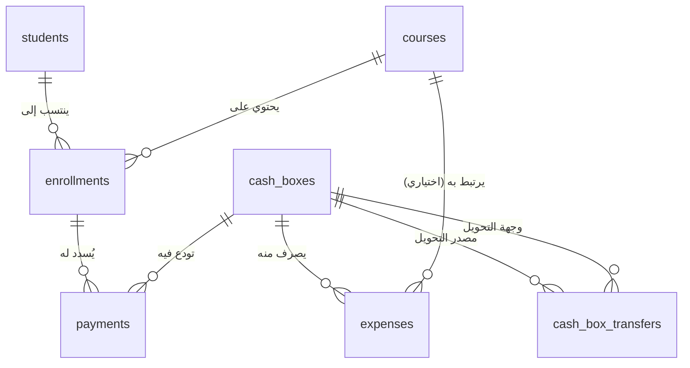

# 🏛️ أكاديمية المصري — المرجع الهندسي والتشغيلي الشامل لنظام إدارة التدريب (LMS)
## Master Architecture, Database Specification & Operating Manual
### Elmasry Academy — Training Management Platform (TrainerPro)

> **الجهة المستفيدة:** أكاديمية المصري للتدريب وهندسة النظم  
> **المشرف العام:** م/ محمد المصري  
> **المطور والمهندس المعماري للنظام:** م/ أحمد الفلاح 👨‍💻 (Lead Software Engineer & System Architect)  
> **الإصدار:** v2.5.0 Production Ready (Dark Luxury Edition)  
> **آخر تحديث واعتماد:** أكتوبر 2026  

---

## 📑 فهرس المحتويات (Table of Contents)
1. [نظرة عامة وهوية المنصة](#1-نظرة-عامة-وهوية-المنصة)
2. [المبادئ الهندسية الصارمة (Core Architectural Principles)](#2-المبادئ-الهندسية-الصارمة-core-architectural-principles)
3. [البنية التحتية والتقنيات المستخدمة (Tech Stack)](#3-البنية-التحتية-والتقنيات-المستخدمة-tech-stack)
4. [مخطط قاعدة البيانات والجداول الأساسية (Database Schemas)](#4-مخطط-قاعدة-البيانات-والجداول-الأساسية-database-schemas)
5. [محرك المعالجة والفيوهات المعتمدة (PostgreSQL Ledger Views)](#5-محرك-المعالجة-والفيوهات-المعتمدة-postgresql-ledger-views)
6. [الدوال الذرية وإجراءات الأمان (Atomic RPC Functions & Locks)](#6-الدوال-الذرية-وإجراءات-الأمان-atomic-rpc-functions--locks)
7. [سياسات الأمان والحماية (RLS & Authentication Security)](#7-سياسات-الأمان-والحماية-rls--authentication-security)
8. [الدليل التشغيلي التفصيلي لكافة الشاشات (Module Operating Guide)](#8-الدليل-التشغيلي-التفصيلي-لكافة-الشاشات-module-operating-guide)
9. [محرك السندات والإيصالات الرسمية القابلة للطباعة (Voucher Engine)](#9-محرك-السندات-والإيصالات-الرسمية-القابلة-للطباعة-voucher-engine)
10. [نظام البحث الشامل والقائمة المنزلقة (UI/UX Drawer & Search)](#10-نظام-البحث-الشامل-والقائمة-المنزلقة-uiux-drawer--search)
11. [دليل الصيانة وحالات الطوارئ (Troubleshooting & Ops)](#11-دليل-الصيانة-وحالات-الطوارئ-troubleshooting--ops)
12. [إرشادات الرفع والإنتاج (Production Deployment Guide)](#12-إرشادات-الرفع-والإنتاج-production-deployment-guide)

---

## 1. نظرة عامة وهوية المنصة

تم تصميم وتطوير منصة **«أكاديمية المصري — نظام إدارة التدريب»** لتمثل النواة الرقمية المركزية لإدارة كافة العمليات الأكاديمية والمالية والتشغيلية في الأكاديمية.
المنصة تخدم مسارات التدريب الاحترافية في مجالات هندسة النظم، الشبكات، البنية التحتية، والسيرفرات السحابية، وتهدف إلى إلغاء المعاملات الورقية العشوائية، منع تضارب أو تسرب الأموال، وتوفير رقابة مالية آنية بالمليم على كافة الخزن والمصروفات ومستحقات الطلاب.

* **الاسم الرسمي:** أكاديمية المصري — نظام إدارة التدريب المعتمد
* **حقوق التطوير والبرمجة:** صُنع وتطوير بواسطة مهندس النظم **م/ أحمد الفلاح 👨‍💻**
* **الجهة المشرفة والمستفيدة:** أكاديمية م/ محمد المصري

---

## 2. المبادئ الهندسية الصارمة (Core Architectural Principles)

بُني النظام على 4 ركائز برمجية غير قابلة للمساومة:

1. **صفر حسابات مالية على الواجهة (Zero Client-Side Balance Calculation):**
   * يُمنع منعاً باتاً استخدام دوال مثل `.reduce()` أو الجمع والطرح اليدوي في جافاسكريبت لحساب رصيد طالب، رصيد خزنة، أو أرباح كورس.
   * كافة الأرقام، الأرصدة، والمؤشرات تُقرأ مباشرة 100% من فيوهات الباك إند المحسوبة داخل محرك PostgreSQL (`enrollment_balances`, `cash_box_balances`, `course_financial_summary`, `dashboard_metrics`).

2. **الأقفال الذرية الصارمة (Atomic Transactions & Row Locking):**
   * منع أي Race Condition في حجز المقاعد أو تسجيل الدفعات المتزامنة باستخدام `SELECT ... FOR UPDATE` داخل دوال الـ PL/pgSQL.
   * مستحيل تجاوز السعة الاستيعابية لأي كورس حتى لو حاول أكثر من مسؤول تسجيل طلاب في نفس الثانية.
   * مستحيل قبول دفعات مالية تتجاوز المبلغ المتبقي على الطالب (حماية ضد الـ Overpayment).

3. **حظر الحذف المالي الصلب (Immutable Financial Audit Trail):**
   * لا يوجد أمر `DELETE` نهائياً على جدول الدفعات (`payments`).
   * إلغاء الدفعات يتم كإجراء محاسبي معتمد (Soft Voiding) عبر تسجيل وقت الإلغاء `voided_at = NOW()` وهوية من ألغى الدفعة، مع استبعادها التلقائي من الخزن والفيوهات المالية مع بقاء أثرها للرقابة.

4. **توجيه الـ RTL واللغة الإنسانية الحية (Human UX & Microcopy):**
   * واجهة مستخدم مبنية بالكامل لليمين (RTL) بهوية Dark Luxury (`#0B0F17`) وخطوط `Cairo` للعربية و`Inter` للأرقام والإنجليزية.
   * التخلص التام من الرطانة المترجمة حرفياً من الإنجليزية، واعتماد المصطلحات المهنية المباشرة (`خالص السداد`، `سداد جزئي`، `منتظم بالحضور`، `مقبوضات واردة`، `مصروفات صادرة`).

---

## 3. البنية التحتية والتقنيات المستخدمة (Tech Stack)

| الطبقة | التقنية المعتمدة | الوظيفة |
| :--- | :--- | :--- |
| **قاعدة البيانات (Database)** | **PostgreSQL 15 (Supabase Cloud)** | تخزين البيانات العلائقية، الفيوهات المحاسبية، والدوال الذرية |
| **الأمان والصلاحيات (Auth & RLS)** | **Supabase Auth + Row-Level Security** | مصادقة الإدمن، تشفير الجلسات، وعزل المفتاح العام anon تماماً |
| **إطار عمل الواجهة (Frontend)** | **React 18 + Vite + TypeScript** | بناء واجهات أحادية الصفحة (SPA) فائقة السرعة وخالية من أخطاء الـ Type |
| **التنسيق والهوية (Styling)** | **Tailwind CSS + Custom CSS Variables** | نظام ألوان فخم (Obsidian Palette `#0B0F17` + Emerald Brand `#10B981`) |
| **الأيقونات (Icons)** | **Lucide React** | أيقونات عصرية موحدة خفيفة الوزن |
| **محرك الإيصالات (Voucher Engine)** | **HTML5 Print API + CSS Paged Media** | توليد وطباعة سندات قبض معتمدة مباشرة من المتصفح |

---

## 4. مخطط قاعدة البيانات والجداول الأساسية (Database Schemas)

قاعدة البيانات مبنية على 8 جداول علائقية رئيسية خاضعة لـ Foreign Key Constraints صارمة:



### 1. جدول الطلاب (`students`):
* `student_id` (UUID - Primary Key)
* `name` (VARCHAR - اسم الطالب)
* `phone` (VARCHAR - رقم الهاتف)
* `email` (VARCHAR - البريد الإلكتروني)
* `employment_status` (ENUM: `'Employed'`, `'Unemployed'`, `'Student'`, `'Freelancer'`)
* `grad_status` (ENUM: `'Graduate'`, `'Undergrad'`)
* `grad_college` (VARCHAR - اسم الكلية إن وجد)
* `previous_courses` (TEXT - خلفيات أو كورسات سابقة)
* `notes` (TEXT - ملاحظات إدارية)
* `created_at`, `updated_at` (TIMESTAMPTZ)

### 2. جدول الكورسات (`courses`):
* `course_id` (UUID - Primary Key)
* `course_name` (VARCHAR - اسم الدورة التدريبية)
* `description` (TEXT - الوصف الفني للدرس ومحتواه)
* `level` (ENUM: `'Beginner'`, `'Intermediate'`, `'Advanced'`)
* `duration_weeks` (INTEGER - عدد أسابيع الدورة)
* `prerequisite_courses` (TEXT - المتطلبات السابقة للمتدرب)
* `max_students` (INTEGER - السعة الاستيعابية القصوى، NULL = مفتوح)
* `default_cost` (DECIMAL - السعر الافتراضي للدورة)
* `availability_status` (ENUM: `'Upcoming'`, `'Active'`, `'Closed'`)
* `link_whatsapp` (TEXT - رابط جروب الواتساب الخاص بالدفعة)
* `link_tasks` (TEXT - رابط منصة تسليم الواجبات والمهام)
* `link_drive` (TEXT - رابط مجلد تسجيلات المحاضرات على Google Drive)
* `link_sources` (TEXT - رابط مذكرات ومصادر المحاضرة)

### 3. جدول الخزن وصناديق المال (`cash_boxes`):
* `cash_box_id` (UUID - Primary Key)
* `name` (VARCHAR - اسم الخزنة مثل: الخزنة الرئيسية، فودافون كاش، إنستاباي)
* `type` (ENUM: `'Main'`, `'Branch'`, `'Online'`, `'Bank'`, `'Petty Cash'`)
* `owner` (VARCHAR - الشخص المسؤول عن عهدة الخزنة: م/ أحمد الفلاح)
* `opening_balance` (DECIMAL - رصيد بداية المدة الافتتاحي)
* `is_active` (BOOLEAN - هل الخزنة نشطة أم مؤرشفة)

### 4. جدول الاشتراكات المركزي (`enrollments`):
* `enrollment_id` (UUID - Primary Key)
* `student_id` (UUID - FK references `students`)
* `course_id` (UUID - FK references `courses`)
* `agreed_cost` (DECIMAL - المبلغ المتفق عليه مع الطالب بعد أي خصومات)
* `status` (ENUM: `'Active'`, `'Completed'`, `'Dropped'`)
* `enrolled_at`, `updated_at` (TIMESTAMPTZ)
* **قيد فريد (Unique Constraint):** `(student_id, course_id)` لمنع تسجيل نفس الطالب مرتين في نفس الكورس بالخطأ.

### 5. جدول الدفعات المالية (`payments`):
* `payment_id` (UUID - Primary Key)
* `enrollment_id` (UUID - FK references `enrollments`)
* `cash_box_id` (UUID - FK references `cash_boxes`)
* `amount` (DECIMAL - مبلغ القسط المدفوع، أكبر من صفر إجبارياً)
* `payment_date` (DATE - تاريخ استلام المبلغ)
* `method` (ENUM: `'Cash'`, `'Bank Transfer'`, `'Vodafone Cash'`, `'InstaPay'`)
* `receipt_ref` (VARCHAR - رقم الإيصال أو كود المعاملة البنكية)
* `notes` (TEXT - تفاصيل السداد)
* `voided_at` (TIMESTAMPTZ - تاريخ إلغاء الدفعة إن أُلغيت، NULL = نشطة)
* `added_by` (UUID - معرف الإدمن الذي سجّل الدفعة)

### 6. جدول المصروفات والنفقات التشغيلية (`expenses`):
* `expense_id` (UUID - Primary Key)
* `cash_box_id` (UUID - FK references `cash_boxes` - مصدر صرف الفلوس)
* `course_id` (UUID - FK اختياري - لربط المصروف بدورة معينة لاحتساب صافي ربحها)
* `amount` (DECIMAL - المبلغ المصروف)
* `expense_date` (DATE - تاريخ الصرف)
* `category` (ENUM: `'Rent'`, `'Salary'`, `'Supplies'`, `'Hardware'`, `'Marketing'`, `'Utilities'`, `'Other'`)
* `description` (VARCHAR - بيان تفصيلي لبند الصرف)
* `notes` (TEXT)

### 7. جدول التحويلات المالية بين الخزن (`cash_box_transfers`):
* `transfer_id` (UUID - Primary Key)
* `from_box_id` (UUID - الخزنة المصدر)
* `to_box_id` (UUID - الخزنة المستلمة)
* `amount` (DECIMAL - المبلغ المحول)
* `transfer_date` (DATE)
* `notes` (TEXT - سبب التحويل)

---

## 5. محرك المعالجة والفيوهات المعتمدة (PostgreSQL Ledger Views)

كافة العمليات الحسابية محوسبة على مستوى الـ Database عبر 4 فيوهات تعمل بخاصية `security_invoker = true`:

### 1. فيو مؤشرات الداشبورد (`dashboard_metrics`):
يقوم بتجميع أرقام الأكاديمية بدقة لحظية:
* `total_students`: إجمالي عدد الطلاب المسجلين بالكامل.
* `new_students_this_month`: عدد الطلاب المنضمين خلال الشهر الميلادي الجاري.
* `active_courses`: عدد الكورسات التي حالتها `Active`.
* `active_enrollments`: عدد اشتراكات الطلاب بحالة `Active`.
* `revenue_this_month`: إجمالي الدفعات غير الملغاة المحصلة هذا الشهر.
* `expenses_this_month`: إجمالي المصروفات التشغيلية لهذا الشهر.
* `net_profit_this_month`: صافي أرباح الشهر (الإيرادات - المصروفات).
* `total_revenue_all_time`: إجمالي مقبوضات الأكاديمية التراكمية التاريخية.
* `total_expenses_all_time`: إجمالي مصروفات الأكاديمية التراكمية التاريخية.
* `net_profit_all_time`: صافي الأرباح التاريخي التراكمي.
* `total_pending_balance`: إجمالي الأقساط والمستحقات المتبقية في ذمة الطلاب النشطين.

### 2. فيو أرصدة الاشتراكات (`enrollment_balances`):
يحسب موقف كل طالب في كل كورس:
* `total_paid`: مجموع الدفعات غير الملغاة فقط المسجلة لهذا الاشتراك.
* `remaining_balance`: `agreed_cost - total_paid`.
* `payment_status`:
  * `Paid` (خالص السداد): عند وصول المتبقي إلى صفر.
  * `Partial` (سداد جزئي): عند سداد جزء وبقاء جزء.
  * `Unpaid` (لم يُسدد بعد): إذا كان إجمالي المدفوع صفر.
  * `Overpaid` (فائض سداد): في حال كانت القيمة سالبة نادراً.

### 3. فيو أرصدة الخزن وصناديق المال (`cash_box_balances`):
معادلة الخزينة المحاسبية الدقيقة:
$$\text{الرصيد الفعلي الحالي} = \text{رصيد بداية المدة} + \text{المقبوضات الواردة} + \text{التحويلات الواردة} - \text{المصروفات الصادرة} - \text{التحويلات الصادرة}$$

### 4. فيو الملخص المالي للكورسات (`course_financial_summary`):
* `collected_payments`: إجمالي المبالغ النقدية المحصلة فعلياً للكورس.
* `expected_revenue`: إجمالي المبالغ المتفق عليها للطلاب المنتظمين والناجحين فقط (مع استبعاد المنسحبين).
* `total_expenses`: المصروفات المرتبطة حصراً بهذا الكورس.
* `net_profit`: `collected_payments - total_expenses`.
* `active_enrollments`: عدد الطلاب المقيدين حالياً.
* `vacant_places`: المقاعد الشاغرة المتبقية قبل إغلاق باب التسجيل.

---

## 6. الدوال الذرية وإجراءات الأمان (Atomic RPC Functions & Locks)

تتم كافة التعديلات المالية عبر دوال مخزنة (Stored Procedures) تعمل بصلاحية `SECURITY DEFINER`:

1. **دالة تسجيل الطالب في كورس (`enroll_student`):**
   * تقوم بقفل صف الكورس `SELECT * FROM courses WHERE course_id = p_course_id FOR UPDATE`.
   * تتحقق من أن الكورس ليس مغلقاً (`Closed`).
   * تتحقق من وجود مقاعد شاغرة إذا كان الكورس محدد السعة (`max_students`).
   * تتحقق من عدم وجود تسجيل مسبق للطالب في نفس الكورس لمنع التكرار.
   * تُدرج الاشتراك بالمبلغ المتفق عليه أو التكلفة الافتراضية للكورس.

2. **دالة تسجيل دفعة مالية (`record_payment`):**
   * تقوم بقفل صف الاشتراك `SELECT * FROM enrollments WHERE enrollment_id = p_enrollment_id FOR UPDATE`.
   * تتحقق من أن الاشتراك ليس منسحباً (`Dropped`).
   * تحسب المتبقي الحقيقي من فيو `enrollment_balances`.
   * **حاجز السداد الزائد (Overpayment Guard):** ترفض المعاملة وتُرجع خطأ صريحاً يوضح المتبقي في حال كان المبلغ أكبر من الدين المتبقي.
   * تُدرج الدفعة وتربطها بمعرف الخزينة والمستخدم المسؤول.

3. **دالة إلغاء الدفعة (`void_payment`):**
   * تقوم بالتحديث الناعم `voided_at = NOW()` لحفظ السجل المحاسبي واستبعاد المبلغ فورياً من الخزينة ورصيد الطالب.

4. **دالة تسجيل المصروف (`record_expense`):**
   * تدرج المصروف وتخصمه لحظياً من الخزينة المحددة، مع دعم ربطه بكورس معين أو تسجيله كبند عام للسنتر.

5. **دالة التحويل بين الخزن (`transfer_between_boxes`):**
   * تنقل الأموال بين خزينتين في حركة ذرية واحدة (خصم من المصدر وإضافة للوجهة) مع إمكانية السماح بالرصيد السالب مع إظهار تحذير في الواجهة.

---

## 7. سياسات الأمان والحماية (RLS & Authentication Security)

* **عزل المفتاح العام (Zero Anonymous Access):**
  كافة الجداول والفيوهات والدوال محمية بسياسات RLS مشددة. أي طلب خارجي باستخدام مفتاح الـ Anon بدون تسجيل دخول إدمن رسمي يُقابل بـ `401 Unauthorized` و `42501 Permission Denied`.
* **تعطيل التسجيل العام (Public Signups Disabled):**
  مغلق تماماً من إعدادات Supabase Auth لمنع أي زائر من إنشاء حساب إدمن.
* **التحقق من الرتبة (`is_admin()`):**
  كل جلسة يتم فحصها عبر التحقق من وجود المعرف `auth.uid()` في جدول المشرفين المعتمدين (`admins`).
* **بيانات الاعتماد الرئيسية المعتمدة:**
  * **البريد الإلكتروني:** `ahmed.elfalah@trainerpro.com`
  * **الصلاحية:** المطور ومسؤول الصلاحيات الأعلى (Superadmin).

---

## 8. الدليل التشغيلي التفصيلي لكافة الشاشات (Module Operating Guide)

### 1. الرئيسية والداشبورد (`/dashboard`):
* عرض نبض الأكاديمية عبر 7 بطاقات إحصائية ملونة تدعم المقارنات الشهرية والتراكمية.
* جدول أحدث 10 دفعات محصلة مع زر **«طباعة إيصال»** لكل معاملة.
* زر «تحديث البيانات» لجلب أحدث الأرقام الحية من السيرفر.

### 2. إدارة الطلاب (`/students`):
* دليل شامل بكافة المتدربين المسجلين، مع فلاتر للحالة الوظيفية وحالة التخرج.
* زر **«تسجيل بكورس»** في كل صف لإلحاق الطالب بأي دورة مباشرة.
* زر **«إضافة طالب جديد»** لفتح نافذة إدخال البيانات الشخصية والجامعية.
* إمكانية الدخول على **ملف الطالب التفصيلي** لمشاهدة تاريخه وسجل كورساته وملاحظاته.

### 3. إدارة الكورسات (`/courses`):
* كروت فاخرة لكل كورس تدريبي توضح المستوى، المدة، المقاعد المشغولة والشاغرة، وروابط الواتساب والمهام.
* زر **«إنشاء كورس جديد»** لتحديد السعر الافتراضي، المتطلبات، والمدة وروابط الماتريال.
* قائمة الخيارات: تعديل الكورس، إغلاق الكورس، والدخول لصفحة **تفاصيل الكورس والمالية**.

### 4. تفاصيل الكورس الشاملة (`/course-details`):
* بطاقة بيانات شاملة ومؤشر المقاعد وروابط الماتريال الأربعة.
* زر **«إضافة طالب لهذا الكورس»**: يتيح الاختيار بين طالب مسجل بالفعل أو إنشاء طالب جديد كلياً وإلحاقه فوراً بنفس الشاشة مع إمكانية تحصيل دفعة أولى.
* جدول الطلاب المقيدين بالدورة مع زر **«دفع قسط»** مباشر يفتح بقيمة المتبقي على الطالب، وقائمة لتعديل حالة الاشتراك (نشط / مكتمل / منسحب).

### 5. جدول الاشتراكات المركزي (`/enrollments`):
* سجل مركزي لكل العمليات التدريبية الجارية والسابقة عبر كافة الكورسات.
* زر **«دفع قسط»** مباشر لكل طالب لم يُكمل سداد مستحقاته.
* فلاتر لحالة الاشتراك وحالة الدفع.

### 6. الدفعات والمقبوضات (`/payments`):
* مراقبة كافة الإيرادات الواردة للخزن من اشتراكات الطلاب.
* فلتر حسب طريقة الدفع (كاش، فودافون كاش، إنستاباي، تحويل بنكي).
* زر **«طباعة إيصال»** لتوليد سند القبض الرسمي.
* زر **«إلغاء»** مع نافذة تأكيد لتنفيذ الإلغاء المحاسبي المعزول (Void).

### 7. إدارة المصروفات (`/expenses`):
* تسجيل نفقات السنتر (إيجارات، مرتبات محاضرين، أدوات وبوفيه، سيرفرات، إعلانات).
* ربط المصروف بكورس معين لاحتساب صافي أرباحه، أو اعتباره مصاريف تشغيل عامة.
* التحذير الفوري في حال تجاوز المصروف للرصيد المتوفر بالخزنة.

### 8. الخزن وصناديق المال (`/cashboxes`):
* بطاقات رقمية لكل خزنة ومحفظة وحساب بنكي توضح الرصيد الفعلي بالمليم.
* إمكانية إنشاء خزن جديدة بمختلف الأنواع والمسؤولين.
* محرك **«تحويل أموال»** مرن يتيح نقل السيولة النقدية بين المحافظ (مثل التحويل من فودافون كاش إلى إنستاباي أو العكس).

### 9. الإعدادات والأمان (`/settings`):
* بطاقة هوية المطور والمسؤول التقني (م/ أحمد الفلاح).
* نموذج تغيير وتحديث كلمة المرور المشفرة للإدمن.
* مؤشرات صحة البنية التحتية وقاعدة البيانات وسياسات الـ RLS.
* ملخص أرصدة الخزن النشطة.

---

## 9. محرك السندات والإيصالات الرسمية القابلة للطباعة (Voucher Engine)

يحتوي النظام على نافذة طباعة إيصال دفع رسمي (`ReceiptModal`) مطابقة لأرقى معايير المحاسبة وسندات القبض الورقية:
* **الترويسة:** شعار واسم «أكاديمية المصري — نظام إدارة التدريب وهندسة النظم المعتمد».
* **البيانات الموثقة:** رقم الإيصال المرجعي، اسم الطالب بالكامل، رقم الهاتف، اسم الكورس، تاريخ السداد، طريقة الدفع، والخزنة المستلمة.
* **خانة المبلغ:** كبسولة زمردية عريضة توضح المبلغ المدفوع بالجنيه المصري بالأرقام والعملة الرسمية.
* **التوقيع والاعتماد:** توقيع المسؤول المالي والمطور المعتمد: **«م/ أحمد الفلاح 👨‍💻»**.
* **دعم الطباعة:** زر «طباعة الإيصال فوراً» يقوم بتهيئة الصفحة تلقائياً لطباعة مقاس A5 أو رول حراري مع عزل خلفيات الشاشة عبر `@media print`.

---

## 10. نظام البحث الشامل والقائمة المنزلقة (UI/UX Drawer & Search)

1. **القائمة المنزلقة الذكية (Drawer Navigation):**
   * استجابة لرغبة إدارة الأكاديمية في توفير مساحة رؤية كاملة 100% للشاشات والجداول، تم تحويل القائمة الجانبية إلى **Drawer منزلق ناعم**.
   * يظهر زر **الـ 3 شرط (Hamburger Menu)** أعلى يمين الشاشة بشكل دائم في كافة الأجهزة والشاشات الكبيرة والصغيرة.
   * بالضغط على الزر، تنزلق القائمة بهدوء فوق خلفية معتمة (Backdrop Blur)، وتُغلق تلقائياً بمجرد اختيار أي قسم أو الضغط خارجها.

2. **البحث السريع العام (Global Search):**
   * شريط بحث ذكي مثبت بالهيدر في كل صفحات المنصة.
   * يبحث لحظياً في الـ Database بمجرد الكتابة في 3 مسارات متزامنة:
     * **الطلاب:** بالاسم أو رقم الهاتف.
     * **الكورسات:** باسم الكورس.
     * **الإيصالات:** برقم الإيصال أو الكود المرجعي.
   * يعرض قائمة منسدلة فورية بنتائج البحث، وبالضغط على أي نتيجة ينقلك مباشرة إلى صفحة ملف الطالب أو تفاصيل الكورس.

---

## 11. دليل الصيانة وحالات الطوارئ (Troubleshooting & Ops)

| العرض / المشكلة | السبب الفني المحتمل | الإجراء العلاجي السريع |
| :--- | :--- | :--- |
| خطأ `42501 permission denied for view ...` | استدعاء الفيو أو الجدول بمفتاح الـ Anon دون مصادقة | تسجيل الدخول كإدمن أولاً؛ نظام الـ RLS يحجب أي قراءة غير مصرحة |
| رفض تسجيل طالب في كورس | الكورس مغلق أو اكتملت السعة القصوى للمقاعد | فتح صفحة الكورس وتعديل السعة أو تحويل حالته إلى `Active` |
| رفض تسجيل دفعة مالية | المبلغ المدخل أكبر من المتبقي، أو حالة الطالب `Dropped` | التحقق من رصيد الطالب؛ الدالة تمنع السداد الزائد عن الدين المتبقي |
| بطء في تحميل الشاشات | انقطاع اتصال الإنترنت بـ Supabase Cloud | التحقق من حالة مشروع Supabase عبر الرابط `urmkcixqpoqkiosihhal` |

---

## 12. إرشادات الرفع والإنتاج (Production Deployment Guide)

1. **إعداد المتغيرات البيئية (`.env`):**
   ```env
   VITE_SUPABASE_URL=https://urmkcixqpoqkiosihhal.supabase.co
   VITE_SUPABASE_ANON_KEY=eyJhbGciOiJIUzI1NiIsInR5cCI6IkpXVCJ9...
   ```

2. **التجميع وبناء الإنتاج (Production Build):**
   ```powershell
   npm run build
   ```
   * يُنتج مجلد `dist/` بحجم خفيف جداً (~109 kB مضغوط بـ Gzip).
   * يتميز بزمن تحميل أولي أقل من نصف ثانية.

3. **الاستضافة الموصى بها:**
   * المنصة جاهزة 100% للرفع المباشر على **Vercel** أو **Cloudflare Pages** أو **Netlify**.
   * تدعم التوجيه أحادي الصفحة (SPA Rewrite) عبر إضافة ملف `vercel.json`:
     ```json
     {
       "rewrites": [{ "source": "/(.*)", "destination": "/index.html" }]
     }
     ```

---

<div dir="rtl" style="text-align: center; margin-top: 40px; padding: 20px; border-top: 1px solid #334155; font-size: 13px; color: #94a3b8;">
  تم إعداد وتوثيق هذا المرجع بواسطة <b>م/ أحمد الفلاح 👨‍💻</b> — مهندس ومطور نظام إدارة أكاديمية المصري<br>
  جميع الحقوق محفوظة © 2026 أكاديمية المصري
</div>
