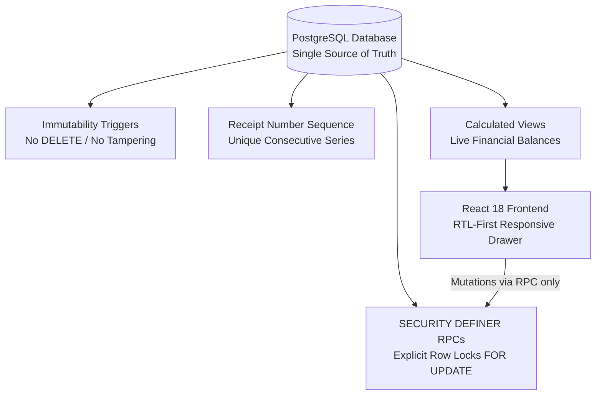
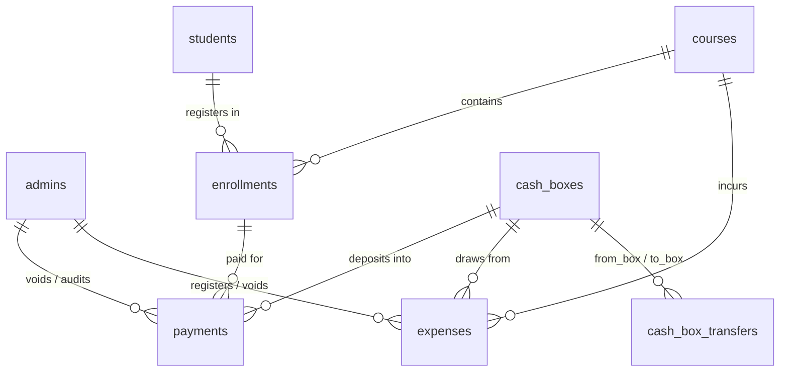

<div dir="rtl" style="text-align: right; direction: rtl; font-family: 'Segoe UI', Tahoma, Arial, sans-serif; line-height: 1.8;">

# 🏛️ أكاديمية المصري — المرجع المعماري والتشغيلي الشامل لنظام إدارة التدريب والمالية (LMS)
## Master Enterprise Architecture, Database Specification & Operating Manual
### Elmasry Academy — Training Management & Financial Ledger Platform (TrainerPro)

> **المؤسسة:** أكاديمية م/ محمد المصري لهندسة النظم والبنية التحتية والشبكات  
> **المشرف العام:** م/ محمد المصري (Eng. Mohamed Elmasry)  
> **كبير مهندسي النظام والمعماري الرئيسي:** م/ أحمد الفلاح (Eng. Ahmed El-Falah — Lead Software Engineer & System Architect)  
> **تاريخ الإصدار:** أكتوبر 2026  
> **حالة الاعتماد:** معتمد للإنتاج (Production-Grade Certified — Hardened)  
> **مستودع المشروع الرسمي على GitHub:** [Ahmed77khaled/elmasry-academy-lms](https://github.com/Ahmed77khaled/elmasry-academy-lms)  
> **البيئة السحابية المعتمدة:** Supabase Cloud (PostgreSQL 15+) + React 18 (Vite + TypeScript)

---

## 📑 فهرس المحتويات الشامل (Table of Contents)

<table dir="rtl" style="width: 100%; border-collapse: collapse; margin-bottom: 25px;">
  <thead>
    <tr style="background-color: #1E3A8A; color: white;">
      <th style="padding: 10px; border: 1px solid #334155; text-align: center; width: 8%;">القسم</th>
      <th style="padding: 10px; border: 1px solid #334155; text-align: right; width: 32%;">عنوان القسم</th>
      <th style="padding: 10px; border: 1px solid #334155; text-align: right; width: 60%;">نطاق التغطية والمخرجات التقنية والتشغيلية</th>
    </tr>
  </thead>
  <tbody>
    <tr>
      <td style="padding: 10px; border: 1px solid #334155; text-align: center;"><strong>01</strong></td>
      <td style="padding: 10px; border: 1px solid #334155;"><strong>نظرة عامة وهوية المنصة</strong></td>
      <td style="padding: 10px; border: 1px solid #334155;">الرؤية الهندسية، أهداف الأكاديمية، نطاق العمل (إدارة تدريب ومحاسبة دفاتر أستاذ)، والمستخدمون المستهدفون.</td>
    </tr>
    <tr style="background-color: #0F172A;">
      <td style="padding: 10px; border: 1px solid #334155; text-align: center;"><strong>02</strong></td>
      <td style="padding: 10px; border: 1px solid #334155;"><strong>المبادئ الهندسية والمعمارية الصارمة</strong></td>
      <td style="padding: 10px; border: 1px solid #334155;">مبدأ قاعدة البيانات كمصدر وحيد للحقيقة (SSOT)، عدم الحذف المالي، التسلسل الرقمي، وتفادي الـ Deadlocks.</td>
    </tr>
    <tr>
      <td style="padding: 10px; border: 1px solid #334155; text-align: center;"><strong>03</strong></td>
      <td style="padding: 10px; border: 1px solid #334155;"><strong>المكدس التقني والبنية التحتية</strong></td>
      <td style="padding: 10px; border: 1px solid #334155;">تفاصيل تقنيات Frontend (React 18, TS, Vite, Tailwind) وBackend (PostgreSQL, Supabase RLS, PostgREST).</td>
    </tr>
    <tr style="background-color: #0F172A;">
      <td style="padding: 10px; border: 1px solid #334155; text-align: center;"><strong>04</strong></td>
      <td style="padding: 10px; border: 1px solid #334155;"><strong>مخطط قاعدة البيانات (8 جداول أساسية)</strong></td>
      <td style="padding: 10px; border: 1px solid #334155;">التوثيق الكامل لكافة الجداول الـ 8 (admins, students, courses, cash_boxes, enrollments, payments, expenses, cash_box_transfers) بالحقول والأنواع والقيود والفهارس.</td>
    </tr>
    <tr>
      <td style="padding: 10px; border: 1px solid #334155; text-align: center;"><strong>05</strong></td>
      <td style="padding: 10px; border: 1px solid #334155;"><strong>تريجرز منع التعديل والحذف المالي</strong></td>
      <td style="padding: 10px; border: 1px solid #334155;">شرح هندسي لـ prevent_financial_record_mutation وضمان خلو سجل الدفعات والمصروفات من الحذف أو التلاعب بأثر رجعي.</td>
    </tr>
    <tr style="background-color: #0F172A;">
      <td style="padding: 10px; border: 1px solid #334155; text-align: center;"><strong>06</strong></td>
      <td style="padding: 10px; border: 1px solid #334155;"><strong>محرك المعالجة والفيوهات المعتمدة (Views)</strong></td>
      <td style="padding: 10px; border: 1px solid #334155;">توثيق معادلات وحسابات الـ 4 فيوهات المحاسبية مع استبعاد السجلات الملغاة: الداشبورد، الأرصدة، الخزن، وأرباح الكورسات.</td>
    </tr>
    <tr>
      <td style="padding: 10px; border: 1px solid #334155; text-align: center;"><strong>07</strong></td>
      <td style="padding: 10px; border: 1px solid #334155;"><strong>الدوال الذرية والأقفال التزامنية (RPCs)</strong></td>
      <td style="padding: 10px; border: 1px solid #334155;">التسجيل الذري، تغيير حالة الاشتراك، سندات القبض، المصروفات، إلغاء العمليات، والتحويل بين الخزن بدون Deadlock.</td>
    </tr>
    <tr style="background-color: #0F172A;">
      <td style="padding: 10px; border: 1px solid #334155; text-align: center;"><strong>08</strong></td>
      <td style="padding: 10px; border: 1px solid #334155;"><strong>مصفوفة الأمان وسياسات RLS وPostgREST</strong></td>
      <td style="padding: 10px; border: 1px solid #334155;">عزل PostgREST عن التعديل المالي المباشر، حصر الدوال بـ SECURITY DEFINER، وفحص صلاحيات المدير is_admin().</td>
    </tr>
    <tr>
      <td style="padding: 10px; border: 1px solid #334155; text-align: center;"><strong>09</strong></td>
      <td style="padding: 10px; border: 1px solid #334155;"><strong>الدليل التشغيلي التفصيلي لكافة الشاشات</strong></td>
      <td style="padding: 10px; border: 1px solid #334155;">دليل عملي مصور لـ 9 وحدات برمجية: الداشبورد، الطلاب، الكورسات، تفاصيل الكورس، الاشتراكات، الدفعات، المصاريف، الخزن، والإعدادات.</td>
    </tr>
    <tr style="background-color: #0F172A;">
      <td style="padding: 10px; border: 1px solid #334155; text-align: center;"><strong>10</strong></td>
      <td style="padding: 10px; border: 1px solid #334155;"><strong>محرك سندات القبض والإيصالات الرسمية</strong></td>
      <td style="padding: 10px; border: 1px solid #334155;">هيكلية الإيصال التسلسلي (REC-00000001)، طباعة A4/A5، التوقيعات الرسمية، والعلامة المائية للسندات الملغاة.</td>
    </tr>
    <tr>
      <td style="padding: 10px; border: 1px solid #334155; text-align: center;"><strong>11</strong></td>
      <td style="padding: 10px; border: 1px solid #334155;"><strong>نظام البحث الفوري والقائمة المنزلقة</strong></td>
      <td style="padding: 10px; border: 1px solid #334155;">البحث الفوري بالهاتف واسم الطالب ورقم السند، ودرج التنقل الجانبي لزيادة مساحة العرض للجداول إلى 100%.</td>
    </tr>
    <tr style="background-color: #0F172A;">
      <td style="padding: 10px; border: 1px solid #334155; text-align: center;"><strong>12</strong></td>
      <td style="padding: 10px; border: 1px solid #334155;"><strong>سجل ترحيلات قاعدة البيانات (Migrations)</strong></td>
      <td style="padding: 10px; border: 1px solid #334155;">شرح تسلسل ملفات الميجرشن وتاريخ تطبيق ميجرشن التقوية الإنتاجية 202610210005_production_hardening.sql.</td>
    </tr>
    <tr>
      <td style="padding: 10px; border: 1px solid #334155; text-align: center;"><strong>13</strong></td>
      <td style="padding: 10px; border: 1px solid #334155;"><strong>دليل الصيانة واستكشاف الأخطاء والنسخ الاحتياطي</strong></td>
      <td style="padding: 10px; border: 1px solid #334155;">استراتيجيات استعادة النظام، فحص سلامة الأرصدة، التعامل مع حالات انقطاع الاتصال، والنسخ الاحتياطي الدوري.</td>
    </tr>
    <tr style="background-color: #0F172A;">
      <td style="padding: 10px; border: 1px solid #334155; text-align: center;"><strong>14</strong></td>
      <td style="padding: 10px; border: 1px solid #334155;"><strong>إرشادات النشر والاستضافة السحابية (Deployment)</strong></td>
      <td style="padding: 10px; border: 1px solid #334155;">إعدادات النشر على Vercel / Netlify، متغيرات البيئة، وضوابط أمان مفاتيح الـ API.</td>
    </tr>
  </tbody>
</table>

---

## 1. نظرة عامة وهوية المنصة (Platform Overview)

منصة **«أكاديمية المصري — نظام إدارة التدريب والمالية (TrainerPro)»** هي بنية برمجية وسحابية متكاملة شُيدت خصيصاً لإدارة عمليات التدريب التقني الاحترافي في مجالات:
- هندسة النظم والبنية التحتية (System Administration & Infrastructure).
- شبكات المؤسسات وهندسة السيرفرات (Enterprise Networks & Servers).
- حلول الحوسبة السحابية ومراكز البيانات (Cloud Computing & Data Centers).

### 🎯 الأهداف التشغيلية للمنصة:
1. **التحكم المحاسبي الصارم (Zero Financial Discrepancy):** القضاء التام على أخطاء التحصيل اليدوي وحسابات الإكسيل المتضاربة، وتوفير دفتر أستاذ مالي غير قابل للتعديل أو الحذف العشوائي.
2. **إدارة دورة حياة المتدرب (End-to-End Trainee Lifecycle):** من لحظة التسجيل الأولي، وتوزيع المقاعد وسداد الأقساط، وحتى إتمام التدريب واستخراج السندات.
3. **انضباط السعة الاستيعابية للمقاعد (Hard Capacity Enforcement):** منع تسجيل أي متدرب إضافي فوق السعة القصوى للكورس على مستوى محرك قاعدة البيانات مباشرة.
4. **الشفافية الرقابية وإيصالات الدفع الرسمية:** إصدار سندات قبض رسمية متسلسلة تلقائياً وموقعة من إدارة الأكاديمية لكل حركة مالية تدخل الخزائن.

> [!IMPORTANT]
> **توصيف النطاق الوظيفي (System Scope Clarification):**  
> المنصة تركز على **إدارة التدريب والمحاسبة المالية والخزن والاشتراكات (Training Operations & Financial Ledger System)**. توزيع المحتوى التعليمي يتم عبر تكامل مع الروابط الخارجية الأربعة للكورس (جروب الواتساب الميداني، منصة تسليم المهام والواجبات، مجلد جوجل درايف للسيرفرات، ومكتبة المصادر والمذكرات).

---

## 2. المبادئ الهندسية الصارمة (Core Architectural Principles)

تم بناء النظام بالكامل وفق 6 ركائز هندسية غير قابلة للكسر:



1. **قاعدة البيانات كالمصدر الوحيد للحقيقة (Database-Driven SSOT):**  
   حظر حساب أي أرصدة مالية أو سعة مقاعد أو متبقي أقساط داخل كود الواجهة (Frontend JavaScript / TypeScript). كافة الأرصدة تُحسب داخل PostgreSQL Views ويتم قراءتها جاهزة بنسبة دقة 100%.
2. **سجل مالي ثابت غير قابل للتلاعب (Immutable Financial Ledger):**  
   يُمنع منعاً باتاً تنفيذ أمر `DELETE` على أي دفعة أو مصروف أو تحويل خزنة. يتم إبطال العمليات الخاطئة عبر آلية **الإلغاء المعتمد (Audited Void Operation)** مع تسجيل هوية المنفذ وتوقيت الإلغاء وسبب إلزامي لا يقل عن 5 أحرف.
3. **أرقام سندات متسلسلة تلقائية (Sequential Database Receipts):**  
   توليد أرقام سندات القبض حصرياً عبر تسلسل قاعدة بيانات `payment_receipt_number_seq` (مثال: `REC-00000001`) لمنع القفزات أو التكرارات، مع بقاء حقل `receipt_ref` مخصصاً لإيصالات التحويل البنكي وفودافون كاش الخارجية.
4. **أقفال تزامنية وحظر الـ Deadlocks في الخزن:**  
   في عمليات التحويل المالي بين صندوقين، يتم قفل الصندوقين معاً داخل قاعدة البيانات بترتيب تصاعدي ثابت `ORDER BY cb.cash_box_id FOR UPDATE`، مما يمنع تعارض الحركات المتزامنة (Deadlock Elimination).
5. **منع تجاوز سعة المقاعد حتى عند تغيير الحالة:**  
   تغيير حالة اشتراك الطالب من «منسحب» إلى «منتظم» يمر حصرياً عبر دالة `set_enrollment_status` الذرية التي تقفل صف الكورس وتفحص المقاعد المتاحة قبل قبول التفعيل.
6. **لغة تجربة مستخدم مصرية حية (Human-Centric Microcopy):**  
   الاعتماد على مصطلحات حية وسريعة ومفهومة لموظفي الأكاديمية والطلاب («خالص السداد»، «سداد جزئي»، «منتظم بالحضور»، «دوّر على...») مع تنسيق الأرقام بالجنيه المصري (`ج.م`).

---

## 3. المكدس التقني والبنية التحتية (Tech Stack)

<table dir="rtl" style="width: 100%; border-collapse: collapse; margin-bottom: 25px;">
  <thead>
    <tr style="background-color: #1E3A8A; color: white;">
      <th style="padding: 10px; border: 1px solid #334155;">الطبقة البرمجية</th>
      <th style="padding: 10px; border: 1px solid #334155;">التقنية / الأداة</th>
      <th style="padding: 10px; border: 1px solid #334155;">الدور والوظيفة في المشروع</th>
    </tr>
  </thead>
  <tbody>
    <tr>
      <td style="padding: 10px; border: 1px solid #334155;"><strong>قاعدة البيانات (Database)</strong></td>
      <td style="padding: 10px; border: 1px solid #334155;">PostgreSQL 15+ (Supabase Cloud)</td>
      <td style="padding: 10px; border: 1px solid #334155;">محرك البيانات المركزي، تنفيذ الـ Views، الـ Triggers، والـ Sequences.</td>
    </tr>
    <tr style="background-color: #0F172A;">
      <td style="padding: 10px; border: 1px solid #334155;"><strong>الأمان والمصادقة (Auth & Security)</strong></td>
      <td style="padding: 10px; border: 1px solid #334155;">Supabase Auth + PostgreSQL RLS</td>
      <td style="padding: 10px; border: 1px solid #334155;">إدارة جلسات المديرين، حظر وصول الـ anon للجداول الحساسة، وإلزام دوال RPC.</td>
    </tr>
    <tr>
      <td style="padding: 10px; border: 1px solid #334155;"><strong>الواجهة الأمامية (Frontend)</strong></td>
      <td style="padding: 10px; border: 1px solid #334155;">React 18 + TypeScript + Vite 5</td>
      <td style="padding: 10px; border: 1px solid #334155;">بناء صفحات SPA تفاعلية سريعة، فحص الأنواع الصارم (Zero Type Errors)، وسرعة بناء فائقة.</td>
    </tr>
    <tr style="background-color: #0F172A;">
      <td style="padding: 10px; border: 1px solid #334155;"><strong>التصميم والواجهات (Styling & Icons)</strong></td>
      <td style="padding: 10px; border: 1px solid #334155;">Tailwind CSS + Lucide React</td>
      <td style="padding: 10px; border: 1px solid #334155;">تصميم داكن عصري (Dark Slate/Obsidian) مريح للعين، متوافق 100% مع RTL العربي.</td>
    </tr>
    <tr>
      <td style="padding: 10px; border: 1px solid #334155;"><strong>محرك الطباعة (Print Engine)</strong></td>
      <td style="padding: 10px; border: 1px solid #334155;">CSS @media print Native</td>
      <td style="padding: 10px; border: 1px solid #334155;">طباعة إيصالات السندات المالية الرسمية بتنسيق ورق A4/A5 فوري عالي الدقة.</td>
    </tr>
  </tbody>
</table>

---

## 4. مخطط قاعدة البيانات والجداول الأساسية (Database Schema — 8 Tables)

النظام يحتوي على **8 جداول أساسية** تترابط فيما بينها بمفاتيح أجنبية وقيود سلامة صارمة:



### 1. جدول مديري النظام (`admins`):
امتداد آمن لجدول `auth.users` لتحديد مديري الأكاديمية ومنحهم صلاحيات الإدارة:
* `admin_id` (`UUID`, PK, Default: `gen_random_uuid()`): المعرف الفريد للمدير.
* `auth_user_id` (`UUID`, UNIQUE, FK -> `auth.users(id)`): ارتباط صريح بحساب المصادقة السحابي.
* `role` (`VARCHAR(50)`, Default: `'instructor'`): دور المستخدم (`superadmin`, `instructor`, `viewer`).
* `created_at` (`TIMESTAMPTZ`, Default: `NOW()`): توقيت إضافة المدير.

### 2. جدول الطلاب والمتدربين (`students`):
* `student_id` (`UUID`, PK): المعرف الفريد للمتدرب.
* `name` (`VARCHAR(255)`, NOT NULL): اسم المتدرب الرباعي الرسمي.
* `phone` (`VARCHAR(20)`): رقم الهاتف المحمول (مفهرس ويدعم مراسلة واتساب والبحث).
* `email` (`VARCHAR(255)`): البريد الإلكتروني.
* `employment_status` (`VARCHAR(50)`): الحالة الوظيفية (`Employed`, `Unemployed`, `Student`).
* `grad_status` (`VARCHAR(50)`): الموقف الدراسي (`Graduate`, `Undergrad`).
* `grad_college` (`VARCHAR(255)`): الكلية والتخصص الجامعي.
* `previous_courses` (`TEXT`): ملاحظات مسبقة عن الدورات التدريبية التي حضرها الطالب سابقاً.
* `notes` (`TEXT`): ملاحظات إدارية عامة.
* `created_at`, `updated_at` (`TIMESTAMPTZ`): طوابع التدقيق الزمني.

### 3. جدول الكورسات والدورات التدريبية (`courses`):
* `course_id` (`UUID`, PK): المعرف الفريد للكورس.
* `course_name` (`VARCHAR(255)`, NOT NULL): اسم الدورة التدريبية.
* `description` (`TEXT`): نبذة تفصيلية عن محتوى الدورة.
* `prerequisites` (`TEXT`): المتطلبات التقنية السابقة للتسجيل في الدورة.
* `level` (`VARCHAR(50)`): المستوى (`Beginner`, `Intermediate`, `Advanced`).
* `duration_weeks` (`INTEGER`): مدة الدورة بعدد الأسابيع.
* `whatsapp_group_url` (`TEXT`): رابط انضمام جروب الواتساب الميداني الخاص بالدورة.
* `task_platform_url` (`TEXT`): رابط منصة تسليم الواجبات والمهام العملية.
* `drive_folder_url` (`TEXT`): رابط مجلد جوجل درايف للنسخ الاحتياطية وإيمدجات المعامل.
* `sources_url` (`TEXT`): رابط المراجع والمذكرات والكتب الدراسية.
* `default_cost` (`NUMERIC`, NOT NULL): التكلفة الافتراضية للكورس بالجنيه المصري.
* `max_students` (`INTEGER`): السعة الاستيعابية القصوى للقاعة (مقاعد محدودة).
* `availability_status` (`VARCHAR(50)`, Default: `'Active'`): حالة الكورس (`Active`, `Closed`, `Archived`).

### 4. جدول الخزن وصناديق المال (`cash_boxes`):
* `cash_box_id` (`UUID`, PK): المعرف الفريد للخزينة.
* `name` (`VARCHAR(255)`, NOT NULL): اسم الخزينة (مثال: الخزينة الرئيسية، فودافون كاش، إنستاباي).
* `type` (`VARCHAR(50)`, NOT NULL): نوع الصندوق (`Cash`, `Vodafone_Cash`, `InstaPay`, `Bank_Account`).
* `owner` (`VARCHAR(255)`): أمين الصندوق المسؤول عن العهدة.
* `opening_balance` (`NUMERIC`, Default: `0.00`): الرصيد الافتتاحي للعهدة.
* `is_active` (`BOOLEAN`, Default: `true`): حالة الصندوق (شغال / معطل).

### 5. جدول الاشتراكات المركزي (`enrollments`):
* `enrollment_id` (`UUID`, PK): المعرف الفريد لعملية التسجيل.
* `student_id` (`UUID`, FK -> `students`): المتدرب المسجل.
* `course_id` (`UUID`, FK -> `courses`): الدورة التدريبية المسجل بها.
* `agreed_cost` (`NUMERIC`, NOT NULL): التكلفة الفعلية المتفق عليها بعد أي منحة أو خصم.
* `status` (`VARCHAR(50)`, Default: `'Active'`): حالة الاشتراك (`Active` منتظم، `Completed` أتم الكورس، `Dropped` منسحب).
* **قيد عدم التكرار (Unique Constraint):** `UNIQUE(student_id, course_id)` يمنع تسجيل الطالب في نفس الكورس مرتين.

### 6. جدول سندات القبض والدفعات المالية (`payments`):
* `payment_id` (`UUID`, PK): المعرف الفريد للدفعة.
* `receipt_number` (`BIGINT`, NOT NULL, UNIQUE, Default: `nextval('payment_receipt_number_seq')`): رقم السند الرسمي التسلسلي الآلي.
* `enrollment_id` (`UUID`, FK -> `enrollments`): الاشتراك التابع له السند.
* `cash_box_id` (`UUID`, FK -> `cash_boxes`): الخزينة التي استلمت النقدية.
* `amount` (`NUMERIC`, NOT NULL, CHECK > 0): قيمة المبلغ المدفوع بالجنيه المصري.
* `payment_date` (`DATE`, NOT NULL): تاريخ سداد الدفعة.
* `payment_method` (`VARCHAR(50)`): طريقة السداد (`Cash`, `Vodafone_Cash`, `InstaPay`, `Bank_Transfer`).
* `receipt_ref` (`VARCHAR(255)`): كود إيصال التحويل الخارجي أو رقم المعاملة البنكية.
* `notes` (`TEXT`): بيان أو ملاحظات السند.
* `voided_at` (`TIMESTAMPTZ`): توقيت إلغاء السند (إذا تم إلغاؤه).
* `voided_by` (`UUID`, FK -> `auth.users(id)`): هوية المستخدم المسؤول الذي ألغى السند.
* `void_reason` (`TEXT`, CHECK: `voided_at IS NULL OR length(btrim(void_reason)) >= 5`): سبب الإلغاء المدون إجبارياً.

### 7. جدول المصروفات والنفقات التشغيلية (`expenses`):
* `expense_id` (`UUID`, PK): المعرف الفريد لسند الصرف.
* `cash_box_id` (`UUID`, FK -> `cash_boxes`): الخزينة المسحوب منها المبلغ.
* `course_id` (`UUID`, FK -> `courses`, NULLABLE): الدورة المرتبط بها المصروف (إن وجدت لحساب أرباحها).
* `amount` (`NUMERIC`, NOT NULL, CHECK > 0): قيمة المصروف بالجنيه المصري.
* `expense_date` (`DATE`, NOT NULL): تاريخ الصرف.
* `category` (`VARCHAR(100)`, NOT NULL): تصنيف المصروف (`Instructor_Salary`, `Rent`, `Utilities`, `Hospitality`, `Marketing`, `Equipment`, `Other`).
* `description` (`TEXT`, NOT NULL): البيان التفصيلي لسبب الصرف.
* `created_by` (`UUID`, FK -> `auth.users`): هوية من سجل المصروف.
* `voided_at` (`TIMESTAMPTZ`): توقيت إلغاء المصروف.
* `voided_by` (`UUID`, FK -> `auth.users`): هوية من ألغى المصروف.
* `void_reason` (`TEXT`, CHECK >= 5 chars): سبب إلغاء المصروف المعتمد.

### 8. جدول التحويلات المالية بين الخزن (`cash_box_transfers`):
* `transfer_id` (`UUID`, PK): المعرف الفريد لحركة التحويل.
* `from_box_id` (`UUID`, FK -> `cash_boxes`): الخزينة المصدر.
* `to_box_id` (`UUID`, FK -> `cash_boxes`, CHECK: `from_box_id <> to_box_id`): الخزينة الوجهة.
* `amount` (`NUMERIC`, NOT NULL, CHECK > 0): المبلغ المحول.
* `transfer_date` (`DATE`, NOT NULL): تاريخ التحويل الفعلي.
* `added_by` (`UUID`, FK -> `auth.users`): هوية الموظف المنفذ للتحويل.
* `notes` (`TEXT`): ملاحظات وبيان التحويل.

---

## 5. تريجرز منع التعديل والحذف المالي (Immutability Triggers)

لحماية دفاتر الحسابات من أي تلاعب يدوي أو حذف غير مقصود، يعمل تريجر `prevent_financial_record_mutation()` قبل أي عملية `UPDATE` أو `DELETE` على جدولي `payments` و`expenses`:

```sql
CREATE OR REPLACE FUNCTION public.prevent_financial_record_mutation()
RETURNS trigger LANGUAGE plpgsql AS $$
BEGIN
  IF TG_OP = 'DELETE' THEN
    RAISE EXCEPTION 'Financial records cannot be deleted; use the audited void operation.';
  END IF;

  -- منع تعديل أي حقل محاسبي نهائياً (القيمة، التاريخ، الخزنة، الاشتراك)
  IF (to_jsonb(NEW) - 'voided_at' - 'voided_by' - 'void_reason')
     IS DISTINCT FROM
     (to_jsonb(OLD) - 'voided_at' - 'voided_by' - 'void_reason') THEN
    RAISE EXCEPTION 'Financial record fields are immutable; use an audited void operation.';
  END IF;

  IF OLD.voided_at IS NOT NULL THEN
    RAISE EXCEPTION 'A voided financial record is immutable.';
  END IF;

  -- اشتراط توثيق الإلغاء بهوية منفذ وسبب لا يقل عن 5 أحرف
  IF NEW.voided_at IS NOT NULL THEN
    IF NEW.voided_by IS NULL OR length(btrim(NEW.void_reason)) < 5 THEN
      RAISE EXCEPTION 'Voiding requires an authenticated actor and a reason of at least 5 characters.';
    END IF;
  END IF;

  RETURN NEW;
END;
$$;
```

---

## 6. محرك المعالجة والفيوهات المعتمدة (PostgreSQL Views)

كافة العمليات الحسابية للأرصدة والموازين والتقارير تتم لحظياً داخل قاعدة البيانات مع تفعيل `security_invoker = true` واستبعاد السجلات الملغاة:

### 1. فيو أرصدة الاشتراكات (`enrollment_balances`):
يحسب لكل اشتراك:
* `agreed_cost`: التكلفة المتفق عليها.
* `total_paid`: إجمالي المبالغ المدفوعة بسندات قبض غير ملغاة (`WHERE voided_at IS NULL`).
* `remaining_balance`: المتبقي على الطالب (`agreed_cost - total_paid`).
* `payment_status`: الحالة المالية التلقائية:
  - `Paid` (خالص السداد): إذا كان المتبقي 0 أو أقل.
  - `Partial` (سداد جزئي): إذا كان المدفوع أكبر من 0 والمتبقي أكبر من 0.
  - `Unpaid` (لم يُسدد): إذا كان المدفوع 0 بالكامل.
  - `Overpaid` (سداد فائض): في الحالات الاستثنائية التي يزيد فيها المدفوع عن المتفق عليه.

### 2. فيو أرصدة الخزن وصناديق المال (`cash_box_balances`):
يحسب الرصيد الفعلي المتوفر في كل خزينة بالمعادلة المحاسبية الدقيقة:
$$\text{الرصيد الفعلي} = \text{الرصيد الافتتاحي} + \text{المقبوضات غير الملغاة} + \text{التحويلات الواردة} - \text{المصروفات غير الملغاة} - \text{التحويلات الصادرة}$$

### 3. فيو الملخص المالي للكورسات (`course_financial_summary`):
يعرض أداء كل دورة تدريبية:
* `active_enrollments`: عدد المتدربين المنتظمين (`status = 'Active'`).
* `vacant_places`: المقاعد الشاغرة المتبقية (`max_students - active_enrollments`).
* `expected_revenue`: الإيراد المتوقع من الطلاب الفعليين (`status <> 'Dropped'`).
* `collected_payments`: النقد الفعلي المحصل بسندات غير ملغاة.
* `total_expenses`: إجمالي نفقات الكورس المعتمدة غير الملغاة.
* `net_profit`: صافي الربح الفعلي المحصل للكورس:
$$\text{صافي الربح} = \text{المقبوضات المحصلة فعلياً} - \text{إجمالي المصروفات غير الملغاة}$$

### 4. فيو مؤشرات الداشبورد التنفيذية (`dashboard_metrics`):
يوفر ملخصاً فورياً لكافة KPIs الإدارة:
* إجمالي الطلاب والطلاب الجدد المسجلين هذا الشهر.
* عدد الكورسات والاشتراكات النشطة حالياً.
* مقبوضات الشهر، مصاريف الشهر، وصافي أرباح الشهر الحالي.
* الإيراد والمصروف وصافي الأرباح التراكمية منذ بداية تشغيل الأكاديمية.
* إجمالي الأقساط المستحقة المتأخرة على الطلاب المنتظمين.

---

## 7. الدوال الذرية والأقفال التزامنية (Atomic RPC Functions)

تتم كافة عمليات الكتابة في النظام عبر دوال مخزنة (RPC) ذات صلاحية `SECURITY DEFINER` ومحمية بأقفال ذرية لمنع تعارض البيانات:

<table dir="rtl" style="width: 100%; border-collapse: collapse; margin-bottom: 25px;">
  <thead>
    <tr style="background-color: #1E3A8A; color: white;">
      <th style="padding: 10px; border: 1px solid #334155;">الدالة الذرية (RPC)</th>
      <th style="padding: 10px; border: 1px solid #334155;">نوع القفل والحماية</th>
      <th style="padding: 10px; border: 1px solid #334155;">الوظيفة والضمانة الهندسية</th>
    </tr>
  </thead>
  <tbody>
    <tr>
      <td style="padding: 10px; border: 1px solid #334155;"><code>enroll_student(...)</code></td>
      <td style="padding: 10px; border: 1px solid #334155;"><code>courses FOR UPDATE</code></td>
      <td style="padding: 10px; border: 1px solid #334155;">قفل صف الكورس، التأكد من أن الكورس ليس Closed، فحص عدد المقاعد المتبقية، ثم تسجيل المتدرب بأمان.</td>
    </tr>
    <tr style="background-color: #0F172A;">
      <td style="padding: 10px; border: 1px solid #334155;"><code>set_enrollment_status(...)</code></td>
      <td style="padding: 10px; border: 1px solid #334155;"><code>courses FOR UPDATE</code> ثم <code>enrollments FOR UPDATE</code></td>
      <td style="padding: 10px; border: 1px solid #334155;">تغيير حالة الاشتراك مع إعادة فحص سعة الكورس ومنع تنشيط الطالب إذا كان الكورس قد اكتمل أو أغلق.</td>
    </tr>
    <tr>
      <td style="padding: 10px; border: 1px solid #334155;"><code>transfer_between_boxes(...)</code></td>
      <td style="padding: 10px; border: 1px solid #334155;"><code>ORDER BY cash_box_id FOR UPDATE</code></td>
      <td style="padding: 10px; border: 1px solid #334155;">قفل الصندوقين بترتيب تصاعدي ثابت لمنع حدوث Deadlock نهائياً أثناء التحويلات المتزامنة.</td>
    </tr>
    <tr style="background-color: #0F172A;">
      <td style="padding: 10px; border: 1px solid #334155;"><code>void_payment(...)</code></td>
      <td style="padding: 10px; border: 1px solid #334155;"><code>payments FOR UPDATE</code></td>
      <td style="padding: 10px; border: 1px solid #334155;">إلغاء سند القبض مع التحقق من صلاحية المدير وتسجيل هوية المنفذ وسبب الإلغاء (5 أحرف فأكثر).</td>
    </tr>
    <tr>
      <td style="padding: 10px; border: 1px solid #334155;"><code>void_expense(...)</code></td>
      <td style="padding: 10px; border: 1px solid #334155;"><code>expenses FOR UPDATE</code></td>
      <td style="padding: 10px; border: 1px solid #334155;">إلغاء سند الصرف وتوثيق السبب مع إعادة احتساب رصيد الخزنة دون حذف السجل المحاسبي.</td>
    </tr>
  </tbody>
</table>

---

## 8. مصفوفة الأمان وسياسات PostgREST وRLS

تم تحصين قاعدة البيانات ضد أي محاولة للالتفاف على قواعد العمل:
1. **قفل التعديل المباشر (PostgREST Write Lockdown):**  
   تم سحب صلاحيات `INSERT, UPDATE, DELETE, TRUNCATE` لكافة الجداول المالية (`payments`, `expenses`, `enrollments`, `cash_box_transfers`) من دور `anon` و`authenticated`؛ التعديل والإدخال يتم **حصرياً** عبر دوال الـ RPC المعتمدة.
2. **سحب صلاحيات الدوال من العامة:**  
   `REVOKE ALL ON FUNCTION ... FROM PUBLIC, anon;`  
   `GRANT EXECUTE ON FUNCTION ... TO authenticated;`  
   مع التحقق داخل كل دالة من شرط المدير: `IF NOT is_admin() THEN RAISE EXCEPTION 'Unauthorized'; END IF;`.
3. **تثبيت مسار البحث (Search Path Hardening):**  
   كافة الدوال تعمل مع تثبيت صريح `SET search_path = pg_catalog, public` لمنع هجمات التسميم التكتيكي لمسارات البحث.

---

## 9. الدليل التشغيلي التفصيلي لكافة الشاشات (Module Operating Guide)

```text
واجهة النظام الرئيسية (TrainerPro Interface)
├── 📊 الرئيسية (Dashboard)       <-- مؤشرات التحصيل، الخزن، الأقساط، والأنشطة اللحظية
├── 👨‍🎓 الطلاب (Students)         <-- سجل المتدربين، الحالة الدراسية، والبحث المباشر
├── 📚 الكورسات (Courses)         <-- الكورسات النشطة، السعة، وتكلفة الدورة الافتراضية
├── 🔍 تفاصيل الكورس (Details)     <-- الروابط الـ 4 الخارجية، جدول المتدربين، والتسجيل السريع
├── 📋 الاشتراكات (Enrollments)   <-- مصفوفة الأرصدة، السداد، وتعديل الحالة مع فحص المقاعد
├── 💳 الدفعات (Payments)         <-- تحصيل الأقساط، طباعة السندات، والإلغاء الموثق
├── 💸 المصروفات (Expenses)       <-- سندات الصرف، تصنيف النفقات، وإلغاء المصاريف الموثق
├── 🏦 الخزن (Cash Boxes)         <-- الصناديق المالية، كشف الحساب، والتحويل بين الخزن
└── ⚙️ الإعدادات (Settings)       <-- سجل الأمان والمديرين، وتوثيق النظام
```

### 1. الرئيسية والداشبورد (`/dashboard`):
* **كروت المؤشرات العليا (KPI Cards):** عرض مقبوضات الشهر ومصاريفه، وصافي الأرباح التراكمية، مع مؤشر إجمالي المديونيات المعلقة على الطلاب المنتظمين.
* **شريط الإجراءات السريعة:** أزرار سريعة لتسجيل طالب جديد، إضافة كورس، سداد قسط، تسجيل مصروف، أو تحويل عهدة بين الخزن.

### 2. إدارة الطلاب (`/students`):
* **جدول المتدربين الشامل:** عرض الاسم، الهاتف، البريد، الكلية، والحالة الوظيفية.
* **التواصل الفوري عبر واتساب:** الضغط على رقم هاتف الطالب يفتح المحادثة المباشرة معه.
* **إضافة متدرب جديد:** نموذج منبثق مدقق للتحقق من سلامة وصيغة رقم الهاتف والبريد.

### 3. إدارة الكورسات (`/courses`):
* **كروت الكورسات التفاعلية:** عرض اسم الدورة، المستوى، السعر الافتراضي، وعداد السعة (المقاعد المحجوزة مقابل السعة القصوى).
* **إضافة كورس جديد:** تحديد السعة الاستيعابية ومستوى التدريب والمدة بالأسابيع.

### 4. تفاصيل الكورس الشاملة (`/course-details`):
* **كارت الوصف والمتطلبات:** عرض المتطلبات التقنية ونبذة عن الكورس.
* **الروابط الخارجية الأربعة الرسمية:**
  - 🟢 **جروب الواتساب الميداني:** لمتابعة النقاشات اليومية.
  - 🔵 **منصة الواجبات والمهام:** لتسليم اللابات والتقييم.
  - 🟡 **مجلد جوجل درايف:** لتحميل السيرفرات ومواد التدريب.
  - 🟣 **مكتبة المصادر والمذكرات:** للاطلاع على المراجع والكتب.
* **مؤشر السعة الحية والمقاعد الشاغرة:** يعرض فوراً عدد الأماكن المتبقية في القاعة.
* **زر التسجيل السريع (`QuickEnrollModal`):** تسجيل طالب حالي أو إنشاء طالب جديد وإلحاقه بالكورس مع سداد دفعة أولى اختيارية بضغطة واحدة.
* **جدول الطلاب المسجلين بالكورس:** يعرض حالة الطالب وسداده المالي، وزر مباشر لتغيير الحالة أو تسجيل دفعة جديدة.

### 5. جدول الاشتراكات المركزي (`/enrollments`):
* **مصفوفة الموقف المالي لكل طالب:** يعرض المتفق عليه، المسدد، والمتبقي.
* **قائمة تعديل الحالة الآمنة:** تحويل حالة الطالب (`Active`, `Completed`, `Dropped`) مع استدعاء `set_enrollment_status` لضمان عدم تجاوز سعة القاعة.

### 6. الدفعات والمقبوضات (`/payments`):
* **جدول السندات:** يعرض رقم السند الرسمي (`REC-00000001`)، اسم الطالب، الكورس، المبلغ، الخزينة، والمرجع الخارجي.
* **زر طباعة الإيصال:** يفتح نافذة السند المالي الرسمي للطباعة المباشرة.
* **زر الإلغاء المعتمد (Void):** يفتح نافذة تطلب إدخال سبب الإلغاء إجبارياً وتوثيق العملية في سجل التدقيق.

### 7. إدارة المصروفات (`/expenses`):
* **سجل النفقات:** تسجيل كافة بنود الصرف وتصنيفها وربطها بالكورس التابعة له لحساب ربحيته بدقة.
* **إلغاء المصروف المعتمد:** إمكانية إلغاء أي مصروف خاطئ مع تسجيل السبب والمسؤول وإعادة المبلغ لرصيد الخزنة تلقائياً.

### 8. الخزن وصناديق المال (`/cashboxes`):
* **كروت الصناديق والعهد:** رصيد كل خزنة محدث لحظياً ومطابق للنقد الفعلي.
* **التحويل بين الخزن:** نموذج ذري يضمن خصم المبلغ من الخزنة المصدر وإضافته للوجهة دفعة واحدة.

### 9. الإعدادات والأمان (`/settings`):
* التحقق من صلاحيات المدير المسجل حالياً، وحالة الاتصال بقاعدة البيانات المشفرة.

---

## 10. محرك سندات القبض والإيصالات الرسمية (Printable Voucher)

تم تزويد المنصة بنافذة طباعة معيارية مجهزة بهوية أكاديمية م/ محمد المصري:

```text
+---------------------------------------------------------------+
|                      أكاديمية المصري                          |
|             سند قبض مالي رسمي — OFFICIAL RECEIPT             |
|                                                               |
| رقم السند: REC-00000001               التاريخ: 2026-10-21     |
| اسم المتدرب: أحمد خالد الفلاح         الدورة: System Admin G3 |
| المبلغ المدفوع: 1,500.00 ج.م          الخزينة: الخزينة الرئيسية|
| طريقة السداد: نقدي (Cash)             المرجع: REC-MANUAL-01   |
| ------------------------------------------------------------- |
| البيان: سداد القسط الأول من تكلفة الدورة المتفق عليها.        |
|                                                               |
|   توقيع المحاسب المستلم:                  اعتماد إدارة الأكاديمية: |
|   ......................                  م/ محمد المصري       |
+---------------------------------------------------------------+
```

* **دعم الطباعة النظيفة (`@media print`):** إخفاء الهيدر والشيل الجانبي أثناء الطباعة ليخرج الإيصال فقط في منتصف الصفحة.
* **العلامة المائية للسندات الملغاة:** في حال تم إلغاء السند عبر الـ Void، تظهر كلمة «ملغى» عريضة ومائلة باللون الأحمر مع توثيق سبب وتوقيت الإلغاء أسفل السند.

---

## 11. نظام البحث الفوري والقائمة المنزلقة (UI/UX Drawer & Search)

* **زر الـ 3 شُرط والقائمة المنزلقة (Off-Canvas Drawer):** زر المنيو أعلى يمين الشاشة يتيح فتح وإغلاق القائمة الجانبية بنعومة تامة، مما يوفر 100% من مساحة الشاشة لعرض الجداول المالية والبيانات الكبيرة دون أي تزاحم بصري.
* **البحث الفوري الذكي (Real-Time Global Search):**
  - **البحث برقم الهاتف:** كتابة رقم هاتف المتدرب يظهر حسابه مباشرة.
  - **البحث بالاسم:** البحث اللحظي في أسماء الطلاب والدورات التدريبية.
  - **البحث برقم السند:** كتابة رقم السند (مثال: `1` أو `REC-00000001`) ينقلك فوراً للدفعات.

---

## 12. سجل ترحيلات قاعدة البيانات (Database Migrations Log)

<table dir="rtl" style="width: 100%; border-collapse: collapse; margin-bottom: 25px;">
  <thead>
    <tr style="background-color: #1E3A8A; color: white;">
      <th style="padding: 10px; border: 1px solid #334155;">ملف الميجرشن</th>
      <th style="padding: 10px; border: 1px solid #334155;">تاريخ الإنشاء والاعتماد</th>
      <th style="padding: 10px; border: 1px solid #334155;">الوظيفة المعمارية</th>
    </tr>
  </thead>
  <tbody>
    <tr>
      <td style="padding: 10px; border: 1px solid #334155;"><code>001_tables.sql</code></td>
      <td style="padding: 10px; border: 1px solid #334155;">15 أكتوبر 2026</td>
      <td style="padding: 10px; border: 1px solid #334155;">إنشاء الجداول الأساسية الثمانية والفهارس الأولية والمفاتيح الأجنبية.</td>
    </tr>
    <tr style="background-color: #0F172A;">
      <td style="padding: 10px; border: 1px solid #334155;"><code>002_views.sql</code></td>
      <td style="padding: 10px; border: 1px solid #334155;">15 أكتوبر 2026</td>
      <td style="padding: 10px; border: 1px solid #334155;">إنشاء فيوهات الحسابات الأربعة للمؤشرات والأرصدة والخزن.</td>
    </tr>
    <tr>
      <td style="padding: 10px; border: 1px solid #334155;"><code>003_functions.sql</code></td>
      <td style="padding: 10px; border: 1px solid #334155;">15 أكتوبر 2026</td>
      <td style="padding: 10px; border: 1px solid #334155;">إنشاء دوال التسجيل والتحصيل الأولي والتحويلات.</td>
    </tr>
    <tr style="background-color: #0F172A;">
      <td style="padding: 10px; border: 1px solid #334155;"><code>004_rls.sql</code></td>
      <td style="padding: 10px; border: 1px solid #334155;">15 أكتوبر 2026</td>
      <td style="padding: 10px; border: 1px solid #334155;">تفعيل سياسات Row Level Security وضبط صلاحيات المديرين.</td>
    </tr>
    <tr style="background-color: #1E3A8A; color: white;">
      <td style="padding: 10px; border: 1px solid #334155;"><strong><code>202610210005_production_hardening.sql</code></strong></td>
      <td style="padding: 10px; border: 1px solid #334155;"><strong>21 أكتوبر 2026</strong></td>
      <td style="padding: 10px; border: 1px solid #334155;"><strong>ميجرشن التقوية الإنتاجية المعتمد:</strong> تريجرز منع الحذف المالي، تسلسل السندات الرقمي، قفل الخزن لمنع Deadlocks، دالة سد ثغرة السعة <code>set_enrollment_status</code>، وسحب صلاحيات PostgREST المباشرة.</td>
    </tr>
  </tbody>
</table>

---

## 13. دليل الصيانة واستكشاف الأخطاء (Troubleshooting & Ops)

### 1. استعادة التوازن المالي في حالة وجود فروقات نقدية:
* في حال اكتشاف خطأ في تحصيل دفعة معينة: **لا تحذف الدفعة مطلقاً**؛ ادخل على شاشة الدفعات واضغط على أيقونة الإلغاء (Void) واكتب سبب الإلغاء، ثم أعد تسجيل الدفعة الصحيحة بالخزينة المناسبة.
* النظام يقوم تلقائياً بخصم الدفعة الملغاة من رصيد الخزنة وحسابات الطالب دون المساس بالتسلسل الرقمي للسندات.

### 2. النسخ الاحتياطي لقاعدة البيانات:
* قاعدة البيانات مستضافة على Supabase مدعومة بنظام النسخ الاحتياطي التلقائي اليومي (Daily Automated Backups).
* لأخذ نسخة احتياطية محلية يدوية عبر سطر الأوامر:
  ```bash
  pg_dump -h db.urmkcixqpoqkiosihhal.supabase.co -U postgres -d postgres -F c -b -v -f trainerpro_backup_$(date +%Y%m%d).dump
  ```

---

## 14. إرشادات الرفع والإنتاج (Production Deployment)

### 1. بناء المشروع واختبار الإنتاج:
```bash
# التأكد من خلو المشروع من أخطاء الـ Types
npm run typecheck

# بناء حزم الإنتاج المحسنة
npm run build
```

### 2. إعدادات استضافة الـ SPA على Vercel أو Netlify:
* لتفادي أخطاء 404 عند عمل Refresh لأي صفحة داخلية في تطبيق الـ Single Page Application، تم تضمين ملف `vercel.json` وملف `_redirects`:
  ```json
  {
    "rewrites": [
      { "source": "/(.*)", "destination": "/index.html" }
    ]
  }
  ```

### 3. ضوابط الأمان للمتغيرات البيئية:
* **مفتاح `VITE_SUPABASE_URL` و `VITE_SUPABASE_ANON_KEY`:** يُسمح بتواجدهم في ملف `.env` الخاص بالواجهة الأمامية لأن كافة الجداول والدوال محمية بسياسات RLS وإجراءات PostgREST الصارمة.
* **مفتاح `service_role`:** **محظور حظراً تاماً ونهائياً** وضعه في الواجهة الأمامية أو رفعه على مستودع GitHub؛ مكانه السيرفرات الخلفية الآمنة والمهام الإدارية السحابية فقط.

---

### 🏛️ حقوق الملكية والاعتماد الهندسية
* **الجهة المشرفة والمالكة:** أكاديمية م/ محمد المصري للتدريب وهندسة النظم.
* **التصميم والتنفيذ المعماري:** م/ أحمد الفلاح (Lead Software Engineer & System Architect).
* **تاريخ الإصدار النهائي:** 21 أكتوبر 2026.
* **الحالة:** معتمد وجاهز للتشغيل والإنتاج 100% (Production-Ready).

</div>
