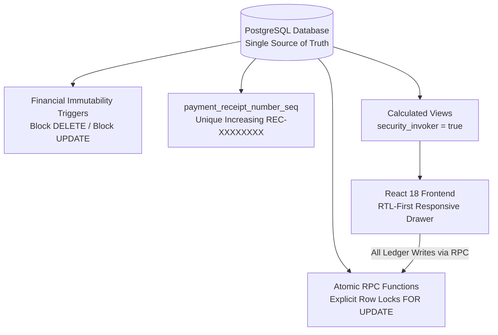

<div dir="rtl" style="text-align: right; direction: rtl; font-family: 'Segoe UI', Tahoma, Arial, sans-serif; line-height: 1.8;">

# 🏛️ أكاديمية المصري — المرجع المعماري والتشغيلي الشامل لنظام إدارة التدريب والمالية (LMS)
## Master Enterprise Architecture, Database Specification & Operating Manual
### Elmasry Academy — Training Management & Financial Ledger Platform (TrainerPro)

> **المؤسسة:** أكاديمية م/ محمد المصري لهندسة النظم والبنية التحتية والشبكات  
> **المشرف العام:** م/ محمد المصري (Eng. Mohamed Elmasry)  
> **كبير مهندسي النظام والمعماري الرئيسي:** م/ أحمد الفلاح (Eng. Ahmed El-Falah — Lead Software Engineer & System Architect)  
> **تاريخ الإصدار والاعتماد:** 21 أكتوبر 2026  
> **حالة الوثيقة:** مرجع معماري وتشغيلي يوثق المعمارية المستهدفة وكود المستودع بدقة. أظهرت نتائج استعلامات التدقيق الميداني المنفذة بتاريخ 21 أكتوبر 2026 مطابقة بنية الجداول الـ 8، وتفعيل `FORCE RLS`، وتفعيل تريجرات الحماية المالية الثلاثة لحركات المقبوضات والمصروفات والتحويلات، وحصر دوال العمليات على فحص الصلاحية الإدارية، وقصر جداول الحركات و`admins` على `SELECT` لدور `authenticated`. وقد تم تطبيق والتحقق ميدانياً بتاريخ 21 أكتوبر 2026 من ميجريشن 008 لتحصين الرصيد الافتتاحي `opening_balance`، حيث أثبتت نتائج الاستعلام الميداني سحب صلاحيات INSERT و DELETE و TRUNCATE وصلاحية UPDATE العامة على مستوى جدول cash_boxes بالكامل لدور authenticated (`table_update = false`)، وقصر الـ UPDATE على الأعمدة التشغيلية الخمسة، وتجميد `opening_balance` و `added_by` و `cash_box_id` و `created_at` على مستوى الـ ACL ومستوى التريجر، وحصر الإنشاء لدور `authenticated` في `create_cash_box` RPC (استناداً إلى نتائج الفحص الميداني المبلغة من جلسة العمل عبر SQL Editor، مع توثيق ترحيل 009 التابع لمعالجة تصفير added_by عند حذف مستخدم auth فقط باعتباره مُبلّغاً عن تشغيله في Supabase SQL Editor على مشروع "TrainerPro"؛ ولم يتم التحقق المستقل من معرف المشروع المختار أو اختباره تشغيلياً).  
> **مستودع المشروع الرسمي على GitHub:** [Ahmed77khaled/elmasry-academy-lms](https://github.com/Ahmed77khaled/elmasry-academy-lms) (الفرع الرئيسي: `main`)  
> **البيئة المعتمدة:** Supabase PostgreSQL 17 + React 18 + TypeScript + Vite 5 + Tailwind CSS.

---

## 📑 فهرس المحتويات الشامل (Table of Contents)

| القسم | عنوان القسم | نطاق التغطية والمخرجات التقنية والتشغيلية |
|---|---|---|
| **01** | **نظرة عامة وهوية المنصة** | الرؤية الهندسية، أهداف الأكاديمية، نطاق العمل (إدارة تدريب ودفتر أستاذ مالي)، والمستخدمون المستهدفون. |
| **02** | **المبادئ الهندسية والمعمارية الصارمة** | مبدأ SSOT لقاعدة البيانات، سجل مالي غير قابل للتعديل أو الحذف، ترقيم إيصالات تسلسلي، وأقفال ذرية. |
| **03** | **المكدس التقني والبنية التحتية** | تفاصيل Frontend (React 18, TS, Vite 5) وBackend (PostgreSQL 17, RLS, PostgREST, Supabase Auth). |
| **04** | **مخطط قاعدة البيانات (8 جداول أساسية)** | التوثيق الكامل لجداول (admins, students, courses, cash_boxes, enrollments, payments, expenses, cash_box_transfers). |
| **05** | **تريجرز منع التعديل والحذف المالي** | توثيق تريجرات الحصانة الأربعة (payments, expenses, cash_box_transfers, cash_boxes) وآلية الإلغاء المالي الموثق. |
| **06** | **محرك المعالجة والفيوهات المعتمدة (Views)** | توثيق حسابات ومعادلات الفيوهات الـ 4 مع security_invoker = true واستبعاد السجلات الملغاة voided_at IS NULL. |
| **07** | **الدوال الذرية والأقفال التزامنية (RPCs)** | تفصيل دوال النظام الـ 9: دالة الفحص is_admin() كحارس مركزي، ودالة create_cash_box، ودوال العمليات الـ 7 المحصنة بفحص الصلاحية وأقفال FOR UPDATE. |
| **08** | **مصفوفة الأمان وسياسات RLS وPostgREST** | سياسات FORCE RLS، حلقة مسح السياسات بميجريشن 007، الصلاحيات المثبتة حياً، وقفل PostgREST. |
| **09** | **الدليل التشغيلي التفصيلي للشاشات** | دليل عملي شامل للـ 9 شاشات، فلاتر المدى الزمني، وتذكير واتساب wa.me، وتصدير إكسيل UTF-8 BOM. |
| **10** | **محرك سندات القبض والإيصالات الرسمية** | رقم الإيصال الرسمي sequence-backed، نافذة الطباعة النظيفة @media print، وتأكيد السندات عبر واتساب. |
| **11** | **البحث الفوري الشامل والقائمة المتجاوبة** | البحث بالاسم ورقم الهاتف ورقم السند REC-XXXXXXXX، وواجهة Obsidian الداكنة المتجاوبة. |
| **12** | **سجل ترحيلات قاعدة البيانات (Migrations)** | توثيق كامل للترحيلات من 001 حتى 006، وميجريشن 007 و 008 المنفذين والمثبتين، وميجريشن 009 المُبلّغ عن تشغيله في SQL Editor. |
| **13** | **الصيانة والنسخ الاحتياطي واستكشاف الأخطاء** | خطوات معالجة الأخطاء المالية، سياسة النسخ الاحتياطي pg_dump، والتعامل مع الفجوات المحاسبية. |
| **14** | **إرشادات النشر والاستضافة السحابية** | إعدادات Vercel / Netlify، متغيرات البيئة، وضوابط أمان مفاتيح API وعزل مفتاح service_role. |

---

## 1. نظرة عامة وهوية المنصة (Platform Overview)

منصة **«أكاديمية المصري — نظام إدارة التدريب والمالية (TrainerPro)»** هي بنية برمجية وسحابية متكاملة شُيدت خصيصاً لإدارة عمليات التدريب التقني الاحترافي في مجالات:
- هندسة النظم والبنية التحتية (System Administration & Infrastructure).
- شبكات المؤسسات وهندسة السيرفرات (Enterprise Networks & Servers).
- حلول الحوسبة السحابية ومراكز البيانات (Cloud Computing & Data Centers).

### 🎯 الأهداف التشغيلية للمنصة:
1. **الرقابة المحاسبية الدقيقة:** تحويل الدورة المالية لأكاديمية المصري إلى دفتر أستاذ رقمي موثق ومقفل يمنع الأخطاء البشرية والتعديل بأثر رجعي.
2. **إدارة دورة حياة المتدرب (End-to-End Trainee Lifecycle):** من التسجيل الأولي، وتخصيص المقاعد، ومتابعة سداد الأقساط عبر إشعارات واتساب الفورية، وحتى إتمام التدريب.
3. **انضباط السعة الاستيعابية للمقاعد (Hard Capacity Enforcement):** منع تسجيل أي متدرب إضافي فوق السعة القصوى للكورس على مستوى محرك قاعدة البيانات مباشرة.
4. **الشفافية الرقابية وإيصالات الدفع الرسمية:** إصدار رقم إيصال متزايد وفريد من قاعدة البيانات (REC-XXXXXXXX) لكل دفعة مسجلة، مع طباعة إيصال رسمي معتمد.

---

## 2. المبادئ الهندسية الصارمة (Core Architectural Principles)



1. **قاعدة البيانات كالمصدر الوحيد للحقيقة (Database-Driven SSOT):**  
   حظر حساب أي أرصدة مالية أو سعة مقاعد أو متبقي أقساط داخل كود الواجهة. الأرصدة المالية الأساسية تُحسب حصرياً داخل PostgreSQL Views مع استبعاد السجلات الملغاة.
2. **سجل مالي ثابت غير قابل للتلاعب (Immutable Financial Ledger):**  
   حظر عمليات الحذف نهائياً (Hard DELETE) أو التعديل المالي. الإلغاء يتم فقط عبر دالة الإلغاء الموثقة مع تسجيل السبب الإلزامي وهوية المدير المنفّذ ووقت الإلغاء.
3. **أرقام سندات متسلسلة تلقائية (Sequential Database Receipts):**  
   توليد `receipt_number` الفريد والمتزايد تلقائياً عبر `payment_receipt_number_seq` بصيغة `REC-00000001` بدون تدخل يدوي.
4. **أقفال تزامنية محكمة وترتيب منع التعارض (Deadlock Prevention):**  
   تقفل دوال التحويل الخزنتين المعنيتين بترتيب تصاعدي محدد لمعرفاتهما (`ORDER BY cash_box_id FOR UPDATE`) لمنع تعارض الأقفال المتزامنة.
5. **قفل المقاعد وضبط السعة الاستيعابية:**  
   تسجيل المتدربين أو إعادة تفعيل الاشتراكات المنسحبة يمر حصرياً عبر دوال تقفل صف الكورس وتفحص المقاعد الشاغرة قبل اعتماد الحركة.
6. **لغة تجربة مستخدم مصرية أصيلة (Human-Centric Microcopy):**  
   اعتماد مصطلحات حية وواضحة لموظفي الأكاديمية والطلاب («خالص السداد»، «سداد جزئي»، «غير مدفوع»، «سداد زيادة») مع تنسيق الأرقام بالجنيه المصري (`ج.م`).

---

## 3. المكدس التقني والبنية التحتية (Tech Stack)

| الطبقة البرمجية | التقنية / الأداة | الدور والوظيفة في المشروع |
|---|---|---|
| **قاعدة البيانات (Database)** | PostgreSQL 17 (Supabase Cloud) | محرك البيانات المركزي، تنفيذ الـ Views، الـ Triggers، والـ Sequences والـ RPCs. |
| **الأمان والمصادقة (Auth & Security)** | Supabase Auth + PostgreSQL RLS | إدارة جلسات المديرين، حظر وصول الـ anon نهائياً، وفرض قيود is_admin() الصارمة. |
| **الواجهة الأمامية (Frontend)** | React 18 + TypeScript + Vite 5 | تطبيق SPA فائق السرعة، خلو كامل من أخطاء الأنواع (Zero Type Errors). |
| **التصميم والواجهات (Styling & Icons)** | Tailwind CSS + Lucide React | تصميم داكن عصري (Dark Slate/Obsidian) مريح للعين، متوافق 100% مع RTL العربي. |
| **محرك التقارير (Reporting Engine)** | Universal CSV Export with UTF-8 BOM | تصدير تقارير محاسبية فورية تدعم اللغة العربية في Microsoft Excel ومحصنة من Formula Injection. |
| **محرك التواصل (Communications)** | WhatsApp Web Integration (wa.me) | روابط تذكير ومتابعة فورية للمتدربين بالأقساط المتبقية وتأكيدات السداد بنقرة واحدة. |

---

## 4. مخطط قاعدة البيانات والجداول الأساسية (8 جداول معتمدة)

### 1. جدول مسؤولي النظام (`admins`):
- `admin_id uuid PRIMARY KEY DEFAULT gen_random_uuid()`
- `auth_user_id uuid NOT NULL UNIQUE REFERENCES auth.users(id) ON DELETE CASCADE`
- `role varchar NOT NULL DEFAULT 'instructor'`
- `created_at timestamptz DEFAULT now()`

### 2. جدول الطلاب والمتدربين (`students`):
- `student_id uuid PRIMARY KEY DEFAULT gen_random_uuid()`
- `name varchar NOT NULL`
- `phone varchar NULLABLE`
- `email varchar NULLABLE`
- `employment_status varchar CHECK (employment_status IN ('Employed', 'Unemployed', 'Student', 'Freelancer'))`
- `grad_status varchar CHECK (grad_status IN ('Graduate', 'Undergrad'))`
- `grad_college varchar NULLABLE`
- `previous_courses text NULLABLE`
- `notes text NULLABLE`
- `created_at timestamptz DEFAULT now()`
- `updated_at timestamptz DEFAULT now()`

### 3. جدول الدورات التدريبية (`courses`):
- `course_id uuid PRIMARY KEY DEFAULT gen_random_uuid()`
- `course_name varchar NOT NULL`
- `description text NULLABLE`
- `level varchar CHECK (level IN ('Beginner', 'Intermediate', 'Advanced'))`
- `duration_weeks integer NULLABLE`
- `prerequisite_courses text NULLABLE` (الاسم المعياري الحقيقي)
- `start_date date NULLABLE`
- `end_date date NULLABLE`
- `max_students integer NULLABLE` (السعة القصوى للمقاعد)
- `default_cost decimal(10,2) NULLABLE CHECK (default_cost >= 0)`
- `availability_status varchar DEFAULT 'Upcoming' CHECK (availability_status IN ('Upcoming', 'Active', 'Closed'))`
- `link_whatsapp text NULLABLE` (جروب واتساب الدفعة)
- `link_tasks text NULLABLE` (منصة تسليم المهام)
- `link_drive text NULLABLE` (جوجل درايف للماتريال)
- `link_sources text NULLABLE` (المصادر والمذكرات)
- `created_at timestamptz DEFAULT now()`
- `updated_at timestamptz DEFAULT now()`

### 4. جدول الخزن وصناديق النقدية (`cash_boxes`):
- `cash_box_id uuid PRIMARY KEY DEFAULT gen_random_uuid()`
- `name varchar NOT NULL`
- `type varchar DEFAULT 'Main'` (كاش، فودافون كاش، إنستاباي، بنك، عهدة)
- `owner varchar NULLABLE`
- `opening_balance decimal(10,2) NOT NULL DEFAULT 0.00` (رصيد افتتاحي يدخل في احتساب رصيد الخزينة الفعلي؛ محصن تريجرياً ضد التعديل اللاحق ومحدد بحد أقصى 99,999,999.99 في دالة create_cash_box لمنع التلاعب المالي المباشر عبر PostgREST).
- `is_active boolean NOT NULL DEFAULT true`
- `notes text NULLABLE`
- `added_by uuid NULLABLE REFERENCES auth.users(id) ON DELETE SET NULL` (مُضاف في ترحيل 008 بدون قيمة افتراضية وبخاصية ON DELETE SET NULL لمنع كسر السجلات عند حذف حساب المستخدم؛ السجلات التاريخية القائمة تظل NULL منعاً للنسبة الخاطئة).
- `created_at timestamptz DEFAULT now()`

> 📌 **توثيق تعارض المخطط التاريخي وأنواع الأعمدة المالية (Schema Divergence & Monetary Types):**  
> 1. **المصدر المعياري للإنتاج (Canonical Production Schema):** المخطط الأصيل المعتمد لبيئة الإنتاج هو `docs/migrations/001_tables.sql` (في مجلد التوثيق العام)؛ ويُعرّف كافة الأعمدة المالية (`courses.default_cost`, `cash_boxes.opening_balance`, `enrollments.agreed_cost`, `payments.amount`, `expenses.amount`, `cash_box_transfers.amount`) بنوع `DECIMAL(10,2)` مع قيود التحقق (`CHECK >= 0` أو `CHECK > 0`).  
> 2. **ترحيلات البداية المؤرشفة بالمستودع (Archived Starter Migrations):** تضمنت مسودات ترحيلات البداية الأولى (`supabase/migrations/001` إلى `004`) محاولات أولية استخدمت نوع `numeric(12,2)` وأسماء قديمة مثل (`id`, `box_type`, `archived`) وافتقرت لجدول `admins`. هذه الملفات مؤرشفة لأسباب تاريخية وتُترك كما هي دون تعديل رجعي، ولا تمثل مخطط الإنتاج الفعلي، حيث بُنيت ترحيلات الإنتاج المعتمدة (من 005 فصاعداً) وتطبيقات الواجهة على المخطط المعياري الأصيل `DECIMAL(10,2)` ومسميات `*_id`.

### 5. جدول الاشتراكات المركزي (`enrollments`):
- `enrollment_id uuid PRIMARY KEY DEFAULT gen_random_uuid()`
- `student_id uuid NOT NULL REFERENCES students(student_id) ON DELETE RESTRICT`
- `course_id uuid NOT NULL REFERENCES courses(course_id) ON DELETE RESTRICT`
- `agreed_cost decimal(10,2) NOT NULL CHECK (agreed_cost >= 0)` (المبلغ المتفق عليه للمتدرب)
- `status varchar DEFAULT 'Active' CHECK (status IN ('Active', 'Completed', 'Dropped'))`
- `enrolled_at timestamptz DEFAULT now()`
- `updated_at timestamptz DEFAULT now()`
- *قيد فريد:* `UNIQUE(student_id, course_id)` يمنع تسجيل الطالب مرتين في نفس الكورس.

### 6. جدول الدفعات والمقبوضات (`payments`):
- `payment_id uuid PRIMARY KEY DEFAULT gen_random_uuid()`
- `receipt_number bigint NOT NULL UNIQUE DEFAULT nextval('payment_receipt_number_seq')`
- `enrollment_id uuid NOT NULL REFERENCES enrollments(enrollment_id) ON DELETE RESTRICT`
- `cash_box_id uuid NOT NULL REFERENCES cash_boxes(cash_box_id) ON DELETE RESTRICT`
- `amount decimal(10,2) NOT NULL CHECK (amount > 0)`
- `payment_date date NOT NULL DEFAULT CURRENT_DATE`
- `method varchar NOT NULL DEFAULT 'Cash'` (الاسم المعياري الحقيقي)
- `receipt_ref varchar NULLABLE` (مرجع التحويل البنكي أو فودافون كاش)
- `notes text NULLABLE`
- `added_by uuid REFERENCES auth.users(id)` (المسؤول الذي سجل الدفعة)
- `voided_at timestamptz NULLABLE` (تاريخ ووقت الإلغاء)
- `voided_by uuid REFERENCES auth.users(id)` (المسؤول الذي ألغى السند)
- `void_reason text NULLABLE` (سبب الإلغاء الإلزامي، لا يقل عن 5 أحرف)
- `created_at timestamptz DEFAULT now()`

### 7. جدول المصروفات التشغيلية (`expenses`):
- `expense_id uuid PRIMARY KEY DEFAULT gen_random_uuid()`
- `cash_box_id uuid NOT NULL REFERENCES cash_boxes(cash_box_id) ON DELETE RESTRICT`
- `course_id uuid NULLABLE REFERENCES courses(course_id) ON DELETE SET NULL`
- `amount decimal(10,2) NOT NULL CHECK (amount > 0)`
- `category varchar DEFAULT 'Other'` (إيجار، مرتبات، بوفيه وأدوات، أجهزة، إعلانات، كهرباء وإنترنت، أخرى)
- `description text NULLABLE`
- `expense_date date NOT NULL DEFAULT CURRENT_DATE`
- `notes text NULLABLE`
- `added_by uuid REFERENCES auth.users(id)` (المسؤول الذي سجل المصروف)
- `voided_at timestamptz NULLABLE` (تاريخ ووقت الإلغاء)
- `voided_by uuid REFERENCES auth.users(id)` (المسؤول الذي ألغى السند)
- `void_reason text NULLABLE` (سبب الإلغاء الإلزامي)
- `created_at timestamptz DEFAULT now()`

### 8. جدول التحويلات بين الخزن (`cash_box_transfers`):
- `transfer_id uuid PRIMARY KEY DEFAULT gen_random_uuid()`
- `from_box_id uuid NOT NULL REFERENCES cash_boxes(cash_box_id) ON DELETE RESTRICT`
- `to_box_id uuid NOT NULL REFERENCES cash_boxes(cash_box_id) ON DELETE RESTRICT`
- `amount decimal(10,2) NOT NULL CHECK (amount > 0)`
- `transfer_date date NOT NULL DEFAULT CURRENT_DATE`
- `added_by uuid REFERENCES auth.users(id)`
- `notes text NULLABLE`
- `created_at timestamptz DEFAULT now()`
- *قيد فحص:* `CHECK (from_box_id <> to_box_id)` يمنع التحويل من الخزينة إلى نفسها.

---

## 5. تريجرز منع التعديل والحذف المالي (Immutability Engine)

تطبيق منظومة التريجرز الإلزامية لمنع التلاعب المالي وإلغاء إمكانيات الحذف العشوائي والتعديل بأثر رجعي:

| اسم الجدول | اسم التريجر (Trigger Name) | الدالة المنفذة (Function) | نطاق وسلوك الحماية الميدانية | الحالة الميدانية |
|---|---|---|---|---|
| `payments` | `trg_payments_financial_immutability` | `prevent_financial_record_mutation()` | حظر الحذف (DELETE) تماماً، حظر تعديل الحقول المالية (UPDATE)، والسماح فقط بالانتقال للإلغاء الموثق مع تسجيل voided_by وسبب لا يقل عن 5 أحرف. | **مثبت بالتدقيق الحي** (21 أكتوبر 2026) |
| `expenses` | `trg_expenses_financial_immutability` | `prevent_financial_record_mutation()` | حظر الحذف (DELETE) تماماً، حظر تعديل بنود المصروف (المبلغ، التاريخ، الخزينة)، والسماح فقط بالإلغاء الموثق. | **مثبت بالتدقيق الحي** (21 أكتوبر 2026) |
| `cash_box_transfers` | `trg_transfers_financial_immutability` | `prevent_transfer_mutation()` | حظر الحذف (DELETE) تماماً، وحظر تعديل أي بيان جوهري للتحويل (المبلغ، خزينة المصدر، خزينة الوجهة، تاريخ التحويل). | **مثبت بالتدقيق الحي** (21 أكتوبر 2026) |
| `cash_boxes` | `trg_cash_boxes_immutability` | `prevent_cash_box_mutation()` | حظر الحذف المباشر (DELETE) وإلزام الأرشفة عبر is_active = false، وحظر أي تعديل على الرصيد الافتتاحي opening_balance وتجميد added_by و cash_box_id و created_at ضد التعديل المباشر (مع الإبلاغ عن تشغيل ترحيل 009 في Supabase SQL Editor على مشروع "TrainerPro" للسماح بتصفير added_by إلى NULL عند حذف حساب المستخدم؛ ولم يتم التحقق المستقل من معرف المشروع المختار أو اختباره تشغيلياً). | **منفذ ومثبت بالتدقيق الميداني** (21 أكتوبر 2026) |

> 🔒 **تحصين الرصيد الافتتاحي للخزن (Cash Box Immutability Hardening — Migration 008):**  
> عولجت ثغرة تعديل الرصيد الافتتاحي عبر ميجريشن 008 المطبقة والمثبتة بنتائج التدقيق الميداني بتاريخ 21 أكتوبر 2026. يضيف الترحيل تريجر `trg_cash_boxes_immutability`، ويسحب صلاحيات `INSERT` و `DELETE` و `TRUNCATE` وصلاحية `UPDATE` العامة على مستوى جدول `cash_boxes` من `authenticated`، مع قصر الـ UPDATE على الأعمدة التشغيلية الخمسة (`name`, `type`, `owner`, `is_active`, `notes`)، وتجميد `opening_balance` و `added_by` و `cash_box_id` و `created_at` على مستوى الـ ACL ومستوى التريجر، وحصر الإنشاء لدور `authenticated` حصراً في دالة `create_cash_box` RPC. أثبتت نتائج فحص الصلاحيات الميداني عبر SQL Editor مطابقة هذه القيود بالكامل (`table_update = false`).  
> ⚠️ **تنويه حول عمود المنشئ (added_by) وميجريشن 009:**  
> تحت ميجريشن 008، تم تجميد `added_by` ضد أي تعديل. ونظراً لأن عمود `added_by` يعتمد قيد المفتاح الأجنبي `ON DELETE SET NULL` مع جدول `auth.users`، فقد أُعد ترحيل تصحيحي تابع (ميجريشن 009: `20261021171218_allow_cash_box_creator_nullification_on_auth_delete.sql`) يسمح حصراً بانتقال القيمة من UUID قائم إلى `NULL` عند حذف حساب المستخدم، مع استمرار حظر تغيير المنشئ إلى أي حساب آخر وتجميد الرصيد الافتتاحي. وقد أُبلغ فقط عن تشغيل هذا الترحيل في Supabase SQL Editor على مشروع "TrainerPro"؛ ولم يتم التحقق المستقل من معرف المشروع المختار أو اختباره تشغيلياً.

---

## 6. محرك المعالجة والفيوهات المعتمدة (PostgreSQL Views)

كافة العمليات الحسابية للأرصدة والموازين تتم لحظياً داخل قاعدة البيانات مع تفعيل `security_invoker = true` واستبعاد السجلات الملغاة:

### 1. فيو أرصدة الاشتراكات (`enrollment_balances`):
```sql
CREATE OR REPLACE VIEW public.enrollment_balances
WITH (security_invoker = true) AS
SELECT
  e.enrollment_id, e.student_id, s.name AS student_name, e.course_id, c.course_name,
  e.agreed_cost, e.status AS enrollment_status, e.enrolled_at,
  COALESCE(p_totals.total_paid, 0::numeric) AS total_paid,
  e.agreed_cost - COALESCE(p_totals.total_paid, 0::numeric) AS remaining_balance,
  CASE
    WHEN (e.agreed_cost - COALESCE(p_totals.total_paid, 0::numeric)) = 0 AND COALESCE(p_totals.total_paid, 0::numeric) > 0 THEN 'Paid'
    WHEN (e.agreed_cost - COALESCE(p_totals.total_paid, 0::numeric)) < 0 THEN 'Overpaid'
    WHEN COALESCE(p_totals.total_paid, 0::numeric) = 0 THEN 'Unpaid'
    ELSE 'Partial'
  END AS payment_status
FROM public.enrollments AS e
JOIN public.students AS s ON s.student_id = e.student_id
JOIN public.courses AS c ON c.course_id = e.course_id
LEFT JOIN (
  SELECT enrollment_id, sum(amount) AS total_paid
  FROM public.payments
  WHERE voided_at IS NULL
  GROUP BY enrollment_id
) AS p_totals ON p_totals.enrollment_id = e.enrollment_id;
```

### 2. فيو أرصدة الخزن وصناديق المال (`cash_box_balances`):
يحسب الرصيد الفعلي المتوفر في كل خزينة بالمعادلة المحاسبية الدقيقة:
$$	ext{الرصيد الفعلي} = 	ext{الرصيد الافتتاحي} + 	ext{المقبوضات المعتمدة} + 	ext{التحويلات الواردة} - 	ext{المصروفات المعتمدة} - 	ext{التحويلات الصادرة}$$

### 3. فيو الملخص المالي للكورسات (`course_financial_summary`):
يعرض أداء كل كورس: عدد المقاعد المشغولة والشاغرة، الإيراد المتوقع، الإيراد الفعلي المحصل، مصروفات الكورس، وصافي الربح المحصل.

### 4. فيو مؤشرات الداشبورد التنفيذية (`dashboard_metrics`):
يوفر ملخصاً فورياً لحظياً للأكاديمية: إجمالي الطلاب، الطلاب الجدد هذا الشهر، الكورسات النشطة، إيرادات ومصروفات وأرباح الشهر الحالي، وإجمالي الأرباح التاريخية، وإجمالي متبقي الأقساط المطلوبة تحصيلها.

---

## 7. الدوال الذرية والأقفال التزامنية (Audited RPCs)

تعتمد المنصة على 9 دوال مركزية في قاعدة البيانات بعد تطبيق ميجريشن 008 (دالة الفحص الإداري is_admin، ودالة إنشاء الخزن create_cash_box، و7 دوال للعمليات المالية والاشتراكات)، مع تمييز معماري دقيق وصارم بين الأنواع:
1. **دالة الفحص والتحقق (`is_admin()`):** هي الفاحص المركزي المستقل (Gatekeeper Predicate Function)؛ تقرأ عضوية المستخدم في جدول `admins` عبر شرط `auth_user_id = auth.uid()`. هي دالة قراءة بحتة لا تستدعي نفسها ولا تأخذ أقفالاً (`FOR UPDATE`).
2. **دوال العمليات التنفيذية السبع (7 Operational Functions):** تستدعي إجبارياً في سطرها الأول فاحص الصلاحية (`IF NOT public.is_admin() THEN RAISE EXCEPTION ...`)، وتطبق الدوال المغيرة للمقاعد والأرصدة أقفال التزامن الذرية `FOR UPDATE` لمنع سباق البيانات.
3. **دالة إنشاء الخزن النقدية المحصنة (`create_cash_box`):** دالة مستقلة لإنشاء الخزن تحت حراسة `is_admin()` مع توثيق هوية المنشئ وتثبيت الرصيد الافتتاحي ومنع التلاعب به.

| اسم الدالة (RPC) | نوع ودور الدالة | المدخلات والبارامترات | الحماية والتحقق الداخلي وسجل التدقيق |
|---|---|---|---|
| `is_admin` | فاحص مركزي (Gatekeeper) | `is_admin()` | الفاحص المستقل؛ تفحص العضوية في `admins` عبر `auth_user_id = auth.uid()` دون استدعاء داخلي ودون أقفال. |
| `enroll_student` | عملية تسجيل متدرب | `(p_student_id, p_course_id, p_agreed_cost, p_status)` | تستدعي `is_admin()`، تقفل صف الكورس `FOR UPDATE` لمنع تجاوز المقاعد. **(لا تسجل معرف `auth.uid()`)**. |
| `set_enrollment_status` | عملية تعديل حالة اشتراك | `(p_enrollment_id, p_status)` | تستدعي `is_admin()`، تقفل صف الكورس والاشتراك `FOR UPDATE` لمنع تجاوز السعة. **(لا تسجل معرف `auth.uid()`)**. |
| `record_payment` | حركة مالية (تسجيل دفعة) | `(p_enrollment_id, p_cash_box_id, p_amount, p_payment_date, p_method, p_receipt_ref, p_notes)` | تستدعي `is_admin()`، تقفل الخزينة والاشتراك `FOR UPDATE`، تحسب المتبقي، وتسجل `added_by = auth.uid()`. |
| `record_expense` | حركة مالية (تسجيل مصروف) | `(p_cash_box_id, p_amount, p_expense_date, p_category, p_description, p_notes, p_course_id)` | تستدعي `is_admin()`، تقفل الخزينة `FOR UPDATE`، وتدرج المصروف مع تسجيل `added_by = auth.uid()`. |
| `transfer_between_boxes` | حركة مالية (تحويل خزن) | `(p_from_box_id, p_to_box_id, p_amount, p_transfer_date, p_notes)` | تستدعي `is_admin()`، تقفل الخزنتين تصاعدياً `FOR UPDATE` لتفادي Deadlock، وتسجل `added_by = auth.uid()`. |
| `void_payment` | عملية إلغاء سند قبض | `(p_payment_id, p_void_reason)` | تستدعي `is_admin()`، تشترط سبباً لا يقل عن 5 أحرف، وتسجل توقيت الإلغاء `voided_at` وهوية المسؤول `voided_by = auth.uid()`. |
| `void_expense` | عملية إلغاء مصروف | `(p_expense_id, p_void_reason)` | تستدعي `is_admin()`، تشترط سبباً لا يقل عن 5 أحرف، وتسجل توقيت الإلغاء `voided_at` وهوية المسؤول `voided_by = auth.uid()`. |
| `create_cash_box` | إنشاء خزنة موثقة | `(p_name, p_type, p_owner, p_opening_balance, p_notes)` | تستدعي `is_admin()`، تفحص عدم سلبية الرصيد، وتدرج الخزنة مع توثيق هوية المنشئ `added_by = auth.uid()`. **(منفذة ومثبتة في ميجريشن 008)**. |

> 📌 **تصحيح هندسي دقيق لسجل التدقيق وهوية المنفذين:**  
> تُظهر نتائج فحص أجسام دوال قاعدة البيانات الحية أن تسجيل هوية المسؤول المنفذ عبر `auth.uid()` مطبق حصرياً على العمليات المالية المباشرة (سندات القبض، المصروفات، تحويلات الخزن، والإلغاء المالي) لوجود أعمدة `added_by` و `voided_by` في تلك الجداول.  
> في المقابل، دوال إدارة الاشتراكات (`enroll_student` و `set_enrollment_status`) تفحص صلاحية المسؤول فقط عبر استدعاء `is_admin()`، **ولا تكتب معرف `auth.uid()` في جدول `enrollments`**، وبالتالي لا يوجد توثيق لهوية المنفذ لكل عملية تسجيل أو تغيير حالة اشتراك في بنية الجدول الحالية.

---

## 8. مصفوفة الأمان وسياسات RLS وPostgREST

### 1. الفصل المعماري بين حارس الواجهة وحدود أمان قاعدة البيانات (UX Guard vs Security Boundary):
- **حارس الواجهة الأمامية (`isAdmin` في `App.tsx` و `AuthContext.tsx`):**  
  هو مجرد حارس لتجربة الاستخدام (UX Guard)؛ وظيفته حجب أزرار التحكم والشاشات وتوجيه أي مستخدم عادي أو غير مصادق لرسالة عدم التصريح وإجباره على تسجيل الخروج.  
  > ⚠️ **تنبيه معماري حاسم:** حارس الواجهة لا يُعتبر حداً أمنياً (Not a Security Boundary)؛ لأن أي مستخدم يستطيع استخراج مفتاح `anon` واستدعاء واجهة PostgREST مباشرة عبر أدوات مثل cURL أو Postman أو دوال المتصفح.

- **الحد الأمني الحقيقي والوحيد (The True Security Boundary):**  
  يقع حصرياً داخل محرك PostgreSQL عبر تفعيل سياسات `FORCE ROW LEVEL SECURITY` الصارمة، وحراسة دوال المعالجة المالية `SECURITY DEFINER` بفحص العضوية الصريح `public.is_admin()`.

### 2. معضلة السياسات التراكمية في PostgreSQL وحلقة المسح الشاملة (RLS Dynamic Purge):
- **المعضلة الهندسية:** في PostgreSQL، تُجمع السياسات المسموحة (Permissive Policies) دائماً بمنطق `OR`.  
  إذا وُجدت أي سياسة قديمة متوارثة من ترحيلات سابقة (مثل `anon_select_students` أو `anon_insert_students` من ميجريشن 001، أو `Allow authenticated read`)، فإن هذه السياسة الواسعة **تبطل تماماً وتلغي أثر** سياسة حصر البيانات على المديرين (`admins_admin_only_policy`).
- **الحل الجذري المعتمد في ترحيل 007 التصحيحي المستقل (`202610210007_purge_legacy_rls_and_revoke_public.sql`):**  
  تم إعداد هذا الترحيل المستقل لتنفيذ حلقة مسح ديناميكية حاسمة (Dynamic PL/pgSQL Purge Loop) تستعلم من جدول النظام `pg_policies` وتحذف كل السياسات السابقة بدون استثناء على الجداول الـ 8 الأساسية لضمان عدم تراكم السياسات المكررة أو المتساهلة مع السياسات الجديدة:
```sql
DO $$
DECLARE r RECORD;
BEGIN
  FOR r IN (
    SELECT schemaname, tablename, policyname
    FROM pg_policies
    WHERE schemaname = 'public'
      AND tablename IN ('admins', 'students', 'courses', 'cash_boxes', 'enrollments', 'payments', 'expenses', 'cash_box_transfers')
  ) LOOP
    EXECUTE format('DROP POLICY IF EXISTS %I ON %I.%I', r.policyname, r.schemaname, r.tablename);
  END LOOP;
END $$;
```

#### جدول السياسات الثمانية الحصرية المثبتة بالتدقيق الحي بعد تنفيذ ميجريشن 007:
أثبتت نتائج الفحص الحي اختفاء كافة السياسات القديمة والمكررة تماماً، وبقاء سياسة واحدة معيارية ومحكمة لكل جدول من الجداول الثمانية:

| اسم الجدول (Table) | اسم السياسة المعتمدة (Policy Name) | نوع الأمر (Command) | الدور المستهدف (Role) | شرط الحماية (Using Expression) |
|---|---|---|---|---|
| `admins` | `admins_admin_only_policy` | `SELECT` | `{authenticated}` | `((auth_user_id = auth.uid()) OR is_admin())` |
| `cash_box_transfers` | `transfers_admin_only_policy` | `SELECT` | `{authenticated}` | `is_admin()` |
| `cash_boxes` | `cash_boxes_admin_only_policy` | `ALL` | `{authenticated}` | `is_admin()` |
| `courses` | `courses_admin_only_policy` | `ALL` | `{authenticated}` | `is_admin()` |
| `enrollments` | `enrollments_admin_only_policy` | `SELECT` | `{authenticated}` | `is_admin()` |
| `expenses` | `expenses_admin_only_policy` | `SELECT` | `{authenticated}` | `is_admin()` |
| `payments` | `payments_admin_only_policy` | `SELECT` | `{authenticated}` | `is_admin()` |
| `students` | `students_admin_only_policy` | `ALL` | `{authenticated}` | `is_admin()` |

> 📌 **تدقيق شرط سياسة المسؤولين (`admins_admin_only_policy`):**  
> الشرط المطبق `((auth_user_id = auth.uid()) OR is_admin())` يتيح لأي مستخدم مصادق قراءة صفه الشخصي للتحقق من هويته ورتبته، وفي نفس الوقت يتيح للمسؤولين قراءة سجلات كافة المسؤولين في النظام، مع سحب كامل لصلاحيات التعديل أو الحذف أو الإضافة المباشرة.

### 3. مصفوفة صلاحيات الجداول وضوابط PostgREST المثبتة حياً بالتدقيق:
أظهرت نتائج استعلامات التدقيق الميداني المنفذة بتاريخ 21 أكتوبر 2026 تطبيق مصفوفة الصلاحيات لدور `authenticated`:

| اسم الجدول (Table) | الدور الممنوح (Grantee) | الصلاحيات المثبتة حياً (Privileges) | الحالة المعمارية والرقابية |
|---|---|---|---|
| `admins` | `authenticated` | `SELECT` فقط | تتيح قراءة السجل الشخصي أو قائمة المسؤولين، ومحظور تماماً من INSERT / UPDATE / DELETE عبر PostgREST لمنع تلاعب المسؤولين بحسابات بعضهم. |
| `cash_box_transfers` | `authenticated` | `SELECT` فقط | محظور من INSERT / UPDATE / DELETE؛ كافة التحويلات تمر حصرياً عبر دالة `transfer_between_boxes`. |
| `enrollments` | `authenticated` | `SELECT` فقط | محظور من INSERT / UPDATE / DELETE؛ التسجيل وتغيير الحالة يمران عبر `enroll_student` و `set_enrollment_status`. |
| `payments` | `authenticated` | `SELECT` فقط | محظور من INSERT / UPDATE / DELETE؛ القبض والإلغاء يمران عبر `record_payment` و `void_payment`. |
| `expenses` | `authenticated` | `SELECT` فقط | محظور من INSERT / UPDATE / DELETE؛ الصرف والإلغاء يمران عبر `record_expense` و `void_expense`. |
| `students` | `authenticated` | `SELECT, INSERT, UPDATE, DELETE` | مسموح بإدارة الطلاب والمتدربين من الواجهة تحت حراسة شرط `is_admin()`. |
| `courses` | `authenticated` | `SELECT, INSERT, UPDATE, DELETE` | مسموح بإدارة الكورسات وبياناتها ومواعيدها من الواجهة تحت حراسة شرط `is_admin()`. |
| `cash_boxes` | `authenticated` | `SELECT` (جدول) + `UPDATE` (أعمدة تشغيلية محددة) | مسموح بقراءة الخزن وتعديل الأعمدة التشغيلية فقط (`name`, `type`, `owner`, `is_active`, `notes`). محظور تماماً من `INSERT` و `DELETE` و `TRUNCATE` ومحظور من تعديل `opening_balance` و `added_by` و `cash_box_id` و `created_at`. الإنشاء محصور في `create_cash_box` والأرشفة عبر `is_active = false`. (مثبت بنتائج التدقيق الميداني لميجريشن 008). |

> 🔒 **تجريد الأدوار العامة (`anon` و `PUBLIC`):**  
> كافة الصلاحيات (`ALL PRIVILEGES`) مسحوبة ومجردة بالكامل من دور `anon` ودور `PUBLIC` على الجداول الثمانية، ولا يملك أي منهما حق قراءة أو كتابة أي صف.

### 4. تحصين ملفات التقارير وإكسيل من هجمات الحقن (CSV Formula Injection Protection):
- في ملف `src/lib/exportExcel.ts`، يتم فحص كل حقل نصي قبل التصدير.
- إذا كانت القيمة النصية تبدأ بأي رمز من الرموز الحسابية أو التشغيلية الخطرة (`=`, `+`, `-`, `@`, `\t`, `\r`)، يتم حقن علامة اقتباس مفردة `'` كبادئة للخلية لإلغاء تفسيرها كمعادلة تنفيذية داخل برامج Excel وتثبيتها كنص نقي آمن.

### 5. التدقيق الهندسي لخاصية حماية كلمات المرور (Leaked Password Protection):
- **تسعير وباقات Supabase:** فحص كلمات المرور المسربة عبر تكامل API الرسمي مع HaveIBeenPwned.org متاح حصرياً في باقات Supabase المدفوعة (Pro Plans وما فوق) ولا يتوفر في الباقة المجانية (Free Tier).
- **الحدود الأمنية لإيقاف التسجيل العام:** إيقاف التسجيل العام (Disable Public Signups) واقتصار التسجيل على الحسابات المنشأة يدوياً يمنع تسجيل المتسللين، ولكنه **لا يحمي** حسابات المديرين الحالية إذا اختار أحد المديرين كلمة مرور ضعيفة أو متسربة في اختراقات سابقة.
- **التوصية التشغيلية:** تفعيل فحص كلمات المرور فور ترقية المشروع إلى باقة Pro، والالتزام بسياسة تعقيد صارمة لحسابات المديرين حالياً.

### 6. مصفوفة التحقق الجنائي التاريخية لما بعد تطبيق 007 (Historical Audit Snapshot — Pre-008):
> ⏱️ **لقطة تاريخية توثيقية (Historical Audit Snapshot):**  
> تمثل المصفوفة الواردة في هذا البند والمخرجات الخام في البند 7 أدناه لقطة فحص تاريخية أُجريت فور تطبيق ميجريشن 007 (صباح 21 أكتوبر 2026) وقبل إعداد وتطبيق ميجريشن 008. تُظهر هذه اللقطة الحالة التاريخية السابقة لقاعدة البيانات، بما فيها منح صلاحيات CRUD لجدول `cash_boxes`، وهي الثغرة الرقابية التي استدعت لاحقاً إعداد وتطبيق ميجريشن 008 لعزل الصلاحيات وحظر تعديل الرصيد الافتتاحي. الصلاحيات الحالية المعتمدة بعد ميجريشن 008 موثقة في «مصفوفة صلاحيات الجداول وضوابط PostgREST» (البند 3 من هذا القسم).

أثبتت نتائج الفحص الجنائي التاريخي المنفذة يدوياً عبر نافذة SQL Editor في Supabase بعد تطبيق ميجريشن 007 (وقبل ميجريشن 008) ما يلي:
1. **الجداول الأساسية (8 من أصل 8):** مفعل عليها `rls_enabled = true` و `force_rls_enabled = true` بنسبة 100%.
2. **صلاحيات الجداول لدور `authenticated` (لقطة تاريخية بعد 007 وقبل 008):** كانت الصلاحيات حينها مقصورة بدقة على `SELECT` لخمسة جداول (`admins` وجداول الحركات الأربعة)، وتتيح CRUD كامل لجدولي `students` و `courses`، بينما كان جدول `cash_boxes` يُتيح CRUD كاملاً آنذاك، قبل أن تُقيّد صلاحيات الكتابة فيه بموجب ميجريشن 008 التي سحبت منه صلاحيات INSERT و DELETE وصلاحية UPDATE العامة (مع سحب TRUNCATE احتياطياً) مع الإبقاء على SELECT للقراءة، وقيدت التحديث على خمسة أعمدة تشغيلية فقط.
3. **التريجرات الثلاثة لمنع التلاعب المالي (قبل إضافة تريجر الخزن في 008):** مفعلة وشغالة بنسبة 100% (`payments`, `expenses`, `cash_box_transfers`).
4. **سياسات الأمان RLS الموجهة للمديرين في تلك اللقطة:** كانت موجهة حصرياً إلى `{authenticated}` وتلزم شرط `is_admin()`.
5. **الدوال المعالجة (8 دوال):**
   - كافة الدوال تعمل بـ `is_security_definer = true` وتضبط مسار البحث الآمن `search_path = pg_catalog, public`.
   - مالك الدوال هو `postgres` مع `owner_bypasses_rls = true` مما يمكنها من تجاوز حلقة التكرار تحت مظلة `FORCE RLS`.
   - **التمييز الدقيق بين الفاحص والعمليات:** دالة `is_admin()` هي الفاحص المستقل (Gatekeeper) الذي يتحقق من جدول `admins` دون استدعاء نفسها ودون أقفال؛ بينما دوال العمليات السبع تستدعي فاحص الصلاحية إجبارياً في بداية جسم الدالة لمنع أي استدعاء غير مصرح به. (نتيجة البحث النصي `%is_admin%` في سكريبت التدقيق أعطت دالة is_admin قيمة true إيجابية كاذبة لأن اسمها مطابق داخل ترويسة تعريفها).
   - دوال العمليات المغيرة للأرصدة والمقاعد تطبق أقفال التزامن الذرية `FOR UPDATE` لمنع سباق البيانات (Race Conditions).
   - تسجيل هوية المسؤول المنفذ `auth.uid()` محصور في العمليات المالية الـ 5 المباشرة (`record_payment`, `record_expense`, `transfer_between_boxes`, `void_payment`, `void_expense`). في المقابل، دوال الاشتراكات (`enroll_student` و `set_enrollment_status`) تفحص `is_admin()` فقط ولا تكتب `auth.uid()`.
6. **جدول تتبع الترحيلات:** تم التأكد من عدم وجود جدول التتبع الآلي لـ Supabase CLI (`MANUAL_SQL_EDITOR_WORKFLOW`)، والتحقق مثبت جنائياً بنتائج الاستعلامات المباشرة.

### 7. سجل مخرجات التدقيق الميداني الخام (لقطة تاريخية بعد 007 وقبل 008):
توثيقاً للمسار التاريخي لتطور النظام، ندرج أدناه الجداول الخام المستخرجة مباشرة من نافذة Supabase SQL Editor بعد تشغيل ميجريشن 007 وقبل تشغيل ميجريشن 008 (تاريخ الفحص التاريخي: صباح 21 أكتوبر 2026):

#### 1) مخرجات فحص سياسات الأمان RLS (التأكد من تنظيف كافة السياسات القديمة والمكررة):
```text
| tablename          | policyname                    | cmd    | roles           | using_condition                             |
| ------------------ | ----------------------------- | ------ | --------------- | ------------------------------------------- |
| admins             | admins_admin_only_policy      | SELECT | {authenticated} | ((auth_user_id = auth.uid()) OR is_admin()) |
| cash_box_transfers | transfers_admin_only_policy   | SELECT | {authenticated} | is_admin()                                  |
| cash_boxes         | cash_boxes_admin_only_policy  | ALL    | {authenticated} | is_admin()                                  |
| courses            | courses_admin_only_policy     | ALL    | {authenticated} | is_admin()                                  |
| enrollments        | enrollments_admin_only_policy | SELECT | {authenticated} | is_admin()                                  |
| expenses           | expenses_admin_only_policy    | SELECT | {authenticated} | is_admin()                                  |
| payments           | payments_admin_only_policy    | SELECT | {authenticated} | is_admin()                                  |
| students           | students_admin_only_policy    | ALL    | {authenticated} | is_admin()                                  |
```

#### 2) مخرجات فحص صلاحيات الجداول لدور `authenticated` (لقطة تاريخية بعد 007 توضح منح CRUD السابق لجدول cash_boxes قبل تقييده في 008):
```text
| table_name         | grantee       | privilege_type |
| ------------------ | ------------- | -------------- |
| admins             | authenticated | SELECT         |
| cash_box_transfers | authenticated | SELECT         |
| cash_boxes         | authenticated | DELETE         |
| cash_boxes         | authenticated | INSERT         |
| cash_boxes         | authenticated | SELECT         |
| cash_boxes         | authenticated | UPDATE         |
| courses            | authenticated | DELETE         |
| courses            | authenticated | INSERT         |
| courses            | authenticated | SELECT         |
| courses            | authenticated | UPDATE         |
| enrollments        | authenticated | SELECT         |
| expenses           | authenticated | SELECT         |
| payments           | authenticated | SELECT         |
| students           | authenticated | DELETE         |
| students           | authenticated | INSERT         |
| students           | authenticated | SELECT         |
| students           | authenticated | UPDATE         |
```

> 📌 **ملاحظة رقابية حول لقطة الصلاحيات التاريخية أعلاه:**  
> يُلاحظ في الجدول التاريخي أعلاه ظهور أربعة صفوف لجدول `cash_boxes` تمنح (`DELETE`, `INSERT`, `SELECT`, `UPDATE`). تم تقييد هذا الوضع التاريخي بموجب ميجريشن 008؛ حيث سُحبت صلاحيات `DELETE` و `INSERT` وصلاحية `UPDATE` العامة على الجدول (مع سحب `TRUNCATE` احتياطياً) مع الإبقاء على `SELECT` للقراءة، وقُيد التحديث حصراً على 5 أعمدة تشغيلية مع تجميد `opening_balance` و `added_by` و `cash_box_id` و `created_at`، كما هو موثق في مصفوفة الصلاحيات المعتمدة (البند 3 من هذا القسم) وسجل ترحيل 008.

#### 3) مخرجات فحص تريجرات الحماية المالية الثلاثة بعد 007 (قبل إضافة تريجر حماية الخزن في 008):
```text
| table_name         | trigger_name                         | trigger_definition                                                                                                                                                 |
| ------------------ | ------------------------------------ | ------------------------------------------------------------------------------------------------------------------------------------------------------------------ |
| cash_box_transfers | trg_transfers_financial_immutability | CREATE TRIGGER trg_transfers_financial_immutability BEFORE DELETE OR UPDATE ON public.cash_box_transfers FOR EACH ROW EXECUTE FUNCTION prevent_transfer_mutation() |
| expenses           | trg_expenses_financial_immutability  | CREATE TRIGGER trg_expenses_financial_immutability BEFORE DELETE OR UPDATE ON public.expenses FOR EACH ROW EXECUTE FUNCTION prevent_financial_record_mutation()    |
| payments           | trg_payments_financial_immutability  | CREATE TRIGGER trg_payments_financial_immutability BEFORE DELETE OR UPDATE ON public.payments FOR EACH ROW EXECUTE FUNCTION prevent_financial_record_mutation()    |
```

#### 4) مخرجات فحص صلاحيات تنفيذ الدوال الـ 8 بعد 007 (قبل إضافة دالة create_cash_box في 008):
```text
| routine_name           | grantee       | privilege_type |
| ---------------------- | ------------- | -------------- |
| enroll_student         | authenticated | EXECUTE        |
| is_admin               | authenticated | EXECUTE        |
| record_expense         | authenticated | EXECUTE        |
| record_payment         | authenticated | EXECUTE        |
| set_enrollment_status  | authenticated | EXECUTE        |
| transfer_between_boxes | authenticated | EXECUTE        |
| void_expense           | authenticated | EXECUTE        |
| void_payment           | authenticated | EXECUTE        |
```

---

## 9. الدليل التشغيلي التفصيلي للشاشات والميزات الجديدة

### 1. لوحة المؤشرات المركزية (Dashboard):
- مؤشرات لحظية للمقبوضات، المصروفات، صافي الأرباح، والطلاب الجدد.
- حسابات فورية مبنية على فيو `dashboard_metrics` بدون أي عمليات حسابية في JavaScript.

### 2. إدارة المقبوضات والدفعات (Payments):
- **فلتر المدى الزمني:** فلاتر جاهزة (اليوم / هذا الأسبوع / هذا الشهر / كل الفترات / فترة مخصصة من وإلى تاريخ).
- **تصدير إكسيل:** تصدير كافة الدفعات المعروضة لملف إكسيل CSV بترميز UTF-8 BOM داعم للعربية.
- **تأكيد السند عبر واتساب:** أيقونة خضراء بجوار اسم المتدرب تفتح محادثة واتساب فورية بنص تأكيد استلام السند ورقم الإيصال.
- **شريط الملخص المالي:** عرض عدد السندات المعروضة وإجمالي المقبوضات المعتمدة لحظياً.

### 3. إدارة المصروفات التشغيلية (Expenses):
- فلاتر المدى الزمني والتصنيفات والبحث بالوصف والخزينة.
- تصدير إكسيل بترميز UTF-8 BOM وتأمين المعادلات.
- شريط الملخص المالي يعرض إجمالي المصروفات المعتمدة باللون الأحمر المميز.
- زر الإلغاء الموثق يطلب سبباً إلزامياً لا يقل عن 5 أحرف.

### 4. جدول الاشتراكات المركزي (Enrollments):
- عرض المتفق عليه والمدفوع والمتبقي وحالة السداد لكل متدرب.
- **زر تذكير واتساب الفوري:** زر مخصص بجوار أي متدرب عليه متبقي مالي، يفتح رسالة واتساب مصاغة بأدب واحترافية لتذكيره بمتبقي القسط واسم الكورس.
- تصدير كشف الاشتراكات والأرصدة لملف إكسيل بضغطة زر.

### 5. إدارة الطلاب ودليل المتدربين (Students):
- دليل شامل بكل المتدربين، مع إمكانية فتح محادثة واتساب مباشرة بنقرة واحدة بجوار رقم هاتف الطالب.
- تصدير بيانات الطلاب كاملة إلى إكسيل.

### 6. تفاصيل الدورة التدريبية (Course Details):
- بطاقة الكورس مع مؤشرات المقاعد الشاغرة ونسبة الامتلاء.
- الروابط التعليمية الأربعة (واتساب، المهام، درايف، المصادر).
- جدول طلاب الكورس مع زر تصدير إكسيل مخصص للدفعة، وأزرار تذكير واتساب الفورية للمتأخرين عن السداد.

---

## 10. محرك سندات القبض والإيصالات الرسمية (Receipts Engine)

* **رقم السند التسلسلي:** يتولد تلقائياً من الـ Sequence بصيغة `REC-00000001`.
* **المرجع الخارجي (`receipt_ref`):** مخصص لرقم معاملة فودافون كاش أو إنستاباي أو إيداع البنك.
* **نافذة الطباعة الرسمية:** نافذة مصممة بتنسيق مالي أنيق وتدعم `@media print` لطباعة السند في منتصف الصفحة بحجم A4/A5، مع تذييل رسمي باسم م/ أحمد الفلاح المشرف على النظام.

---

## 11. نظام البحث الفوري والقائمة المتجاوبة (UI/UX)

- البحث العام الموحد يدعم: اسم الطالب، رقم الهاتف، اسم الكورس، ورقم السند (سواء بصيغة `REC-00000001` أو كرقم مجرد).
- واجهة مستخدم Obsidian متجاوبة بالكامل تدعم مختلف مقاسات الشاشات والهواتف الذكية.
- قائمة جانبية قابلة للطي لراحة عين المستخدم وسرعة التنقل بين الوحدات.

---

## 12. سجل ترحيلات قاعدة البيانات المعتمدة (Migrations Log)

| رقم الترحيل | اسم الملف في المستودع | الحالة والتوثيق | التغييرات ونطاق المعالجة |
|---|---|---|---|
| `001` | `20261015024100_001_create_core_tables.sql` | مؤرشف (تأسيسي محلي قديم) | إنشاء الجداول الأساسية المبدئية بنظام المعرفات `id` وسياسات anon تجريبية. |
| `002` | `20261015024134_002_create_database_views.sql` | مؤرشف (قديم) | فيوهات محاسبية مبدئية تعتمد على عمود `voided` القديم. |
| `003` | `20261015024155_003_create_rpc_functions.sql` | مؤرشف (قديم) | دوال RPC مبدئية بدون حراسة إدارية داخلية. |
| `004` | `20261015024209_004_fix_constraint_and_seed.sql` | مؤرشف (قديم) | قيود وبيانات تجريبية أولية. |
| `005` | `202610210005_production_hardening.sql` | **موثق في المستودع** (مخطط الإنتاج `*_id`) | ترقيم إيصالات تسلسلي Sequence، تريجرز منع الحذف والتعديل، وأقفال التحويل الذرية. يتطلب إثبات الحالة الحية عبر سكريبت التدقيق. |
| `006` | `202610210006_security_and_authorization_hardening.sql` | **موثق في المستودع** (أكتوبر 2026) | حراسة `is_admin` لدوال التحصيل والمصروفات، وتسجيل `added_by = auth.uid()`، وتوحيد الأرصدة على `voided_at IS NULL`. |
| `007` | `202610210007_purge_legacy_rls_and_revoke_public.sql` | **منفذ يدوياً ومثبت بنتائج التدقيق الحي** (21 أكتوبر 2026) | ترحيل تصحيحي مستقل نُفذ عبر SQL Editor؛ طبق بنجاح حلقة المسح الديناميكية لإزالة السياسات المكررة، وقصر صلاحيات authenticated على SELECT فقط لجدول admins وجداول الحركات الأربعة، وحصر صلاحيات INSERT/UPDATE/DELETE على students وcourses وcash_boxes، وتفعيل تريجر trg_transfers_financial_immutability. أثبتت نتائج الفحص الحي مطابقة الصلاحيات والتريجرات. |
| `008` | `202610210008_protect_cash_boxes_opening_balance.sql` | **منفذ ومثبت بنتائج التدقيق الميداني على قاعدة الإنتاج** (21 أكتوبر 2026) | ترحيل تصحيحي نُفذ بنجاح عبر SQL Editor؛ طبق سحب صلاحيات INSERT و DELETE و TRUNCATE وصلاحية UPDATE العامة على مستوى جدول cash_boxes بالكامل من authenticated (`table_update = false`)، وقصر الـ UPDATE على الأعمدة التشغيلية الخمسة (`true`)، مع حظر تعديل opening_balance و added_by و cash_box_id و created_at (`false`) على مستوى محرك PostgreSQL وعلى مستوى التريجر، وقصر الإنشاء لدور authenticated حصراً على دالة create_cash_box RPC المحصنة بـ is_admin() (مثبت بنتائج استعلام التدقيق الميداني المبلغة من جلسة العمل). |
| `009` | `20261021171218_allow_cash_box_creator_nullification_on_auth_delete.sql` | **مُبلّغ عن تشغيله في SQL Editor على TrainerPro** (لم يُتحقق استقلالياً من معرف المشروع أو اختباره تشغيلياً) | ترحيل تصحيحي تابع بعد 008؛ يعالج تعارض تريجر `prevent_cash_box_mutation` مع قيد المفتاح الأجنبي `ON DELETE SET NULL` بالسماح حصراً بتحويل `added_by` من UUID قائم إلى `NULL` عند حذف مستخدم من جدول `auth.users`، مع استمرار تجميد الرصيد الافتتاحي ومنع إعادة تعيين المنشئ لأي UUID آخر. (أُبلغ فقط عن تشغيله في Supabase SQL Editor على مشروع "TrainerPro"؛ ولم يتم التحقق المستقل من معرف المشروع المختار أو اختباره تشغيلياً). |

> 📌 **ملاحظة معمارية للمطابقة الحية:**  
> نظراً لأن الترحيلات تطبق في بيئة Supabase الحية عبر نافذة الاستعلامات (SQL Editor) يدوياً ولم تُدرج عبر أداة Supabase CLI في جدول ترحيلات آلي (`schema_migrations` غير موجود)، فإن الحكم النهائي على مطابقة قاعدة البيانات لا يعتمد على افتراضات المستودع، بل يستند حصرياً إلى نتائج تشغيل سكريبت التدقيق الشامل `trainerpro_comprehensive_audit.sql` ومطابقة مخرجاته يدوياً.

---

## 13. دليل الصيانة واستكشاف الأخطاء والنسخ الاحتياطي

### 1. معالجة وتصحيح الأخطاء المالية:
- يُمنع منعاً باتاً محاولة حذف أي قيد مالي من قاعدة البيانات مباشرة.
- في حال الخطأ في دفعة أو مصروف، يتم إلغاء السند عبر زر **«إلغاء»** مع كتابة السبب الإلزامي، ثم إعادة تسجيل السند بالقيم الصحيحة.
- تسلسل الإيصالات (`payment_receipt_number_seq`) متزايد دائماً؛ لا يتم التلاعب به في حال وجود فجوات ناتجة عن إلغاء حركات.

### 2. النسخ الاحتياطي عبر pg_dump:
```bash
export PGSSLMODE=require
: "${PGPASSWORD:?Set PGPASSWORD securely}"
pg_dump -h db.urmkcixqpoqkiosihhal.supabase.co -p 5432 -U postgres -d postgres   -Fc --no-owner --no-privileges   -f "trainerpro_backup_$(date +%Y%m%d).dump"
unset PGPASSWORD PGSSLMODE
```

---

## 14. إرشادات النشر والاستضافة السحابية (Production Deployment)

### 1. فحوصات البناء قبل النشر:
```bash
npm run typecheck
npm run build
```

### 2. إعدادات إعادة توجيه الـ SPA (SPA Routing):
ملف `vercel.json` المعتمد في جذر المشروع:
```json
{
  "rewrites": [{ "source": "/(.*)", "destination": "/index.html" }]
}
```
وملف `public/_redirects` المعتمد لـ Netlify:
```text
/* /index.html 200
```

### 3. ضوابط مفاتيح البيئة:
- `VITE_SUPABASE_URL` و `VITE_SUPABASE_ANON_KEY` مخصصان للاستخدام في المتصفح، وقاعدة البيانات مؤمنة بالكامل ضدهما عبر RLS المطبق بنسبة 100%.
- يُحظر تماماً وضع مفتاح `service_role` في كود الواجهة الأمامية أو مستودع GitHub.

---

### 🏛️ حقوق الملكية والاعتماد الهندسية
* **الجهة المشرفة والمالكة:** أكاديمية م/ محمد المصري للتدريب وهندسة النظم.
* **التصميم والتنفيذ المعماري:** م/ أحمد الفلاح (Lead Software Engineer & System Architect).
* **تاريخ مراجعة وتحديث المرجع:** 21 أكتوبر 2026.
* **الحالة:** مرجع معماري وتشغيلي يوثق المعمارية المستهدفة وكود المستودع. أظهرت نتائج استعلامات التدقيق الميداني المنفذة بتاريخ 21 أكتوبر 2026 مطابقة بنية الجداول وسياسات RLS المحصورة وتريجرات الحركات المالية، وتطبيق ترحيل 008 والتحقق الميداني من مخرجاته عبر SQL Editor (سحب UPDATE العام وحظر تعديل الرصيد الافتتاحي وحصر الإنشاء في RPC) استناداً إلى نتائج فحص الصلاحيات الميداني المنفذ والمبلغ في جلسة العمل، مع توثيق ترحيل 009 فقط باعتباره مُبلّغاً عن تشغيله في Supabase SQL Editor على مشروع "TrainerPro"؛ دون تحقق مستقل من معرف المشروع المختار أو اختبار تشغيلي.

</div>